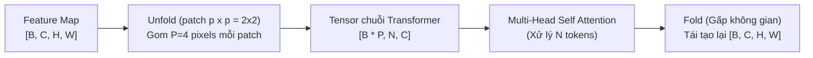

# BÁO CÁO TOÀN DIỆN VỀ TENSOR SHAPES CỦA CÁC KHỐI TRANSFORMER TRONG MOBILENET / MOBILEVIT-XXS

> **Mục tiêu:** Tài liệu này chuẩn hóa và ghi nhận chi tiết, chính xác 100% kích thước hình dạng (Tensor Shapes) của mọi phép toán liên quan đến các khối Transformer trong mô hình `apple/mobilevit-xx-small`. Dữ liệu được trích xuất và đối soát trực tiếp từ mô hình thực thi trên PyTorch và giải thích toán học cho việc thiết kế, mô phỏng (RTL Verification), và ánh xạ phần cứng (HW/SW Co-Design trên FPGA AMD Kria KV260).

---

## 1. Tổng quan Kiến trúc MobileViT-XXS

MobileViT kết hợp ưu điểm của mạng tích chập cục bộ (**CNN**) và khả năng mô hình hóa quan hệ toàn cục (**Vision Transformer - ViT**).

### 1.1. Sơ đồ khối tổng quát và Vị trí Transformer Stages
Đầu vào chuẩn của mô hình là ảnh RGB kích thước: $\mathbf{X_{in}} \in \mathbb{R}^{B \times 3 \times 256 \times 256}$ (với $B=1$ khi chạy Single Frame Inference trên KV260).

Mô hình gồm 5 phân tầng (Stages), trong đó Transformer xuất hiện tại 3 tầng cuối:
- **Layer 0 (Stage 0):** Conv3x3, Stride 2 $\rightarrow$ Feature Map $128 \times 128$
- **Layer 1 (Stage 1):** Inverted Residual Blocks (MV2) $\rightarrow$ Feature Map $64 \times 64$
- **Layer 2 (Stage 2):** **MobileViT Block 1** (Chứa **2 Transformer Blocks**) $\rightarrow$ Feature Map $32 \times 32$
- **Layer 3 (Stage 3):** **MobileViT Block 2** (Chứa **4 Transformer Blocks**) $\rightarrow$ Feature Map $16 \times 16$
- **Layer 4 (Stage 4):** **MobileViT Block 3** (Chứa **3 Transformer Blocks**) $\rightarrow$ Feature Map $8 \times 8$

Tổng cộng: **$2 + 4 + 3 = 9$ khối Transformer** trong toàn bộ mạng.

---

## 2. Cơ chế Unfold / Patching: Nguồn gốc Toán học của Số lượng Token $N$

Khác với ViT truyền thống (chia ảnh thành các patch rồi làm phẳng độc lập), MobileViT áp dụng kỹ thuật **Unfolding (Trải không gian)** nhằm duy trì thông tin không gian cục bộ:

### 2.1. Công thức toán học
Gọi kích thước Feature Map đầu vào khối Transformer là $H_{feat} \times W_{feat}$.
Kích thước patch cục bộ của MobileViT được cố định là:
$$p_h = 2, \quad p_w = 2 \implies P = p_h \times p_w = 4 \text{ (Số pixel trong một patch)}$$

1. **Chiều dài chuỗi Token ($N$ - Sequence Length):**
   $$N = \frac{H_{feat} \times W_{feat}}{P} = \frac{H_{feat} \times W_{feat}}{4}$$
   *Ý nghĩa:* $N$ chính là số lượng patch trải dài trên toàn bộ feature map.

2. **Chiều Batch đưa vào Transformer ($B_{trans}$):**
   $$B_{trans} = B \times P = B \times 4$$
   *Ý nghĩa:* MobileViT nhóm tất cả các pixel có cùng vị trí tương đối trong patch $2 \times 2$ vào cùng một chuỗi độc lập, biến $P$ pixel thành $P$ chuỗi con chạy song song (Batch = 4 khi $B=1$).

---

## 3. Bản chất cốt lõi: $N$ trước và sau khi chia Multi-Head

> [!IMPORTANT]
> **Quy tắc cơ bản của Transformer:**
> Phép chia Multi-Head (Tách $H$ heads) **CHỈ chia chiều kênh đặc trưng (Channel / Embedding Dimension $C \rightarrow H \times d_k$)**, **TUYỆT ĐỐI KHÔNG chia chiều số lượng token ($N$)**!
>
> Tất cả các Head đều tính toán Attention trên cùng toàn bộ $N$ tokens của chuỗi!

### Bảng tổng hợp đối chiếu 3 Transformer Stages

| Thông số / Thuộc tính | Stage 2 (`Layer 2`) | Stage 3 (`Layer 3`) | Stage 4 (`Layer 4`) |
| :--- | :---: | :---: | :---: |
| **Kích thước Feature Map** ($H \times W$) | $32 \times 32$ | $16 \times 16$ | $8 \times 8$ |
| **Patch Size** ($p \times p$) | $2 \times 2$ ($P=4$) | $2 \times 2$ ($P=4$) | $2 \times 2$ ($P=4$) |
| **Số khối Transformer liên tiếp** | **2 Blocks** | **4 Blocks** | **3 Blocks** |
| **Batch Size tương đương** ($B \times P$) | $1 \times 4 = \mathbf{4}$ | $1 \times 4 = \mathbf{4}$ | $1 \times 4 = \mathbf{4}$ |
| **SỐ LƯỢNG TOKEN $N$ TRƯỚC CHIA HEAD** | $\mathbf{N = 256}$ | $\mathbf{N = 64}$ | $\mathbf{N = 16}$ |
| **SỐ LƯỢNG TOKEN $N$ SAU CHIA HEAD** | $\mathbf{N = 256}$ | $\mathbf{N = 64}$ | $\mathbf{N = 16}$ |
| **Tổng số kênh đặc trưng ($C$ / $d_{model}$)** | **64** | **80** | **96** |
| **Số lượng Attention Heads ($H$)** | **4** | **4** | **4** |
| **Số chiều mỗi Head ($d_k = C / H$)** | $\mathbf{d_k = 16}$ | $\mathbf{d_k = 20}$ | $\mathbf{d_k = 24}$ |
| **Kích thước ma trận Attention Score ($Q \times K^T$)** | **$[256 \times 256]$** | **$[64 \times 64]$** | **$[16 \times 16]$** |
| **Độ rộng FFN Intermediate Dimension** | **128** ($2 \times C$) | **160** ($2 \times C$) | **192** ($2 \times C$) |

---

## 4. Chi tiết Tensor Shapes qua từng phép tính bên trong Transformer

Dưới đây là kích thước Tensor chi tiết tại từng điểm kiểm tra (Hook points) đo được trực tiếp từ mô hình `apple/mobilevit-xx-small` (với Batch ảnh $B=1$):

### 4.1. Stage 2 (Tầng 2: $N = 256, d_k = 16, H = 4$)
1. **Đầu vào MobileViT Block 1:** `[1, 16, 32, 32]` (C=16 từ Stage 1)
2. **Sau Local Representation (Conv 3x3 + Conv 1x1):** `[1, 64, 32, 32]`
3. **Sau Unfold (Chuyển sang chuỗi Transformer):**
   $$\mathbf{X}_{in} \in \mathbb{R}^{4 \times 256 \times 64} \quad [B_{trans}, N, C]$$
4. **Chiếu Q, K, V (Linear Projection):**
   - Query: `[4, 256, 64]`
   - Key: `[4, 256, 64]`
   - Value: `[4, 256, 64]`
5. **Tách Multi-Head (Reshape & Permute sang `[B, H, N, d_k]`):**
   - $\mathbf{Q} \in \mathbb{R}^{4 \times 4 \times 256 \times 16}$
   - $\mathbf{K} \in \mathbb{R}^{4 \times 4 \times 256 \times 16}$
   - $\mathbf{V} \in \mathbb{R}^{4 \times 4 \times 256 \times 16}$
6. **Tính Attention Score ($\mathbf{Q} \times \mathbf{K}^T$ qua MatMul 1):**
   - Score trước chia tỉ lệ: `[4, 4, 256, 256]`
   - Scaled Score ($\times \frac{1}{\sqrt{d_k}}$ hoặc Dyadic Scale): `[4, 4, 256, 256]`
7. **Softmax Phân bố Xác suất:**
   - Softmax Probabilities $\mathbf{A} \in \mathbb{R}^{4 \times 4 \times 256 \times 256}$
8. **Tổng hợp Ngữ cảnh Context ($\mathbf{A} \times \mathbf{V}$ qua MatMul 2):**
   - Head Context: `[4, 4, 256, 16]`
9. **Ghép các Heads (Concat & Permute):**
   - Concat Context: `[4, 256, 64]`
10. **Chiếu đầu ra Out Projection + Residual Add 1:** `[4, 256, 64]`
11. **Khối FFN (Feed-Forward Network) + Residual Add 2:**
    - FFN Linear 1: `[4, 256, 128]`
    - FFN Activation: `[4, 256, 128]`
    - FFN Linear 2: `[4, 256, 64]`
    - Sau LayerNorm: `[4, 256, 64]`
12. **Fold (Gấp không gian trở lại Tensor 2D):**
    - Trở lại Feature Map: `[1, 64, 32, 32]`
13. **Local Fusion (Concat + Conv 1x1 + Conv 3x3):** `[1, 24, 32, 32]` (Đầu ra tầng 2)

---

### 4.2. Stage 3 (Tầng 3: $N = 64, d_k = 20, H = 4$)
1. **Đầu vào MobileViT Block 2:** `[1, 48, 16, 16]` (Sau downsampling MV2)
2. **Sau Local Representation (Conv 3x3 + Conv 1x1):** `[1, 80, 16, 16]`
3. **Sau Unfold:**
   $$\mathbf{X}_{in} \in \mathbb{R}^{4 \times 64 \times 80} \quad [B_{trans}, N, C]$$
4. **Chiếu Q, K, V:**
   - Query: `[4, 64, 80]`
   - Key: `[4, 64, 80]`
   - Value: `[4, 64, 80]`
5. **Tách Multi-Head (`[B, H, N, d_k]`):**
   - $\mathbf{Q} \in \mathbb{R}^{4 \times 4 \times 64 \times 20}$
   - $\mathbf{K} \in \mathbb{R}^{4 \times 4 \times 64 \times 20}$
   - $\mathbf{V} \in \mathbb{R}^{4 \times 4 \times 64 \times 20}$
6. **Tính Attention Score ($\mathbf{Q} \times \mathbf{K}^T$):**
   - Scaled Score: `[4, 4, 64, 64]`
7. **Softmax:** `[4, 4, 64, 64]`
8. **Context Matrix ($\mathbf{A} \times \mathbf{V}$):** `[4, 4, 64, 20]`
9. **Concat Heads:** `[4, 64, 80]`
10. **FFN:**
    - Tuyến tính: `[4, 64, 160]` $\rightarrow$ `[4, 64, 80]`
11. **Fold:** `[1, 80, 16, 16]`
12. **Local Fusion:** `[1, 48, 16, 16]` (Đầu ra tầng 3)

---

### 4.3. Stage 4 (Tầng 4: $N = 16, d_k = 24, H = 4$)
1. **Đầu vào MobileViT Block 3:** `[1, 64, 8, 8]` (Sau downsampling MV2)
2. **Sau Local Representation (Conv 3x3 + Conv 1x1):** `[1, 96, 8, 8]`
3. **Sau Unfold:**
   $$\mathbf{X}_{in} \in \mathbb{R}^{4 \times 16 \times 96} \quad [B_{trans}, N, C]$$
4. **Chiếu Q, K, V:**
   - Query: `[4, 16, 96]`
   - Key: `[4, 16, 96]`
   - Value: `[4, 16, 96]`
5. **Tách Multi-Head (`[B, H, N, d_k]`):**
   - $\mathbf{Q} \in \mathbb{R}^{4 \times 4 \times 16 \times 24}$
   - $\mathbf{K} \in \mathbb{R}^{4 \times 4 \times 16 \times 24}$
   - $\mathbf{V} \in \mathbb{R}^{4 \times 4 \times 16 \times 24}$
6. **Tính Attention Score ($\mathbf{Q} \times \mathbf{K}^T$):**
   - Scaled Score: `[4, 4, 16, 16]`
7. **Softmax:** `[4, 4, 16, 16]`
8. **Context Matrix ($\mathbf{A} \times \mathbf{V}$):** `[4, 4, 16, 24]`
9. **Concat Heads:** `[4, 16, 96]`
10. **FFN:**
    - Tuyến tính: `[4, 16, 192]` $\rightarrow$ `[4, 16, 96]`
11. **Fold:** `[1, 96, 8, 8]`
12. **Local Fusion:** `[1, 64, 8, 8]` (Đầu ra tầng 4)

---

## 5. Đặc tả Ánh xạ Phần cứng (Hardware Mapping Specification cho VLSI)

Bộ tăng tốc phần cứng MHA trên PL là một **Single-Head Attention Engine** tối ưu diện tích. Do đó, phần mềm (Driver/Hook trên PS) sẽ nạp tuần tự từng Head ($H=4$) và từng Batch ($B_{trans}=4$) xuống FPGA thông qua AXI DMA.

### 5.1. Bảng Thông số Cấu hình Driver & AXI DMA cho từng Stage

| Tham số Phần cứng | Stage 2 | Stage 3 | Stage 4 |
| :--- | :---: | :---: | :---: |
| **Giá trị thanh ghi `REG_SEQ_LEN` (`0x10`)** | `16'd256` | `16'd64` | `16'd16` |
| **Giá trị thanh ghi `REG_HEAD_DIM` (`0x14`)** | `16'd16` | `16'd20` | `16'd24` |
| **Chiều rộng Bus AXI Stream** | 128-bit (16 Bytes) | 128-bit (16 Bytes) | 128-bit (16 Bytes) |
| **Số Beats AXI cho mỗi Token** | **1 Beat** (16 B) | **2 Beats** (16 B + 4 B data + 12 B pad) | **2 Beats** (16 B + 8 B data + 8 B pad) |
| **Tổng số Bytes ma trận Q (hoặc K, V) mỗi Head** | $256 \times 16 = \mathbf{4,096 \text{ Bytes}}$ | $64 \times 32 = \mathbf{2,048 \text{ Bytes}}$ | $16 \times 32 = \mathbf{512 \text{ Bytes}}$ |
| **Tổng số Beats DMA Stream In (Q+K+V)** | $256 \times 3 = \mathbf{768 \text{ Beats}}$ | $128 \times 3 = \mathbf{384 \text{ Beats}}$ | $32 \times 3 = \mathbf{96 \text{ Beats}}$ |
| **Dung lượng BRAM đệm K/V trên FPGA** | $256 \times 16 = 4 \text{ KB}$ | $64 \times 20 = 1.28 \text{ KB}$ | $16 \times 24 = 384 \text{ B}$ |
| **Kích thước Ma trận Softmax BRAM** | $256 \times 256 = 64 \text{ KB}$ | $64 \times 64 = 4 \text{ KB}$ | $16 \times 16 = 256 \text{ B}$ |
| **Số chu kỳ xung nhịp tính Softmax FSM** | $\sim 256 \times 3 \text{ cycles/row}$ | $\sim 64 \times 3 \text{ cycles/row}$ | $\sim 16 \times 3 \text{ cycles/row}$ |
| **Thời điểm phát cờ ngắt `m_axis_tlast`** | Khi đếm đủ **256 hàng** | Khi đếm đủ **64 hàng** | Khi đếm đủ **16 hàng** |

---

## 6. Kết luận & Khuyến nghị Kỹ thuật

1. **Về Testbench & Golden Vectors:**
   - File `export_golden_vectors.py` **không được lặp nhân tạo** $N$ lên 256 cho Stage 3 và Stage 4.
   - Vector nạp vào testbench mô phỏng bắt buộc phải có kích thước tự nhiên:
     - Stage 2: $256 \times 16$
     - Stage 3: $64 \times 20$ (đệm căn lề 32 bytes/token trên bus 128-bit)
     - Stage 4: $16 \times 24$ (đệm căn lề 32 bytes/token trên bus 128-bit)
2. **Về RTL Core:**
   - Các bộ đếm hàng, FSM Softmax (`softmax_lut.sv`) và bộ kiểm soát TLAST (`score_v_gemm.sv`) **bắt buộc phải sử dụng giá trị `reg_seq_len` cấu hình động** từ AXI-Lite Reg `0x10` (`REG_SEQ_LEN`) và `reg_head_dim` từ AXI-Lite Reg `0x14` (`REG_HEAD_DIM`) thay vì dùng hằng số biên dịch `MAX_TOKENS = 256`.
