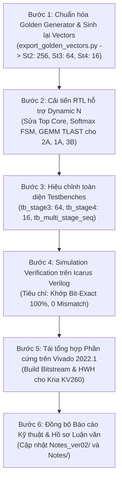

# KẾ HOẠCH CHI TIẾT 6 BƯỚC KHẮC PHỤC RTL DYNAMIC TOKEN $N$ VÀ ĐỒNG BỘ TOÀN DIỆN 3 BIẾN THỂ PHẦN CỨNG (VARIANTS 1A, 2A, 3B)

> **Mục tiêu:** Khắc phục triệt để lỗi thiết kế phần cứng bị cố định (hardcoded) số lượng Token $N = 256$ trong RTL và Testbenches; loại bỏ cơ chế lặp dữ liệu nhân tạo trong bộ sinh vector mẫu (Golden Model); nâng cấp hệ thống phần cứng hỗ trợ linh hoạt độ dài chuỗi động $N \in \{256, 64, 16\}$ theo đúng cấu trúc tự nhiên của MobileViT-XXS qua cả 3 Stages; đồng bộ hóa và tái kiểm tra (Re-verify & Re-synthesize) trên cả 3 biến thể kiến trúc phần cứng.

---

## 1. Bối cảnh Kỹ thuật & Phân tích Nguyên nhân Gốc rễ (Root-Cause Analysis)

### 1.1. Sự sai lệch giữa Mô hình AI và Thiết kế Phần cứng
Theo đặc tả tự nhiên của MobileViT-XXS khi nhận ảnh đầu vào $256 \times 256$, sau bước Unfolding (patch $2 \times 2 \implies P=4$), số lượng token $N$ của 3 tầng Transformer là:
- **Stage 2 (`layer.2`):** $N = 256$, $d_k = 16$, $H = 4$
- **Stage 3 (`layer.3`):** $N = 64$, $d_k = 20$, $H = 4$
- **Stage 4 (`layer.4`):** $N = 16$, $d_k = 24$, $H = 4$

### 1.2. Ba khiếm khuyết phần cứng gây Treo hệ thống (Deadlock) nếu không sửa:
1. **Vòng lặp nạp Key bị treo/chạy lãng phí (`attention_core_top_*.sv`):**
   - Dòng 536 hiện tại: `if (k_pair_idx == 7'd127)` ($128 \text{ cặp} \times 2 = 256$ keys).
   - *Hậu quả:* Ở Stage 3 ($N=64 \implies 32$ cặp) và Stage 4 ($N=16 \implies 8$ cặp), lõi tiếp tục lặp qua vùng nhớ BRAM chưa khởi tạo, làm sai lệch hoàn toàn kết quả tính toán.
2. **FSM Softmax bị đóng băng (`softmax_lut.sv`):**
   - Các trạng thái `ST_FIND_MAX`, `ST_EXP_ACC`, `ST_NORM_OUT` so sánh bộ đếm với hằng số biên dịch `N_TOKENS = 256`.
   - *Hậu quả:* Khi nạp $N=64$ hoặc $N=16$, FSM sẽ chờ vĩnh viễn đến chu kỳ 256, treo cứng pipeline tính toán phi tuyến.
3. **Mất tín hiệu `TLAST` làm treo AXI DMA (`score_v_gemm.sv`):**
   - Điều kiện phát cờ kết thúc gói tin AXI-Stream: `row_cnt == MAX_TOKENS - 1` ($255$).
   - *Hậu quả:* Với $N=64$ và $N=16$, `row_cnt` không bao giờ chạm tới 255 $\implies$ `m_axis_tlast` không bao giờ được kích hoạt $\implies$ Kênh AXI DMA PL-to-PS bị treo vĩnh viễn, làm sập toàn bộ driver PYNQ trên hệ điều hành Ubuntu.

### 1.3. Khiếm khuyết của Golden Vector Generator (`export_golden_vectors.py`):
- Tại dòng 204–207, script sử dụng `x_in.repeat(1, reps, 1)[:, :256, :]` để cưỡng ép Stage 3 và 4 có 256 tokens (mục đích ban đầu là stress-test dung lượng BRAM tối đa). Điều này làm sai lệch bản chất kiểm thử xác minh (Functional Verification) của mô hình thật.

---

## 2. Kế hoạch Thực thi 6 Bước Chi tiết (Master Execution Plan)



---

### BƯỚC 1: Chuẩn hóa Python Golden Model & Xuất lại Vectors Mẫu (.hex)
1. **Sửa đổi logic trong `export_golden_vectors.py`:**
   - Xóa bỏ hoàn toàn đoạn mã lặp token `x_in.repeat(...)`.
   - Giữ nguyên kích thước token tự nhiên $N$:
     - Stage 2: $N = 256, d_k = 16$
     - Stage 3: $N = 64, d_k = 20$
     - Stage 4: $N = 16, d_k = 24$
2. **Xuất lại toàn bộ file `.hex` vào 5 thư mục đích:**
   - `model_notebook/ivit_surgery/golden_vectors/`
   - `Project/src/Hardware/rtl_ver02/`
   - `Project/src/Hardware/rtl_ver02_1A/`
   - `Project/src/Hardware/rtl_ver02_2A/`
   - `Project/src/Hardware/rtl_ver02_3B/`
3. **Kiểm tra nghiệm thu (Validation):**
   - Đảm bảo số phần tử file `q_matrix_st3.hex` là $64 \times 20 = 1,280$ phần tử.
   - Đảm bảo số phần tử file `q_matrix_st4.hex` là $16 \times 24 = 384$ phần tử.

---

### BƯỚC 2: Cải tiến RTL Core hỗ trợ Dynamic $N$ trên Cả 3 Biến thể (2A, 1A, 3B)
1. **Module `attention_core_top_*.sv`:**
   - Nối cổng cấu hình `reg_seq_len` (từ thanh ghi AXI-Lite Reg `0x14`, giá trị 256, 64, hoặc 16) truyền vào các module con: `softmax_lut` và `score_v_gemm`.
   - Điều chỉnh vòng lặp duyệt Key pairs:
     ```verilog
     // Cũ: if (k_pair_idx == 7'd127)
     // Mới:
     if (k_pair_idx == (reg_seq_len >> 1) - 1)
     ```
2. **Module `softmax_lut.sv`:**
   - Thêm cổng `input logic [15:0] seq_len`.
   - Trong FSM điều khiển:
     - Thay thế so sánh `token_cnt == N_TOKENS - 1` trong các trạng thái `ST_FIND_MAX`, `ST_EXP_ACC`, `ST_NORM_OUT` bằng `token_cnt == seq_len - 1`.
     - Giữ `N_TOKENS` làm tham số phân bổ bộ nhớ tối đa (`MAX_TOKENS = 256`).
3. **Module `score_v_gemm.sv`:**
   - Thêm cổng `input logic [15:0] seq_len`.
   - Cập nhật logic tạo cờ `m_axis_tlast`:
     ```verilog
     // Cũ: assign m_axis_tlast = (row_cnt == MAX_TOKENS - 1) && ...
     // Mới:
     assign m_axis_tlast = (row_cnt == seq_len - 1) && ...
     ```
4. **Quy trình triển khai:**
   - Vá lỗi trước trên **Variant 2A** (`rtl_ver02_2A`) $\rightarrow$ Xác minh chạy thông suốt.
   - Lan truyền mã nguồn chuẩn hóa sang **Variant 1A** (`rtl_ver02_1A`) và **Variant 3B** (`rtl_ver02_3B`).

---

### BƯỚC 3: Hiệu chỉnh Toàn diện Bộ Testbenches
1. **Testbench cô lập Stage 3 (`tb_stage3_isolated_*.sv`):**
   - Đặt `TEST_TOKENS = 64`, `TEST_HEAD_DIM = 20`.
   - Cập nhật nạp thanh ghi cấu hình AXI-Lite: ghi `16'd64` vào địa chỉ `0x14`.
   - Cập nhật số lượng Beats kiểm tra Ingress (384 beats) và Egress (128 beats, TLAST tại beat 127).
2. **Testbench cô lập Stage 4 (`tb_stage4_isolated_*.sv`):**
   - Đặt `TEST_TOKENS = 16`, `TEST_HEAD_DIM = 24`.
   - Nạp `16'd16` vào địa chỉ `0x14`.
   - Cập nhật Ingress (96 beats) và Egress (32 beats, TLAST tại beat 31).
3. **Testbench chuỗi tuần tự 3 Stages (`tb_multi_stage_seq_*.sv`):**
   - Mô phỏng đúng kịch bản suy luận tuần tự của mạng MobileViT:
     $$\text{Stage 2 } (N=256, d_k=16) \longrightarrow \text{Stage 3 } (N=64, d_k=20) \longrightarrow \text{Stage 4 } (N=16, d_k=24)$$
   - Kiểm tra khả năng tự động reset con trỏ địa chỉ BRAM và cấu hình thanh ghi động giữa các stage.

---

### BƯỚC 4: Chạy Simulation Verification trên Icarus Verilog
1. Chạy các kịch bản kiểm thử cô lập:
   - `run_stage_isolated_dv_2A.bat` (Stage 3 & Stage 4).
   - Tương tự cho Variant 1A và Variant 3B.
2. Chạy kịch bản liên hoàn:
   - `run_multi_stage_seq_2A.bat`.
3. **Tiêu chuẩn vượt qua (Pass Criteria):**
   - Số lỗi Mismatch = 0 trên toàn bộ $N \times d_k$ bytes đầu ra.
   - Tín hiệu `TKEEP` và `TLAST` xuất hiện đúng chu kỳ quy định.

---

### BƯỚC 5: Tái Tổng hợp Phần cứng trên Vivado (Synthesis & Implementation)
1. Sử dụng script TCL tự động hóa đã chuẩn bị:
   - `Project/src/Hardware/synthesis/build_kv260_mha_2A.tcl`
2. Tạo bitstream mới:
   - `attention_core_top_2A.bit`
   - `attention_core_top_2A.hwh`
3. Cập nhật bitstream mới vào các thư mục Overlay của Phase 3 (`03_ivit_hw_accelerated`) và Phase 4 (`04_all_9_transformers_hw`).
4. Kiểm tra Timing Slack (WNS > 0 tại xung nhịp 150 MHz hoặc 200 MHz) và báo cáo mức độ tiêu thụ tài nguyên (LUTs, FFs, BRAMs, DSPs).

---

### BƯỚC 6: Đồng bộ Báo cáo Kỹ thuật & Hồ sơ Luận văn
1. Ghi nhận chi tiết kết quả vào thư mục `Notes_ver02/`:
   - Bảng so sánh tài nguyên và độ trễ chu kỳ thực tế cho từng Stage của 3 biến thể phần cứng.
   - Phân tích chi tiết cơ chế dynamic framing và bus efficiency.
2. Cập nhật các sơ đồ khối và tài liệu hướng dẫn vận hành.

---

## 3. Phân công Thứ tự Thực hiện Ngay

| Thứ tự | Hạng mục công việc | Trạng thái |
| :---: | :--- | :---: |
| **1** | Lưu tài liệu kế hoạch này vào `Notes/` và `Notes_ver02/` | **ĐANG THỰC HIỆN** |
| **2** | Sửa `export_golden_vectors.py` & Sinh lại toàn bộ vector .hex | **KẾ TIẾP** |
| **3** | Sửa RTL lõi Variant 2A (`attention_core_top_2A`, `softmax_lut`, `score_v_gemm`) | Chờ Bước 2 |
| **4** | Sửa Testbenches Variant 2A & Chạy mô phỏng Icarus Verilog | Chờ Bước 3 |
| **5** | Lan truyền sang Variant 1A và Variant 3B | Chờ Bước 4 |
| **6** | Chạy tổng hợp Vivado Bitstream cho Kria KV260 | Chờ Bước 5 |

