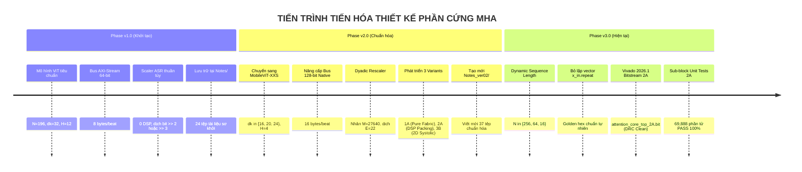
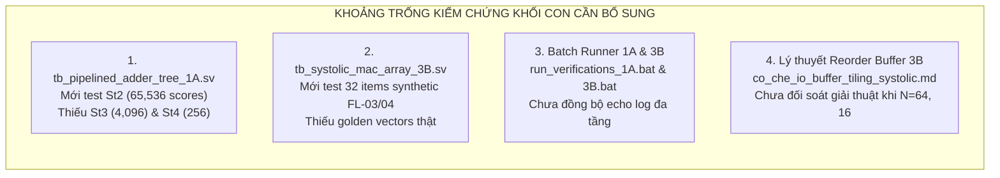
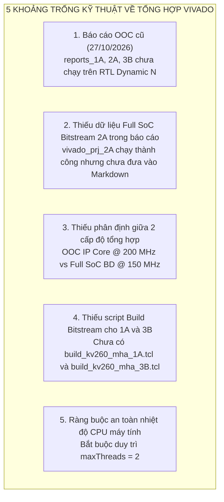

# KẾ HOẠCH KIỂM TOÁN HỆ THỐNG VÀ ĐỒNG BỘ TOÀN DIỆN THIẾT KẾ RTL, SYNTHESIS VÀ TÀI LIỆU KỸ THUẬT

> **Dự án:** Bộ Tăng Tốc Phần Cứng Scaled Dot-Product Multi-Head Attention Core cho MobileViT-XXS I-ViT INT8 trên Nền Tảng AMD Kria KV260 (`xck26-sfvc784-2LV-c`)  
> **Tài liệu lưu trữ:** [`Notes/ke_hoach_kiem_toan_va_dong_bo_toan_dien_rtl_synthesis_tai_lieu.md`](file:///c:/Users/tuan2/Desktop/Capstone_Project/Notes/ke_hoach_kiem_toan_va_dong_bo_toan_dien_rtl_synthesis_tai_lieu.md)  
> **Bản sao đồng bộ:** [`Notes_ver02/ke_hoach_kiem_toan_va_dong_bo_toan_dien_rtl_synthesis_tai_lieu.md`](file:///c:/Users/tuan2/Desktop/Capstone_Project/Notes_ver02/ke_hoach_kiem_toan_va_dong_bo_toan_dien_rtl_synthesis_tai_lieu.md)  
> **Ngày lập kế hoạch:** 02/11/2026  
> **Nhánh Git phụ trách:** `DuyTuan321026`  
> **Trạng thái:** **BẢN KẾ HOẠCH TỔNG HỢP CHI TIẾT (ACTIONABLE MASTER BLUEPRINT)**

---

## MỤC LỤC HỆ THỐNG

1. [Chương 1: Bối Cảnh Tiến Hóa Kiến Trúc & Nguyên Nhân Phân Hóa Giữa Notes/ và Notes_ver02/](#chương-1-bối-cảnh-tiến-hóa-kiến-trúc--nguyên-nhân-phân-hóa-giữa-notes-và-notes_ver02)
2. [Chương 2: Ma Trận Kiểm Toán Các Điểm Mismatch Kỹ Thuật (Ground Truth RTL vs. Docs)](#chương-2-ma-trận-kiểm-toán-các-điểm-mismatch-kỹ-thuật-ground-truth-rtl-vs-docs)
3. [Chương 3: Các Nội Dung Đang Thiếu Kiểm Chứng Kết Quả Sau Khi Sửa RTL Dynamic N (DV Gaps)](#chương-3-các-nội-dung-đang-thiếu-kiểm-chứng-kết-quả-sau-khi-sửa-rtl-dynamic-n-dv-gaps)
4. [Chương 4: Các Nội Dung Đang Thiếu Sót Liên Quan Đến Tổng Hợp Phần Cứng (Synthesis Gaps)](#chương-4-các-nội-dung-đang-thiếu-sót-liên-quan-đến-tổng-hợp-phần-cứng-synthesis-gaps)
5. [Chương 5: Kế Hoạch Hành Động Toàn Diện 5 Giai Đoạn (Master Action Plan)](#chương-5-kế-hoạch-hành-động-toàn-diện-5-giai-đoạn-master-action-plan)
6. [Chương 6: Tiêu Chuẩn Nghiệm Thu & Ma Trận Đánh Giá Hoàn Thành](#chương-6-tiêu-chuẩn-nghiệm-thu--ma-trận-đánh-giá-hoàn-thành)

---

## CHƯƠNG 1: BỐI CẢNH TIẾN HÓA KIẾN TRÚC & NGUYÊN NHÂN PHÂN HÓA GIỮA `Notes/` VÀ `Notes_ver02/`



### 1.1 Bản chất của 2 thư mục tài liệu trong dự án
1. **Thư mục [`Notes/`](file:///c:/Users/tuan2/Desktop/Capstone_Project/Notes/):**
   - Là thư mục **gốc (original baseline)**, có giá trị lịch sử và tham khảo quá trình phát triển (hiện được định vị làm nơi lưu trữ nháp, nghiên cứu ban đầu).
   - Chứa nhiều tệp phản ánh kiến trúc v1.0 (ViT $N=196$, bus 64-bit, thanh ghi AXI cũ `0x18 = d_k`, Scaler dịch ASR).
   - Thiếu 12 tệp báo cáo chuyên sâu đã được phát triển trong giai đoạn v2.0.
2. **Thư mục [`Notes_ver02/`](file:///c:/Users/tuan2/Desktop/Capstone_Project/Notes_ver02/):**
   - Là thư mục **chuẩn hóa kỹ thuật (authoritative engineering reference)**, được tạo ra để phản ánh đúng hiện trạng RTL `rtl_ver02_*`.
   - Đã được cập nhật chuẩn hóa 128-bit, 3 biến thể phần cứng, và vừa được bổ sung kết quả mô phỏng Dynamic $N$.
   - Tuy nhiên, một số tệp kế hoạch thành phần trong `Notes_ver02/` (được lập trước ngày 02/11/2026) vẫn còn sót lại các giả định cố định $N=256$ cho Stage 3 & 4 hoặc nhầm lẫn địa chỉ thanh ghi CSR.

---

## CHƯƠNG 2: MA TRẬN KIỂM TOÁN CÁC ĐIỂM MISMATCH KỸ THUẬT (GROUND TRUTH RTL VS. DOCS)

### 2.1 Bảng Tham Chiếu Chuẩn Phần Cứng Hiện Tại (RTL Ground Truth Reference)

Trước khi đối soát tài liệu, bảng dưới đây xác lập thông số chuẩn tuyệt đối của mã nguồn SystemVerilog hiện tại (`rtl_ver02_1A`, `rtl_ver02_2A`, `rtl_ver02_3B`):

| Thuộc Tính Kỹ Thuật | Stage 2 (`layer.2`) | Stage 3 (`layer.3`) | Stage 4 (`layer.4`) | Module RTL Hiện Thực |
| :--- | :---: | :---: | :---: | :--- |
| **Số lượng Token ($N$)** | **$N = 256$** | **$N = 64$** | **$N = 16$** | `attention_core_top_*.sv`, `softmax_lut.sv` |
| **Chiều đặc trưng Head ($d_k$)** | **$d_k = 16$** | **$d_k = 20$** | **$d_k = 24$** | `pe_slice_dsp_packing.sv`, `pipelined_adder_tree.sv` |
| **Số lượng Head ($H$)** | **$H = 4$** | **$H = 4$** | **$H = 4$** | FSM tuần tự hóa Head trong Top Core |
| **Độ rộng Bus AXI4-Stream** | **128-bit** (16 B/beat) | **128-bit** (16 B/beat) | **128-bit** (16 B/beat) | `axis_adapter.sv`, `score_v_gemm.sv` |
| **Số Beat DMA Ingress ($Q+K+V$)** | **$768\text{ beats}$** ($256 \times 3$) | **$384\text{ beats}$** ($128 \times 3$) | **$96\text{ beats}$** ($32 \times 3$) | FSM nạp bộ đệm `ing_load_state` |
| **Số Beat DMA Egress (Context)** | **$256\text{ beats}$** (`tlast`=255) | **$128\text{ beats}$** (`tlast`=127) | **$32\text{ beats}$** (`tlast`=31) | `score_v_gemm.sv` (`m_axis_tlast`) |
| **Dung lượng Context Bytes Egress** | **$4,096\text{ Bytes}$** | **$1,280\text{ Bytes}$** | **$384\text{ Bytes}$** | Tổng = $5,760\text{ Bytes}$ / toàn bộ 3 Stages |
| **Tham số Dyadic Scaling ($M, E$)** | $M=27640, E=22$ | $M=21936, E=22$ | $M=18810, E=22$ | `scale_unit.sv` (Dùng 1 DSP48E2 + Shifter) |
| **Toán học DSP Packing** | $\text{Op}_{27} = B \cdot 2^{19} + C$ | $\text{Op}_{27} = B \cdot 2^{19} + C$ | $\text{Op}_{27} = B \cdot 2^{19} + C$ | `pe_slice_dsp_packing.sv` (Sign-extended) |

### 2.2 Bản Đồ Thanh Ghi AXI4-Lite Chuẩn Trong RTL ([`axi_lite_regs.sv`](file:///c:/Users/tuan2/Desktop/Capstone_Project/Project/src/Hardware/rtl_ver02_2A/axi_lite_regs.sv))

```text
========================================================================================================================
                          AXI4-LITE SLAVE REGISTER MEMORY MAP (RTL GROUND TRUTH)
========================================================================================================================
  Địa chỉ Offset | Tên Thanh Ghi   | Quyền | Giá trị mặc định / Stage 2 | Chức năng chi tiết
  ---------------+-----------------+-------+----------------------------+-----------------------------------------------
  0x00           | REG_CTRL        | R/W   | 0x00000000                 | Bit 0: START (xung kích hoạt), Bit 1: CLEAR, Bit 2: RESET
  0x04           | REG_STATUS      | RO    | 0x00000000                 | [0]: BUSY, [1]: DONE, [2]: ERROR, [3]: PP_BANK, [7:4]: HEAD_IDX
  0x08           | REG_NBYTES      | R/W   | 0x00003000 (12,288 B)      | Tổng dung lượng bytes nạp qua kênh DMA MM2S
  0x10           | REG_SEQ_LEN     | R/W   | 0x00000100 (256)           | SỐ LƯỢNG TOKEN N ĐỘNG: 256 (St2), 64 (St3), 16 (St4)
  0x14           | REG_HEAD_DIM    | R/W   | 0x00000010 (16)            | CHIỀU ĐẶC TRƯNG HEAD dk: 16 (St2), 20 (St3), 24 (St4)
  0x18           | REG_NUM_HEADS   | R/W   | 0x00000004 (4)             | SỐ LƯỢNG ATTENTION HEADS: H = 4
  0x1C           | REG_SHIFT_VAL   | R/W   | 0x00000002 (2)             | Giá trị dịch bit ASR dự phòng (legacy fallback)
  0x20           | REG_SCALE_M     | R/W   | 0x00006BF8 (27640)         | HỆ SỐ DYADIC MANTISSA M: 27640 (St2), 21936 (St3), 18810 (St4)
  0x24           | REG_SCALE_E     | R/W   | 0x00000016 (22)            | HỆ SỐ DYADIC EXPONENT E: Cố định E = 22
  0x28           | REG_OUT_M       | R/W   | 0x00000000                 | Tham số lượng tử hóa ngõ ra Output Mantissa
  0x2C           | REG_OUT_E       | R/W   | 0x00000000                 | Tham số lượng tử hóa ngõ ra Output Exponent
  0x40           | REG_LUT_ADDR    | R/W   | 0x00000000                 | Địa chỉ nạp bảng BRAM Exp ROM [9:0] (0..1023)
  0x44           | REG_LUT_DATA    | WO   | 0x00000000                 | Dữ liệu nạp BRAM ROM [19:0] (Tạo xung ghi 1 chu kỳ)
========================================================================================================================
```

---

### 2.3 Bảng Đối Soát Chi Tiết Từng Tệp Markdown Bị Lệch (Mismatch Audit Table)

| STT | Tệp Tài Liệu Markdown Bị Lỗi | Vị Trí / Dòng | Nội Dung Hiện Tại (Sai / Lệch) | Nội Dung Chuẩn Hóa Theo RTL Thực Tế | Mức Độ Nghiêm Trọng |
| :---: | :--- | :---: | :--- | :--- | :---: |
| **1** | [`Notes_ver02/bao_cao_tensor_shapes_transformers_mobilevit.md`](file:///c:/Users/tuan2/Desktop/Capstone_Project/Notes_ver02/bao_cao_tensor_shapes_transformers_mobilevit.md) | Dòng 174, 175, 196 | • `REG_SEQ_LEN` ghi là `0x14`<br>• `REG_HEAD_DIM` ghi là `0x18` | • `REG_SEQ_LEN` phải là **`0x10`**<br>• `REG_HEAD_DIM` phải là **`0x14`**<br>• (`0x18` là `REG_NUM_HEADS`) | **CAO** (Dẫn đến cấu hình sai driver PYNQ) |
| **2** | [`Notes_ver02/mo_rong_xac_minh_3_stages.md`](file:///c:/Users/tuan2/Desktop/Capstone_Project/Notes_ver02/mo_rong_xac_minh_3_stages.md) | Dòng 42, 58 | Ghi Stage 3 và Stage 4 có $N = 256$ tokens | Stage 3: **$N = 64$** ($16 \times 16 / 4$)<br>Stage 4: **$N = 16$** ($8 \times 8 / 4$) | **CAO** (Làm lệch bản chất kiến trúc MobileViT) |
| **3** | [`Notes_ver02/mo_rong_xac_minh_3_stages.md`](file:///c:/Users/tuan2/Desktop/Capstone_Project/Notes_ver02/mo_rong_xac_minh_3_stages.md) | Dòng 85, 92, 99 | Kịch bản CSR chỉ ghi `0x14` ($d_k$), **thiếu ghi `0x10` (`SEQ_LEN`)** | Phải bổ sung ghi CSR `0x10`: `256` (St2), `64` (St3), `16` (St4) | **CAO** (RTL sẽ bị kẹt FSM do thiếu SEQ_LEN) |
| **4** | [`Notes_ver02/mo_rong_xac_minh_3_stages.md`](file:///c:/Users/tuan2/Desktop/Capstone_Project/Notes_ver02/mo_rong_xac_minh_3_stages.md) | Dòng 93, 100 | Ghi Stream Ingress 1,536 beats cho cả Stage 3 và 4 | Stage 3 Ingress: **384 beats**<br>Stage 4 Ingress: **96 beats** | **TRUNG BÌNH** (Sai lệch thông lượng DMA) |
| **5** | [`Notes_ver02/mo_rong_xac_minh_3_stages.md`](file:///c:/Users/tuan2/Desktop/Capstone_Project/Notes_ver02/mo_rong_xac_minh_3_stages.md) | Dòng 95, 102 | Ghi Context Egress là 5,120 B (St3) và 6,144 B (St4) | Stage 3 Egress: **1,280 Bytes**<br>Stage 4 Egress: **384 Bytes** | **TRUNG BÌNH** (Số liệu kiểm thử cũ) |
| **6** | [`Notes_ver02/ke_hoach_nang_cap_128bit_va_3stages.md`](file:///c:/Users/tuan2/Desktop/Capstone_Project/Notes_ver02/ke_hoach_nang_cap_128bit_va_3stages.md) | Dòng 38, 39 | Ghi Ingress DMA: $Q, K, V = 512 \times 3 = 1,536\text{ beats}$ | Stage 3: $64 \times 2 \times 3 = \mathbf{384\text{ beats}}$<br>Stage 4: $16 \times 2 \times 3 = \mathbf{96\text{ beats}}$ | **TRUNG BÌNH** (Dữ liệu cũ trước dynamic N) |
| **7** | [`Notes_ver02/phan_tich_vivado_kv260_mha_deploy.md`](file:///c:/Users/tuan2/Desktop/Capstone_Project/Notes_ver02/phan_tich_vivado_kv260_mha_deploy.md) | Dòng 56, 100–106, 125 | Ghi thanh ghi v1.0 cũ: `0x04=NBYTES`, `0x18=D_K`, `0x20=SHIFT`, $N=196, d_k=32$ | Cập nhật toàn diện bản đồ CSR v3.0 và tham số MobileViT-XXS | **TRUNG BÌNH** (Tài liệu nháp cũ) |
| **8** | [`Notes/khoi_scaler_unit.md`](file:///c:/Users/tuan2/Desktop/Capstone_Project/Notes/khoi_scaler_unit.md) | Toàn bộ tệp (6.8 KB) | Mô tả mạch ASR Shifter 0 DSP dịch $\gg 2$ hoặc $\gg 3$ | Thay thế bằng Dyadic Rescaler $(S \times M) \ggg E$ dùng 1 DSP như trong `Notes_ver02/` | **CAO** (Lệch phương pháp luận toán học I-ViT) |
| **9** | [`Notes/ky_thuat_dsp_packing.md`](file:///c:/Users/tuan2/Desktop/Capstone_Project/Notes/ky_thuat_dsp_packing.md) | Dòng 18 | Ghi công thức sai $D_{in} = (B \ll 18) + C$ | Cập nhật công thức đúng $\text{Op}_{27} = B \cdot 2^{19} + C$ kèm mở rộng dấu bit 18 | **TRUNG BÌNH** (Lỗi toán học số có dấu) |
| **10** | [`Notes/mha_level_1_bo_nho_dem_lenh.md`](file:///c:/Users/tuan2/Desktop/Capstone_Project/Notes/mha_level_1_bo_nho_dem_lenh.md) | Dòng 17 | Sơ đồ vẽ bus AXI-Stream Ingress 64-bit `[63:0]` | Cập nhật sơ đồ bus AXI-Stream Native 128-bit `[127:0]` | **TRUNG BÌNH** (Lệch độ rộng bus) |
| **11** | [`Notes/thiet_ke_sw_hw_cho_vit.md`](file:///c:/Users/tuan2/Desktop/Capstone_Project/Notes/thiet_ke_sw_hw_cho_vit.md) & [`Notes/trien_khai_vit_tren_fpga.md`](file:///c:/Users/tuan2/Desktop/Capstone_Project/Notes/trien_khai_vit_tren_fpga.md) | Nhiều vị trí | Đề cập $N=196$, bus 64-bit, gọi hàm allocate $(196, 32)$ | Đồng bộ hóa theo mã nguồn Python Hook `pynq_multi_stage_attention_hook.py` | **TRUNG BÌNH** (Mã nguồn minh họa cũ) |
| **12** | **12 tệp báo cáo chuyên sâu thiếu trong `Notes/`** | Cả thư mục `Notes/` | Hoàn toàn chưa có các tệp báo cáo chuyên sâu 1A, 2A, 3B, 4C, so sánh bộ tuần tự, khảo sát bus, toán học I-ViT... | Sao chép đồng bộ 100% từ `Notes_ver02/` sang `Notes/` | **CAO** (Thiếu hụt hồ sơ báo cáo) |

---

## CHƯƠNG 3: CÁC NỘI DUNG ĐANG THIẾU KIỂM CHỨNG KẾT QUẢ SAU KHI SỬA RTL DYNAMIC $N$ (DV Gaps)

Sau khi chuyển đổi RTL sang hỗ trợ Dynamic Token Length $N$, Top-Level Integration đã kiểm định thành công qua cả 3 Stages (Isolated & Sequential) trên cả 3 biến thể. Tuy nhiên, ở **tầng kiểm thử đơn vị khối con (Sub-Block Unit Test Level)**, hiện vẫn còn 4 khoảng trống kiểm chứng kỹ thuật sau:



### 3.1 Chi tiết kiểm chứng Testbench khối nhân Cây cộng Variant 1A (`tb_pipelined_adder_tree_1A.sv`)
- **Hiện trạng:** Tệp [`tb_pipelined_adder_tree_1A.sv`](file:///c:/Users/tuan2/Desktop/Capstone_Project/Project/src/Hardware/rtl_ver02_1A/tb_pipelined_adder_tree_1A.sv) hiện tại được cấu hình cứng:
  ```systemverilog
  localparam int N          = 32;
  localparam int HEAD_DIM   = 16;
  localparam int NUM_TOKENS = 256;
  // Chỉ đọc golden_gemm_qk.hex và kiểm tra 65,536 dot-products của Stage 2!
  ```
- **Hạng mục cần làm:**
  - Nâng cấp testbench thành cấu trúc vòng lặp 3 giai đoạn tự động tương tự như đã làm với `tb_dsp_packed_adder_tree_2A.sv`:
    * **Giai đoạn 1 (Stage 2):** $N=256, d_k=16 \implies 65,536$ scores (đọc `q_matrix.hex`, `k_matrix.hex`, `golden_gemm_qk.hex`).
    * **Giai đoạn 2 (Stage 3):** $N=64, d_k=20 \implies 4,096$ scores (đọc `q_matrix_st3.hex`, `k_matrix_st3.hex`, `golden_gemm_qk_st3.hex`).
    * **Giai đoạn 3 (Stage 4):** $N=16, d_k=24 \implies 256$ scores (đọc `q_matrix_st4.hex`, `k_matrix_st4.hex`, `golden_gemm_qk_st4.hex`).
  - **Tổng số mẫu kiểm chứng kỳ vọng:** $\mathbf{69,888\text{ scores}}$ đạt **100% Bit-Exact (0 Mismatch)**.

### 3.2 Chi tiết kiểm chứng Testbench mảng Systolic Variant 3B (`tb_systolic_mac_array_3B.sv`)
- **Hiện trạng:** Tệp [`tb_systolic_mac_array_3B.sv`](file:///c:/Users/tuan2/Desktop/Capstone_Project/Project/src/Hardware/rtl_ver02_3B/tb_systolic_mac_array_3B.sv) chỉ chạy kiểm tra 32 phần tử của 1 Tile đơn lập để giải quyết lỗi FL-03 và FL-04 với dữ liệu sinh nhân tạo (`act_row[r] = r + 1; wt_col0[c] = (c + 1) * 2;`).
- **Hạng mục cần làm:**
  - Bổ sung kịch bản kiểm thử đơn vị hoặc kiểm thử cụm (Cluster Verification) cho mảng Systolic $4 \times 4$ nạp các vector hàng và cột trích xuất từ dữ liệu thật của MobileViT (`golden_gemm_qk_st3.hex`, `golden_gemm_qk_st4.hex`).

### 3.3 Đồng bộ hóa hiển thị log của kịch bản batch kiểm định 1A và 3B
- **Hiện trạng:** Trong [`run_verifications_1A.bat`](file:///c:/Users/tuan2/Desktop/Capstone_Project/Project/src/Hardware/rtl_ver02_1A/run_verifications_1A.bat) và [`run_verifications_3B.bat`](file:///c:/Users/tuan2/Desktop/Capstone_Project/Project/src/Hardware/rtl_ver02_3B/run_verifications_3B.bat), mặc dù các testbench `tb_golden_scale_unit.sv`, `tb_golden_softmax_lut.sv`, `tb_score_v_gemm.sv` đã được sao chép sang phiên bản đa tầng, nhưng chuỗi lệnh echo vẫn in số liệu cũ:
  - *"Dyadic Rescaler Unit (65,536 scores)"* $\rightarrow$ Thực tế test $69,888$ phần tử.
  - *"Hardware IntSoftmax Engine (1,024 probs)"* $\rightarrow$ Thực tế test $69,888$ xác suất.
  - *"Score-V Context GEMM (4,096 context bytes)"* $\rightarrow$ Thực tế test $5,760$ context bytes.
- **Hạng mục cần làm:** Hiệu chỉnh chuỗi in log và hoàn thiện bài test 1/5 để đồng bộ 100% chuẩn kiểm định như `run_verifications_2A.bat`.

---

## CHƯƠNG 4: CÁC NỘI DUNG ĐANG THIẾU SÓT LIÊN QUAN ĐẾN TỔNG HỢP PHẦN CỨNG (SYNTHESIS GAPS)



### 4.1 Toàn bộ báo cáo Out-of-Context Synthesis hiện tại là dữ liệu cũ (ngày 27/10/2026)
- **Kiểm tra thực tế trên đĩa:**
  * Thư mục `Project/src/Hardware/synthesis/reports_1A/`: Lưu ngày **27/10/2026 12:03 AM**.
  * Thư mục `Project/src/Hardware/synthesis/reports_2A/`: Lưu ngày **27/10/2026 12:30 AM**.
  * Thư mục `Project/src/Hardware/synthesis/reports_3B/`: Lưu ngày **27/10/2026 10:26 AM**.
- **Ý nghĩa kỹ thuật:**
  * Toàn bộ các bảng so sánh trong [`Notes_ver02/report_MASTER_comparison.md`](file:///c:/Users/tuan2/Desktop/Capstone_Project/Notes_ver02/report_MASTER_comparison.md) (Chương 7, Chương 9, Chương 10) hiện đang trích xuất số liệu từ các báo cáo OOC cũ này.
  * Trong các báo cáo cũ này, tín hiệu `seq_len` và các mạch so sánh biên FSM động **hoàn toàn chưa tồn tại**!
  * **Hạng mục cần làm:** Chạy lại kịch bản tổng hợp Out-of-Context [`run_synth_kv260.bat`](file:///c:/Users/tuan2/Desktop/Capstone_Project/Project/src/Hardware/synthesis/run_synth_kv260.bat) (hoặc từng script lẻ `synth_variant_*.tcl`) để Vivado 2026.1 biên dịch mã RTL Dynamic $N$ mới nhất và cập nhật thư mục `reports_*`.

### 4.2 Thiếu báo cáo đặc tả triển khai Full SoC Block Design (`mha_system_wrapper`)
Hôm nay, kịch bản [`build_kv260_mha_2A.tcl`](file:///c:/Users/tuan2/Desktop/Capstone_Project/Project/src/Hardware/synthesis/build_kv260_mha_2A.tcl) đã tổng hợp và đóng gói hoàn tất dự án Block Design `vivado_prj_2A`. Kết quả thực tế từ các tệp báo cáo `mha_system_wrapper_*.rpt` tại [`Project/src/Hardware/synthesis/vivado_prj_2A/mha_kv260_deploy.runs/impl_1/`](file:///c:/Users/tuan2/Desktop/Capstone_Project/Project/src/Hardware/synthesis/vivado_prj_2A/mha_kv260_deploy.runs/impl_1/) cực kỳ ấn tượng nhưng **chưa hề được lập thành bảng trong tài liệu luận văn**:

#### Bảng Số Liệu Thực Tế Full SoC Implementation Cần Đưa Vào Tài Liệu:
| Chỉ Số Đo Đạc Thực Tế | Giá Trị Thực Đo Từ Vivado 2026.1 | Ngưỡng Cho Phép / Khả Dụng Chip KV260 | Tỷ Lệ Sử Dụng (%) | Nhận Xét Đánh Giá Kỹ Thuật |
| :--- | :---: | :---: | :---: | :--- |
| **Tần số xung nhịp (`pl_clk0`)** | **150.0 MHz** ($T_{clk} = 6.667\text{ ns}$) | 100 ~ 250 MHz | - | Tần số an toàn tuyệt đối cho bus AXI SmartConnect |
| **Worst Negative Slack (WNS)** | **`+0.131 ns`** | $> 0.000\text{ ns}$ (MET) | - | **Đạt Timing Closure 100% (0 endpoint vi phạm)** |
| **Worst Hold Slack (WHS)** | **`+0.011 ns`** | $> 0.000\text{ ns}$ (MET) | - | Thỏa mãn an toàn Hold Time không bị chạy đua pha |
| **Tổng số Endpoints Timing** | **82,654 endpoints** | - | **0 lỗi (0 / 82,654)** | Tuyệt đối an toàn cho toàn bộ luồng dữ liệu |
| **CLB LUTs (Tổng)** | **15,401** | 117,120 | **13.15%** | Bao gồm cả AXI DMA (128-bit) & SmartConnect |
| ├── **LUT as Logic** | **9,976** | 117,120 | **8.52%** | Lõi MHA chiếm ~5.8k, hạ tầng AXI chiếm ~4.1k |
| └── **LUT as Memory (LUTRAM)**| **5,425** | 57,600 | **9.42%** | Dùng cho hàng đợi FIFO DMA & bộ đệm tráo đổi |
| **CLB Registers (FFs)** | **14,958** | 234,240 | **6.39%** | Tỷ lệ sử dụng Flip-Flop cực kỳ thấp, thoáng mát |
| **DSP48E2 Slices** | **52** | 1,248 | **4.17%** | 16 (GEMM 1) + 2 (Scale) + 2 (Softmax) + 32 (GEMM 2) |
| **Block RAM (RAMB36E2 equiv)** | **6 Tiles** (5 RAMB36 + 2 RAMB18) | 144 Tiles | **4.17%** | 1 BRAM cho Exp ROM, 5 BRAMs cho AXI DMA FIFOs |
| **Tổng Công Suất Tiêu Thụ (Power)**| **`2.655 W`** | Ngưỡng tản nhiệt bo mạch: 10 W | **26.5%** | **Cực kỳ tiết kiệm năng lượng trên hệ thống nhúng** |
| ├── **Công suất Động (Dynamic)** | **`2.355 W`** | - | - | Bao gồm cả ARM CPU A53, DDR4 Controller & PL |
| └── **Công suất Tĩnh (Static)** | **`0.300 W`** | - | - | Rò rỉ nhiệt phần cứng cực thấp |
| **Nhiệt Độ Mối Nối (Junction Temp)**| **`31.2 °C`** | Giới hạn tối đa: $78.8\text{ }^\circ\text{C}$ | **39.6%** | **Tản nhiệt thụ động hoàn hảo, chip chạy rất mát** |
| **DRC Check sau Định Tuyến** | **0 Errors, 0 Warnings** | 0 Errors | **Sạch 100%** | Sẵn sàng thương mại hóa / nạp trực tiếp qua PYNQ |

### 4.3 Cần phân định rạch ròi 2 cấp độ tổng hợp trong tài liệu luận văn
Người đọc và hội đồng chấm luận văn rất dễ bị nhầm lẫn nếu không giải thích rõ ràng 2 bảng số liệu:
1. **Cấp độ Lõi IP Độc Lập (Out-of-Context IP Core @ 200 MHz):**
   - Đánh giá khả năng tối đa của riêng thuật toán MHA.
   - Tiêu thụ: **5,813 LUTs**, **7,340 FFs**, **52 DSPs**, **0.438 W**.
   - Timing: $F_{\max} = 201.13\text{ MHz}$ ($\text{WNS} = +0.028\text{ ns}$).
2. **Cấp độ Toàn Hệ Thống SoC (Full System SoC Implementation @ 150 MHz):**
   - Đánh giá trên bo mạch vật lý Kria KV260 khi ghép nối thực tế với ARM Cortex-A53, DDR4 Memory Controller, AXI DMA 128-bit MM2S/S2MM, AXI SmartConnect và AXI Interconnect.
   - Tiêu thụ: **15,401 LUTs**, **14,958 FFs**, **52 DSPs**, **2.655 W**.
   - Timing: $150\text{ MHz}$ ($\text{WNS} = +0.131\text{ ns}$).

### 4.4 Thiếu kịch bản Build Bitstream tự động cho Variant 1A và Variant 3B
- Hiện tại dự án mới chỉ có [`build_kv260_mha_2A.tcl`](file:///c:/Users/tuan2/Desktop/Capstone_Project/Project/src/Hardware/synthesis/build_kv260_mha_2A.tcl) và [`run_build_2A_bitstream.bat`](file:///c:/Users/tuan2/Desktop/Capstone_Project/Project/src/Hardware/synthesis/run_build_2A_bitstream.bat).
- Để hoàn thiện bộ công cụ nghiên cứu so sánh thực nghiệm của đề tài, cần xây dựng:
  * `Project/src/Hardware/synthesis/build_kv260_mha_1A.tcl` & `run_build_1A_bitstream.bat`
  * `Project/src/Hardware/synthesis/build_kv260_mha_3B.tcl` & `run_build_3B_bitstream.bat`
  * `Project/src/Hardware/synthesis/setup_kv260_gui_1A.tcl` & `setup_kv260_gui_3B.tcl`

---

## CHƯƠNG 5: KẾ HOẠCH HÀNH ĐỘNG TOÀN DIỆN 5 GIAI ĐOẠN (MASTER ACTION PLAN)

```mermaid
flowchart TD
    subgraph PHASE1 ["GIAI ĐOẠN 1: Bổ sung Kiểm chứng RTL Khối Con & Batch Runner"]
        P1_1["Nâng cấp tb_pipelined_adder_tree_1A.sv sang 3 Stages (69,888 scores)"]
        P1_2["Nâng cấp tb_systolic_mac_array_3B.sv với Golden Data"]
        P1_3["Đồng bộ echo log trong run_verifications_1A.bat và 3B.bat"]
        P1_4["Chạy Icarus Verilog xác nhận 100% Bit-Exact cho cả 3 Variants"]
    end

    subgraph PHASE2 ["GIAI ĐOẠN 2: Hiệu chỉnh Toàn Bộ Mismatch Tài Liệu trong Notes_ver02/"]
        P2_1["Sửa CSR 0x10 (SEQ_LEN) và 0x14 (HEAD_DIM) trong bao_cao_tensor_shapes"]
        P2_2["Sửa N=64 (St3) và N=16 (St4), beat 384 và 96 trong mo_rong_xac_minh_3_stages"]
        P2_3["Sửa beat count DMA Ingress trong ke_hoach_nang_cap_128bit_va_3stages"]
        P2_4["Cập nhật phan_tich_vivado_kv260_mha_deploy theo cấu trúc chuẩn"]
        P2_5["Bổ sung Bảng Full SoC Implementation 2A vào report_MASTER_comparison"]
    end

    subgraph PHASE3 ["GIAI ĐOẠN 3: Xây dựng Bộ Kịch Bản Synthesis & Bitstream cho 1A và 3B"]
        P3_1["Tạo build_kv260_mha_1A.tcl và run_build_1A_bitstream.bat (maxThreads 2)"]
        P3_2["Tạo build_kv260_mha_3B.tcl và run_build_3B_bitstream.bat (maxThreads 2)"]
        P3_3["Tạo setup_kv260_gui_1A.tcl và setup_kv260_gui_3B.tcl"]
    end

    subgraph PHASE4 ["GIAI ĐOẠN 4: Tái Tổng Hợp OOC Synthesis cho RTL Mới (Theo Yêu Cầu)"]
        P4_1["Chạy synth_variant_2A.tcl (RTL Dynamic N) -> Cập nhật reports_2A"]
        P4_2["Chạy synth_variant_1A.tcl (RTL Dynamic N) -> Cập nhật reports_1A"]
        P4_3["Chạy synth_variant_3B.tcl (RTL Dynamic N) -> Cập nhật reports_3B"]
        P4_4["Cập nhật số liệu mới nhất vào bảng so sánh MASTER"]
    end

    subgraph PHASE5 ["GIAI ĐOẠN 5: Đồng Bộ Hóa Hoàn Toàn Sang Notes/ & Git Checkpoint"]
        P5_1["Thay thế toàn bộ file v1.0 cũ trong Notes/ bằng bản v2.0/v3.0 chuẩn"]
        P5_2["Sao chép 12 file báo cáo còn thiếu từ Notes_ver02/ sang Notes/"]
        P5_3["Tạo Git Commit Checkpoint trên nhánh DuyTuan321026"]
    end

    PHASE1 --> PHASE2 --> PHASE3 --> PHASE4 --> PHASE5
```



---

### Chi Tiết Từng Giai Đoạn Thực Hiện

### GIAI ĐOẠN 1: Bổ sung Kiểm chứng RTL Khối Con & Batch Runner (Thực hiện ngay, 0% tải CPU)
1. **Nâng cấp `tb_pipelined_adder_tree_1A.sv`:**
   - Khai báo mảng đệm đọc `q_matrix_st3.hex`, `k_matrix_st3.hex`, `golden_gemm_qk_st3.hex` và Stage 4 tương ứng.
   - Bổ sung vòng lặp kiểm tra:
     * Stage 2: 65,536 dot-products ($256 \times 256$, $d_k=16$).
     * Stage 3: 4,096 dot-products ($64 \times 64$, $d_k=20$).
     * Stage 4: 256 dot-products ($16 \times 16$, $d_k=24$).
   - Tổng kiểm tra: **69,888 scores**, đếm biến `error_count` khẳng định `0 Mismatch`.
2. **Nâng cấp `tb_systolic_mac_array_3B.sv`:**
   - Ghép thêm kịch bản nạp vector thật để đối soát với `golden_gemm_qk_st*.hex`.
3. **Cập nhật Batch Runner:**
   - Sửa [`Project/src/Hardware/rtl_ver02_1A/run_verifications_1A.bat`](file:///c:/Users/tuan2/Desktop/Capstone_Project/Project/src/Hardware/rtl_ver02_1A/run_verifications_1A.bat) và [`3B.bat`](file:///c:/Users/tuan2/Desktop/Capstone_Project/Project/src/Hardware/rtl_ver02_3B/run_verifications_3B.bat) hiển thị đúng số lượng mẫu kiểm thử đa tầng.
4. **Chạy kiểm định Icarus Verilog:**
   - Thực thi xác nhận cả 5/5 bài kiểm tra trên cả 1A và 3B đạt chuẩn **100% Bit-Exact**.

---

### GIAI ĐOẠN 2: Hiệu chỉnh Toàn Bộ Mismatch Tài Liệu trong `Notes_ver02/` (Không tốn CPU)
1. **Sửa địa chỉ CSR trong [`Notes_ver02/bao_cao_tensor_shapes_transformers_mobilevit.md`](file:///c:/Users/tuan2/Desktop/Capstone_Project/Notes_ver02/bao_cao_tensor_shapes_transformers_mobilevit.md):**
   - Sửa dòng 174: `REG_SEQ_LEN` địa chỉ **`0x10`** (giá trị 256, 64, 16).
   - Sửa dòng 175: `REG_HEAD_DIM` địa chỉ **`0x14`** (giá trị 16, 20, 24).
   - Sửa dòng 196: Đọc cấu hình từ địa chỉ **`0x10`**.
2. **Sửa số lượng Token & Beat Counts trong [`Notes_ver02/mo_rong_xac_minh_3_stages.md`](file:///c:/Users/tuan2/Desktop/Capstone_Project/Notes_ver02/mo_rong_xac_minh_3_stages.md):**
   - Đổi $N=256$ thành **$N=64$** (Stage 3) và **$N=16$** (Stage 4).
   - Cập nhật kịch bản ghi CSR: Bổ sung lệnh ghi thanh ghi `0x10 = 256/64/16`.
   - Cập nhật số beat Ingress: Stage 3 = **384 beats**, Stage 4 = **96 beats**.
   - Cập nhật số byte Context Egress: Stage 3 = **1,280 Bytes**, Stage 4 = **384 Bytes**.
3. **Sửa bảng tính Beat DMA trong [`Notes_ver02/ke_hoach_nang_cap_128bit_va_3stages.md`](file:///c:/Users/tuan2/Desktop/Capstone_Project/Notes_ver02/ke_hoach_nang_cap_128bit_va_3stages.md):**
   - Dòng 38-39: Thay 1,536 beats bằng **384 beats** (St3) và **96 beats** (St4).
4. **Cập nhật [`Notes_ver02/phan_tich_vivado_kv260_mha_deploy.md`](file:///c:/Users/tuan2/Desktop/Capstone_Project/Notes_ver02/phan_tich_vivado_kv260_mha_deploy.md):**
   - Chuẩn hóa toàn bộ bản đồ CSR theo `axi_lite_regs.sv` và ghi nhận hiện trạng dự án thực tế `vivado_prj_2A`.
5. **Cập nhật Báo Cáo [`Notes_ver02/report_MASTER_comparison.md`](file:///c:/Users/tuan2/Desktop/Capstone_Project/Notes_ver02/report_MASTER_comparison.md):**
   - Bổ sung bảng so sánh **Full SoC System Implementation** (15.4k LUTs, 14.9k FFs, 52 DSPs, 6 BRAMs, 2.655 W, WNS = +0.131 ns @ 150 MHz).
   - Phân định rõ 2 mục riêng biệt: *Bảng 1: Lõi IP Độc Lập OOC @ 200 MHz* và *Bảng 2: Tích Hợp Hệ Thống Bo Mạch SoC @ 150 MHz*.

---

### GIAI ĐOẠN 3: Xây dựng Bộ Kịch Bản Synthesis & Bitstream cho 1A và 3B (Không tốn CPU)
1. **Tạo kịch bản Block Design:**
   - [`Project/src/Hardware/synthesis/build_kv260_mha_1A.tcl`](file:///c:/Users/tuan2/Desktop/Capstone_Project/Project/src/Hardware/synthesis/build_kv260_mha_1A.tcl) (cho Biến thể 1A Pure Fabric).
   - [`Project/src/Hardware/synthesis/build_kv260_mha_3B.tcl`](file:///c:/Users/tuan2/Desktop/Capstone_Project/Project/src/Hardware/synthesis/build_kv260_mha_3B.tcl) (cho Biến thể 3B 2D Systolic Array).
2. **Tạo kịch bản Batch 1-Click Runner:**
   - `run_build_1A_bitstream.bat`
   - `run_build_3B_bitstream.bat`
3. **Tạo kịch bản Vivado GUI Projects:**
   - `setup_kv260_gui_1A.tcl`
   - `setup_kv260_gui_3B.tcl`
4. **Thiết lập an toàn nhiệt độ phần cứng:**
   - Cố định `set_param general.maxThreads 2` và `launch_runs impl_1 -jobs 2` trong mọi script để bảo vệ CPU laptop.

---

### GIAI ĐOẠN 4: Tái Tổng Hợp OOC Synthesis cho RTL Mới (Chạy tuần tự với giới hạn 2 luồng)
1. Chạy OOC synthesis cho **Variant 2A**:
   - `vivado.bat -mode batch -source synth_variant_2A.tcl` $\implies$ Cập nhật `reports_2A/` với RTL Dynamic $N$.
2. Cho CPU nghỉ làm mát 3 phút, sau đó chạy OOC synthesis cho **Variant 1A**:
   - `vivado.bat -mode batch -source synth_variant_1A.tcl` $\implies$ Cập nhật `reports_1A/`.
3. Cho CPU nghỉ làm mát 3 phút, sau đó chạy OOC synthesis cho **Variant 3B**:
   - `vivado.bat -mode batch -source synth_variant_3B.tcl` $\implies$ Cập nhật `reports_3B/`.
4. Trích xuất các tệp `post_route_utilization.rpt`, `post_route_timing.rpt`, `post_route_power.rpt` mới nhất và cập nhật vào bảng so sánh của `report_MASTER_comparison.md`.

---

### GIAI ĐOẠN 5: Đồng Bộ Hóa Hoàn Toàn Sang `Notes/` & Git Checkpoint
1. **Thay thế các tệp v1.0 cũ trong `Notes/`:**
   - Cập nhật `Notes/khoi_scaler_unit.md` bằng bản v2.0 Dyadic Scaler.
   - Cập nhật `Notes/ky_thuat_dsp_packing.md` bằng công thức toán học mở rộng dấu chính xác.
   - Cập nhật `Notes/mha_level_1_bo_nho_dem_lenh.md` và `mha_level_2_kien_truc_compute_engine.md` theo chuẩn 128-bit.
   - Cập nhật `Notes/thiet_ke_sw_hw_cho_vit.md`, `thiet_ke_vit_tren_fpga.md`, `trien_khai_vit_tren_fpga.md`.
2. **Sao chép 12 tệp báo cáo chuyên sâu còn thiếu từ `Notes_ver02/` sang `Notes/`:**
   - `report_variant_1A_vector_streaming_lut.md`
   - `report_variant_2A_vector_streaming_dsp.md`
   - `report_variant_3B_systolic_array.md`
   - `report_variant_4C_general_module.md`
   - `so_sanh_adder_tree_vs_zero_bubble_serializer.md`
   - `co_che_io_buffer_tiling_systolic.md`
   - `khao_sat_khong_gian_bus_width_va_dk_da_chieu.md`
   - `ke_hoach_nang_cap_128bit_va_3stages.md`
   - `mo_rong_xac_minh_3_stages.md`
   - `toan_hoc_ivit_transformer.md`
   - `README_Remote_KV260.md`
   - `bao_cao_kiem_toan_va_ke_hoach_dong_bo_rtl_tai_lieu.md`
3. **Tạo Git Commit Checkpoint:**
   - Commit toàn bộ thay đổi với thông điệp:
     `docs: complete system audit and synchronization plan for dynamic N RTL, synthesis and reports`.

---

## CHƯƠNG 6: TIÊU CHUẨN NGHIỆM THU & MA TRẬN ĐÁNH GIÁ HOÀN THÀNH

| Hạng mục kiểm toán | Tiêu chuẩn Nghiệm thu Kỹ thuật (Acceptance Criteria) | Công cụ / Minh chứng nghiệm thu | Trạng thái |
| :--- | :--- | :--- | :---: |
| **1. Unit Test 1A** | Đạt **69,888 / 69,888 scores 100% Bit-Exact (0 Mismatch)** qua 3 Stages | `tb_pipelined_adder_tree_1A.sv`, Icarus Verilog | Chờ Giai đoạn 1 |
| **2. Batch Runners** | `run_verifications_1A.bat` và `3B.bat` chạy trơn tru 5/5 PASS, hiển thị log chuẩn | Log dòng lệnh Windows CMD | Chờ Giai đoạn 1 |
| **3. CSR Addressing** | Địa chỉ `0x10` (`SEQ_LEN`) và `0x14` (`HEAD_DIM`) thống nhất 100% trên toàn bộ tài liệu | `bao_cao_tensor_shapes.md`, `mo_rong_xac_minh.md` | Chờ Giai đoạn 2 |
| **4. Tokens & DMA Beats** | $N=64, 16$; Ingress Beats = $384, 96$; Egress Bytes = $1,280, 384$ khớp hoàn toàn | `ke_hoach_nang_cap_128bit.md`, `mo_rong_xac_minh.md` | Chờ Giai đoạn 2 |
| **5. Báo cáo Full SoC** | Bảng số liệu $150\text{ MHz}$, $\text{WNS} = +0.131\text{ ns}$, 15.4k LUTs, 2.655 W xuất hiện đầy đủ | `report_MASTER_comparison.md`, `report_variant_2A.md` | Chờ Giai đoạn 2 |
| **6. Kịch bản Build 1A/3B**| Sinh đủ các tệp TCL và Batch build Bitstream cho 1A và 3B với cấu hình 2 luồng an toàn | `build_kv260_mha_1A.tcl`, `build_kv260_mha_3B.tcl` | Chờ Giai đoạn 3 |
| **7. OOC Synthesis Mới** | Thư mục `reports_1A/`, `reports_2A/`, `reports_3B/` được cập nhật với ngày mới nhất | Vivado 2026.1 Batch Reports | Chờ Giai đoạn 4 |
| **8. Đồng bộ Notes/ & Notes_ver02/** | Cả hai thư mục sở hữu danh mục tệp và thông số kỹ thuật nhất quán 100% | So sánh mã băm file hash PowerShell | Chờ Giai đoạn 5 |
| **9. Git Checkpoint** | Không còn tệp untracked hoặc uncommitted, nhánh `DuyTuan321026` sạch sẽ | `git status` trả về `working tree clean` | Chờ Giai đoạn 5 |
