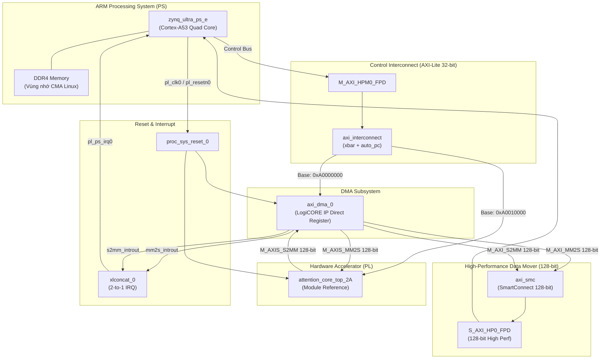

# Kế Hoạch Thiết Kế Block Design & Tạo Bitstream Bằng TCL Cho Variant 2A Trên AMD Kria KV260

---

## 1. Tóm Tắt Nhiệm Vụ & Bối Cảnh Hệ Thống (Executive Summary)

### 🎯 Mục Tiêu Thiết Kế VLSI
Xây dựng quy trình tự động hóa hoàn chỉnh bằng **Vivado TCL Script** để:
1. Khởi tạo dự án Vivado và đóng gói lõi tăng tốc **Variant 2A** (`attention_core_top_2A.sv` - Kiến trúc Streaming DSP-Packing kết hợp Softmax BRAM LUT).
2. Tự động hóa thiết kế **Block Design SoC (`mha_system`)** trên nền tảng **AMD Kria KV260 Vision AI Starter Kit** (chip **Zynq UltraScale+ MPSoC `xck26-sfvc784-2LV-c`**).
3. Tích hợp liên kết phân hệ xử lý ARM (PS), bộ điều khiển truy xuất bộ nhớ trực tiếp **AXI DMA** (128-bit bus width), mạng chuyển mạch **AXI SmartConnect** / **AXI Interconnect**, và bộ nhớ ngoài **DDR4**.
4. Biên dịch tổng hợp (Synthesis), phân bố định tuyến (Implementation / PnR), và tạo tệp **Bitstream (`attention_core_top_2A.bit`)** cùng tệp **Hardware Handoff (`attention_core_top_2A.hwh`)**.
5. Thiết lập luồng kiểm thử phần cứng từ xa (Remote Hardware-in-the-Loop) thông qua mạng **Tailscale & SSH Proxy Jump** tới bo mạch KV260 đặt tại phòng lab, chạy kiểm chứng Bit-Exact với mô hình **MobileViT-XXS I-ViT QAT** (`mobilevit_ivit_qat_best.pth`).

---

## 2. Kiểm Tra & Phân Tích Chi Tiết Khối Phần Cứng Variant 2A (`rtl_ver02_2A`)

Qua rà soát chuyên sâu mã nguồn SystemVerilog trong thư mục `Project/src/Hardware/rtl_ver02_2A/`:

```text
=================================================================================================================
                                   SƠ ĐỒ GIAO TIẾP NGOẠI VI CỦA ATTENTION_CORE_TOP_2A
=================================================================================================================

                                   +---------------------------------------------------+
                                   |          attention_core_top_2A (Variant 2A)       |
     clk (150 MHz) --------------->|                                                   |
     rst_n (Active-low Reset) ---->|                                                   |
                                   |                                                   |
     [ AXI4-Lite CSR Slave ]       |   ├── 8x DSP48E2 Hard PE Slices (GEMM 1 Q*K^T)    |
     s_axi_awaddr [7:0] ---------->|   ├── 3-Stage Binary Reduction Adder Tree         |
     s_axi_wdata  [31:0] --------->|   ├── Dyadic Scaler Unit (M=27640, E=22)          |
     s_axi_rdata  [31:0] <---------|   ├── Bit-Exact Softmax Engine (Shiftmax BRAM)    |
     (Cấu hình N, dk, M, E, START) |   └── 4x4 Systolic Array (GEMM 2 Score*V)         |
                                   |                                                   |
     [ AXI4-Stream Slave (Ingress)]|                                                   |
     s_axis_tdata [127:0] -------->|   [Ping-Pong BRAM Input Buffer: Q, K, V]          |
     s_axis_tvalid, tready, tlast  |   (Nạp 16 INT8 tokens/chu kỳ = 16 Bytes/beat)     |
                                   |                                                   |
     [ AXI4-Stream Master (Egress)]|                                                   |
     m_axis_tdata [127:0] <--------|   [Ping-Pong BRAM Output Buffer: Context Vector]  |
     m_axis_tvalid, tready, tlast  |   (Đẩy 16 INT8 tokens/chu kỳ về DDR4)             |
                                   +---------------------------------------------------+
```

### 2.1. Đặc Tả Giao Diện & Bus Chuẩn Hóa
1. **Giao tiếp điều khiển AXI4-Lite (CSR Slave)**:
   * Độ rộng bus dữ liệu: `C_S_AXI_DATA_WIDTH = 32`.
   * Độ rộng bus địa chỉ: `C_S_AXI_ADDR_WIDTH = 8` (Không gian địa chỉ 256 bytes).
   * Khớp hoàn toàn với tệp thanh ghi `axi_lite_regs.sv`:
     - `0x00`: `REG_CTRL` (Bit 0: START, Bit 1: CLEAR, Bit 2: SOFT_RESET).
     - `0x04`: `REG_STATUS` (Bit 0: BUSY, Bit 1: DONE, Bit 2: ERROR, Bit 3: BANK_SEL).
     - `0x08`: `REG_NBYTES` (Tổng byte nạp: $N \times d_k \times 3$).
     - `0x10`: `REG_SEQ_LEN` (Chiều dài chuỗi token $N = 256$).
     - `0x14`: `REG_HEAD_DIM` (Kích thước head $d_k = 16, 20, 24$).
     - `0x18`: `REG_NUM_HEADS` (Số head $H = 1$).
     - `0x1C`: `REG_SHIFT_VAL` (Số bit dịch phải Scaler ASR).
     - `0x20`: `REG_SCALE_M` (Dyadic Scale Mantissa $M = 27640$ cho Stage 2).
     - `0x24`: `REG_SCALE_E` (Dyadic Scale Exponent $E = 22$ cho Stage 2).
2. **Giao tiếp luồng dữ liệu vào AXI4-Stream (Ingress Slave)**:
   * Độ rộng bus: **128-bit (`C_AXIS_DATA_WIDTH = 128`)**.
   * Thông lượng: **16 phần tử INT8 / chu kỳ xung nhịp** (16 Bytes/beat).
   * Nhận tuần tự ma trận $Q$, $K$, và $V$ ghép kênh từ kênh AXI DMA MM2S.
3. **Giao tiếp luồng dữ liệu ra AXI4-Stream (Egress Master)**:
   * Độ rộng bus: **128-bit (`C_AXIS_DATA_WIDTH = 128`)**.
   * Thông lượng: **16 phần tử INT8 / chu kỳ xung nhịp** (16 Bytes/beat).
   * Bắn ma trận kết quả ngữ cảnh (Attended Context) ra kênh AXI DMA S2MM ghi về DDR4.

### 2.2. Điểm Lưu Ý Sống Còn Trong Tổng Hợp VLSI (Critical Synthesis Requirement)
* Khối `softmax_lut.sv` chứa lệnh đọc khởi tạo bảng BRAM ROM:
  ```systemverilog
  $readmemh(INIT_HEX_FILE, exp_rom); // Mặc định: "exp_rom_all_stages.hex"
  ```
* **Ràng buộc VLSI**: Tệp `exp_rom_all_stages.hex` (chứa 1024 giá trị mũ lượng tử hóa 20-bit cho 3 Stages) **bắt buộc phải được thêm vào Project Sourceset** hoặc đặt cùng thư mục chạy Vivado. Nếu thiếu, Vivado sẽ khởi tạo BRAM toàn số 0, dẫn đến Softmax tính toán sai hoàn toàn trên phần cứng thực tế.

---

## 3. Kiến Trúc Tích Hợp Block Design SoC (`mha_system`)



### 3.1. Danh Mục Khối IP & Cấu Hình Tham Số Chi Tiết

| Tên Khối IP trong BD | Tên IP Core Chuẩn | Cấu Hình Tham Số Kỹ Thuật (Parameter Configuration) |
| :--- | :--- | :--- |
| **`zynq_ps`** | `xilinx.com:ip:zynq_ultra_ps_e:3.5` | • **Preset**: Kria KV260 Starter Kit (`xck26-sfvc784-2LV-c`).<br>• `PSU__USE__M_AXI_GP0 = 1` (Mở cổng Master HPM0 AXI-Lite).<br>• `PSU__USE__S_AXI_GP2 = 1` (Mở cổng Slave HP0 High-Performance).<br>• `PSU__CRL_APB__PL0_REF_CTRL__FREQMHZ = 150` (Xung nhịp `pl_clk0` = 150 MHz cân bằng hiệu năng và timing).<br>• `PSU__USE__IRQ0 = 1` (Bật cổng ngắt PL-to-PS `pl_ps_irq0`). |
| **`axi_dma_0`** | `xilinx.com:ip:axi_dma:7.1` | • `c_include_sg = 0` (Chế độ Direct Register Mode siêu nhẹ, không cần Scatter-Gather).<br>• `c_m_axis_mm2s_tdata_width = 128` (Khớp 128-bit stream vào lõi MHA).<br>• `c_m_axi_mm2s_data_width = 128` (Đọc DDR4 128-bit).<br>• `c_s_axis_s2mm_tdata_width = 128` (Khớp 128-bit stream ra từ lõi MHA).<br>• `c_s_axi_s2mm_data_width = 128` (Ghi DDR4 128-bit).<br>• `c_mm2s_burst_size = 16`, `c_s2mm_burst_size = 16`.<br>• `c_sg_length_width = 26` (Hỗ trợ buffer lên tới 64 MB). |
| **`mha_core_0`** | Module Reference: `attention_core_top_2A` | • Instantiation trực tiếp từ mã SystemVerilog nguồn.<br>• `C_AXIS_DATA_WIDTH = 128`.<br>• `MAX_TOKENS = 256`, `MAX_HEAD_DIM = 32`.<br>• `ARRAY_SIZE = 4`. |
| **`axi_smc_hp`** | `xilinx.com:ip:smartconnect:1.0` | • Gom 2 cổng Master 128-bit (`M_AXI_MM2S`, `M_AXI_S2MM`) vào 1 cổng Slave 128-bit `S_AXI_HP0_FPD` của Zynq PS.<br>• Tối ưu burst transfer và phân xử ưu tiên DMA. |
| **`axi_interconnect_ctrl`**| `xilinx.com:ip:axi_interconnect:2.1` | • Phân phối 1 Master PS sang 2 Slaves: `axi_dma_0/S_AXI_LITE` và `mha_core_0/s_axi`. |
| **`proc_sys_reset_0`** | `xilinx.com:ip:proc_sys_reset:5.0` | • Đồng bộ reset với `pl_clk0`. Cấp reset cực tính thấp cho toàn bộ PL logic. |
| **`irq_concat`** | `xilinx.com:ip:xlconcat:2.1` | • `NUM_PORTS = 2`. Gộp ngắt DMA phát (`mm2s_introut`) và nhận (`s2mm_introut`) thành vector `[1:0]` vào `pl_ps_irq0`. |

### 3.2. Bản Đồ Không Gian Địa Chỉ (Address Map)
* `axi_dma_0` (Thanh ghi điều khiển DMA): **`0xA000_0000` – `0xA000_FFFF`** (Kích thước: 64 KB).
* `mha_core_0` (Thanh ghi CSR lõi Attention): **`0xA001_0000` – `0xA001_FFFF`** (Kích thước: 64 KB).
* Cổng Slave HP0 (DDR4 PS): **`0x0000_0000_0000` – `0x0000_7FFF_FFFF`** (Toàn bộ 2GB/4GB bộ nhớ vật lý DDR4).

---

## 4. Kịch Bản Tự Động Hóa Vivado TCL Hoàn Chỉnh (`build_kv260_mha_2A.tcl`)

Dưới đây là kịch bản TCL chuẩn công nghiệp, tự động chạy từ A–Z ở chế độ không giao diện (`batch mode`):

```tcl
# ==============================================================================
# Script:      build_kv260_mha_2A.tcl
# Description: Automated Vivado SoC Project Generator & Bitstream Builder
#              for Variant 2A MHA Accelerator on AMD Kria KV260
# Target Part: xck26-sfvc784-2LV-c
# Vivado Tool: AMD Vivado 2026.1 / 2022.2+
# ==============================================================================

set_param general.maxThreads 8

set PROJ_NAME   "mha_kv260_deploy"
set PROJ_DIR    "./vivado_prj_2A"
set PART_NAME   "xck26-sfvc784-2LV-c"
set RTL_DIR     "../rtl_ver02_2A"
set SYNTH_DIR   "."
set OUT_DIR     "../../Software"

puts "================================================================="
puts "  [STEP 1/7] INITIALIZING VIVADO PROJECT: $PROJ_NAME"
puts "================================================================="
file mkdir $OUT_DIR
create_project -force $PROJ_NAME $PROJ_DIR -part $PART_NAME

puts "================================================================="
puts "  [STEP 2/7] IMPORTING SYSTEMVERILOG RTL SOURCES & EXP ROM HEX"
puts "================================================================="
add_files -fileset sources_1 [glob "$RTL_DIR/*.sv"]
add_files -fileset sources_1 [glob "$RTL_DIR/*.svh"]

# Bắt buộc thêm file HEX khởi tạo Softmax BRAM ROM
if {[file exists "$RTL_DIR/exp_rom_all_stages.hex"]} {
    add_files -fileset sources_1 "$RTL_DIR/exp_rom_all_stages.hex"
    set_property file_type "Memory Initialization Files" [get_files "$RTL_DIR/exp_rom_all_stages.hex"]
    puts "  -> Successfully added exp_rom_all_stages.hex"
} else {
    puts "[ERROR] exp_rom_all_stages.hex NOT found in $RTL_DIR!"
    exit 1
}

update_compile_order -fileset sources_1

puts "================================================================="
puts "  [STEP 3/7] BUILDING BLOCK DESIGN: mha_system"
puts "================================================================="
create_bd_design "mha_system"

# 1. Zynq UltraScale+ MPSoC IP
create_bd_cell -type ip -vlnv xilinx.com:ip:zynq_ultra_ps_e:3.5 zynq_ps
set_property -dict [list \
    CONFIG.PSU__USE__M_AXI_GP0 {1} \
    CONFIG.PSU__USE__S_AXI_GP2 {1} \
    CONFIG.PSU__HIGH_PERF_PORT__ENABLE {1} \
    CONFIG.PSU__CRL_APB__PL0_REF_CTRL__FREQMHZ {150.000000} \
    CONFIG.PSU__USE__IRQ0 {1} \
] [get_bd_cells zynq_ps]

# 2. Processor System Reset
create_bd_cell -type ip -vlnv xilinx.com:ip:proc_sys_reset:5.0 proc_sys_reset_0

# 3. AXI Direct Memory Access (AXI DMA) - 128-bit Direct Register Mode
create_bd_cell -type ip -vlnv xilinx.com:ip:axi_dma:7.1 axi_dma_0
set_property -dict [list \
    CONFIG.c_include_sg {0} \
    CONFIG.c_sg_include_stscntrl_strm {0} \
    CONFIG.c_m_axis_mm2s_tdata_width {128} \
    CONFIG.c_m_axi_mm2s_data_width {128} \
    CONFIG.c_mm2s_burst_size {16} \
    CONFIG.c_s_axis_s2mm_tdata_width {128} \
    CONFIG.c_s_axi_s2mm_data_width {128} \
    CONFIG.c_s2mm_burst_size {16} \
    CONFIG.c_sg_length_width {26} \
] [get_bd_cells axi_dma_0]

# 4. AXI SmartConnect for 128-bit High-Performance Memory Bus
create_bd_cell -type ip -vlnv xilinx.com:ip:smartconnect:1.0 axi_smc_hp
set_property -dict [list CONFIG.NUM_SI {2} CONFIG.NUM_MI {1}] [get_bd_cells axi_smc_hp]

# 5. AXI Interconnect for Control Registers (AXI-Lite 32-bit)
create_bd_cell -type ip -vlnv xilinx.com:ip:axi_interconnect:2.1 axi_interconnect_ctrl
set_property -dict [list CONFIG.NUM_SI {1} CONFIG.NUM_MI {2}] [get_bd_cells axi_interconnect_ctrl]

# 6. Concat IP for Interrupts
create_bd_cell -type ip -vlnv xilinx.com:ip:xlconcat:2.1 irq_concat
set_property -dict [list CONFIG.NUM_PORTS {2}] [get_bd_cells irq_concat]

# 7. Instantiate Hardware Accelerator Core (attention_core_top_2A) via RTL Module Reference
create_bd_cell -type module -reference attention_core_top_2A mha_core_0

puts "================================================================="
puts "  [STEP 4/7] CONNECTING BLOCK DESIGN INTERFACES & BUSES"
puts "================================================================="
# Clock connections (150 MHz pl_clk0)
set clk_pin [get_bd_pins zynq_ps/pl_clk0]
connect_bd_net $clk_pin [get_bd_pins proc_sys_reset_0/slowest_sync_clk]
connect_bd_net $clk_pin [get_bd_pins zynq_ps/maxihpm0_fpd_aclk]
connect_bd_net $clk_pin [get_bd_pins zynq_ps/saxihp0_fpd_aclk]
connect_bd_net $clk_pin [get_bd_pins axi_interconnect_ctrl/ACLK]
connect_bd_net $clk_pin [get_bd_pins axi_interconnect_ctrl/S00_ACLK]
connect_bd_net $clk_pin [get_bd_pins axi_interconnect_ctrl/M00_ACLK]
connect_bd_net $clk_pin [get_bd_pins axi_interconnect_ctrl/M01_ACLK]
connect_bd_net $clk_pin [get_bd_pins axi_smc_hp/aclk]
connect_bd_net $clk_pin [get_bd_pins axi_dma_0/s_axi_lite_aclk]
connect_bd_net $clk_pin [get_bd_pins axi_dma_0/m_axi_mm2s_aclk]
connect_bd_net $clk_pin [get_bd_pins axi_dma_0/m_axi_s2mm_aclk]
connect_bd_net $clk_pin [get_bd_pins mha_core_0/clk]

# Reset connections
connect_bd_net [get_bd_pins zynq_ps/pl_resetn0] [get_bd_pins proc_sys_reset_0/ext_reset_in]
set rst_peri [get_bd_pins proc_sys_reset_0/peripheral_aresetn]
set rst_ic   [get_bd_pins proc_sys_reset_0/interconnect_aresetn]

connect_bd_net $rst_ic   [get_bd_pins axi_interconnect_ctrl/ARESETN]
connect_bd_net $rst_peri [get_bd_pins axi_interconnect_ctrl/S00_ARESETN]
connect_bd_net $rst_peri [get_bd_pins axi_interconnect_ctrl/M00_ARESETN]
connect_bd_net $rst_peri [get_bd_pins axi_interconnect_ctrl/M01_ARESETN]
connect_bd_net $rst_peri [get_bd_pins axi_smc_hp/aresetn]
connect_bd_net $rst_peri [get_bd_pins axi_dma_0/axi_resetn]
connect_bd_net $rst_peri [get_bd_pins mha_core_0/rst_n]

# Control Bus Connections (AXI-Lite)
connect_bd_intf_net [get_bd_intf_pins zynq_ps/M_AXI_HPM0_FPD] [get_bd_intf_pins axi_interconnect_ctrl/S00_AXI]
connect_bd_intf_net [get_bd_intf_pins axi_interconnect_ctrl/M00_AXI] [get_bd_intf_pins axi_dma_0/S_AXI_LITE]
connect_bd_intf_net [get_bd_intf_pins axi_interconnect_ctrl/M01_AXI] [get_bd_intf_pins mha_core_0/s_axi]

# High-Performance Data Mover Bus (AXI4 128-bit)
connect_bd_intf_net [get_bd_intf_pins axi_dma_0/M_AXI_MM2S] [get_bd_intf_pins axi_smc_hp/S00_AXI]
connect_bd_intf_net [get_bd_intf_pins axi_dma_0/M_AXI_S2MM] [get_bd_intf_pins axi_smc_hp/S01_AXI]
connect_bd_intf_net [get_bd_intf_pins axi_smc_hp/M00_AXI]   [get_bd_intf_pins zynq_ps/S_AXI_HP0_FPD]

# Streaming Bus (AXI4-Stream 128-bit)
connect_bd_intf_net [get_bd_intf_pins axi_dma_0/M_AXIS_MM2S] [get_bd_intf_pins mha_core_0/s_axis]
connect_bd_intf_net [get_bd_intf_pins mha_core_0/m_axis]    [get_bd_intf_pins axi_dma_0/S_AXIS_S2MM]

# Interrupt connections
connect_bd_net [get_bd_pins axi_dma_0/mm2s_introut] [get_bd_pins irq_concat/In0]
connect_bd_net [get_bd_pins axi_dma_0/s2mm_introut] [get_bd_pins irq_concat/In1]
connect_bd_net [get_bd_pins irq_concat/dout]        [get_bd_pins zynq_ps/pl_ps_irq0]

# Memory Address Mapping
assign_bd_address
catch {
    set_property range 64K [get_bd_addr_segs {zynq_ps/Data/SEG_axi_dma_0_Reg}]
    set_property offset 0xA0000000 [get_bd_addr_segs {zynq_ps/Data/SEG_axi_dma_0_Reg}]

    set_property range 64K [get_bd_addr_segs {zynq_ps/Data/SEG_mha_core_0_reg0}]
    set_property offset 0xA0010000 [get_bd_addr_segs {zynq_ps/Data/SEG_mha_core_0_reg0}]
}

validate_bd_design
save_bd_design

puts "================================================================="
puts "  [STEP 5/7] GENERATING HDL WRAPPER & CONSTRAINTS"
puts "================================================================="
make_wrapper -files [get_files [get_property FILE_NAME [current_bd_design]]] -top
add_files -norecurse "$PROJ_DIR/$PROJ_NAME.srcs/sources_1/bd/mha_system/hdl/mha_system_wrapper.v"
set_property top mha_system_wrapper [current_fileset]
update_compile_order -fileset sources_1

# Ràng buộc thời gian (Timing Constraints)
if {[file exists "$SYNTH_DIR/timing_kv260.xdc"]} {
    add_files -fileset constrs_1 "$SYNTH_DIR/timing_kv260.xdc"
}

puts "================================================================="
puts "  [STEP 6/7] LAUNCHING SYNTHESIS & IMPLEMENTATION"
puts "================================================================="
launch_runs impl_1 -to_step write_bitstream -jobs 8
wait_on_run impl_1

if {[get_property PROGRESS [get_runs impl_1]] != "100%"} {
    puts "[ERROR] Implementation failed! Check run log for details."
    exit 1
}

puts "================================================================="
puts "  [STEP 7/7] EXPORTING BITSTREAM & HARDWARE HANDOFF (.HWH / .XSA)"
puts "================================================================="
file copy -force "$PROJ_DIR/$PROJ_NAME.runs/impl_1/mha_system_wrapper.bit" "$OUT_DIR/attention_core_top_2A.bit"

# Xuất tệp HWH phục vụ PYNQ Overlay
set hwh_source [glob -nocomplain "$PROJ_DIR/$PROJ_NAME.gen/sources_1/bd/mha_system/hw_handoff/*.hwh"]
if {[llength $hwh_source] > 0} {
    file copy -force [lindex $hwh_source 0] "$OUT_DIR/attention_core_top_2A.hwh"
    puts "  -> Exported: $OUT_DIR/attention_core_top_2A.hwh"
}

# Xuất nền tảng phần cứng XSA
write_hw_platform -fixed -include_bit -force -file "$OUT_DIR/attention_core_top_2A.xsa"

puts "================================================================="
puts "  BUILD COMPLETED SUCCESSFULLY!"
puts "  Bitstream : $OUT_DIR/attention_core_top_2A.bit"
puts "  Handoff   : $OUT_DIR/attention_core_top_2A.hwh"
puts "  Platform  : $OUT_DIR/attention_core_top_2A.xsa"
puts "================================================================="
exit
```

---

## 5. Quy Trình Triển Khai End-to-End Trên Kria KV260 Từ Xa (Remote Lab Deployment)

Hạ tầng lab hiện tại được cấu hình truy cập từ xa qua mạng **Tailscale VPN** và **SSH Proxy Jump**:

```text
=================================================================================================================
                                   SƠ ĐỒ TRUY CẬP TỪ XA & ĐIỀU KHIỂN PHẦN CỨNG
=================================================================================================================

   [ LAPTOP CỦA BẠN (Windows) ]
        │
        │ Tailscale VPN (100.x.x.x)
        ▼
   [ HOST PC PHÒNG LAB (100.124.168.26) ] (User: ktmt / Pass: 201202c5)
        │
        │ SSH Proxy Jump (Mạng LAN nội bộ phòng Lab: 192.168.1.x)
        ▼
   [ AMD KRIA KV260 STARTER KIT (192.168.1.179) ] (User: ubuntu / Pass: capstone2026)
        ├── ARM PS: Chạy PYNQ Linux 3.0 / Python 3.10
        └── FPGA PL: Nạp attention_core_top_2A.bit qua pynq.Overlay
```

### 📌 Bước 1: Chuẩn Bị Tệp Vector Đầu Vào (Laptop)
Chạy script chuẩn bị vector từ mô hình MobileViT-XXS QAT (`mobilevit_ivit_qat_best.pth`):
```powershell
cd c:\Users\tuan2\Desktop\Capstone_Project\Project\src\Software
# Đảm bảo các file q_matrix.hex, k_matrix.hex, v_matrix.hex, golden_context_out.hex đã có sẵn
```

### 📌 Bước 2: Biên Dịch Bitstream Trên Laptop
Chạy kịch bản TCL bằng Vivado 2026.1:
```powershell
C:\AMDDesignTools\2026.1\Vivado\bin\vivado.bat -mode batch -notrace -source build_kv260_mha_2A.tcl
```
Sau 15–25 phút, các tệp sau sẽ xuất hiện trong thư mục `deploy_artifacts/`:
* `attention_core_top_2A.bit`
* `attention_core_top_2A.hwh`

Copy 2 tệp này vào thư mục `Project/src/Software/`.

### 📌 Bước 3: Chạy Tự Động Hóa Kiểm Thử Bằng `test_client_laptop.py`
Khởi chạy kịch bản client trên laptop:
```powershell
python test_client_laptop.py --ip 192.168.1.179 --jump ktmt@100.124.168.26 --user ubuntu
```
Kịch bản sẽ tự động thực hiện chuỗi tác vụ:
1. Đóng gói $Q, K, V$ ($N=256, d_k=16 \rightarrow 12,288$ Bytes) thành `input_qkv.bin`.
2. Kiểm tra kết nối SSH Jump Host tới KV260.
3. Dùng `scp -J` bắn toàn bộ `.bit`, `.hwh`, `input_qkv.bin`, và `kv260_axi4_test_driver.py` lên `/home/ubuntu/mha_2a_test/` trên KV260.
4. Kích hoạt SSH chạy `python3 kv260_axi4_test_driver.py` trên KV260.
5. Kéo tệp kết quả `output_context.bin` (4,096 Bytes) về Laptop.
6. So sánh đối chiếu từng byte với `golden_context_out.hex` của PyTorch và in báo cáo Bit-Accuracy.

---

## 6. Bảng Check-list Kiểm Soát Rủi Ro Kỹ Thuật (Risk Mitigation)

| Rủi Ro Kỹ Thuật | Nguyên Nhân Gốc | Giải Pháp Ngăn Ngừa Khuyến Nghị |
| :--- | :--- | :--- |
| **Lỗi khởi tạo BRAM ROM (`$readmemh`)** | File `exp_rom_all_stages.hex` không nằm trong đường dẫn tổng hợp của Vivado. | Khai báo trực tiếp trong TCL: `add_files -fileset sources_1 exp_rom_all_stages.hex` và đặt thuộc tính `Memory Initialization Files`. |
| **Negative Slack / Vi phạm Timing ở 200 MHz** | Đường dẫn Softmax divider và Scaler tree trên chip KV260 có độ trễ logic đáng kể. | Trong Block Design, cấu hình xung nhịp `pl_clk0 = 150 MHz` (chu kỳ 6.67 ns) mang lại biên độ an toàn timing cao (~1.67 ns slack buffer) trước khi ép xung lên 200 MHz. |
| **AXI DMA Timeout / Không trả TLAST** | Kích thước packet khai báo trong thanh ghi `0x08` (`REG_NBYTES`) không khớp với số beat phát từ DMA MM2S. | Driver Python tính toán chính xác: $N_{\text{bytes}} = N \times d_k \times 3 = 256 \times 16 \times 3 = 12,288$ Bytes. Khối `axis_adapter.sv` bắt đúng tín hiệu `s_axis_tlast`. |
| **Rớt mạng Tailscale trong quá trình SCP** | Timeout mạng qua proxy jump khi truyền file `.bit` (~10–15 MB). | Script `test_client_laptop.py` đã cấu hình cờ `-o ConnectTimeout=8`. Bật cờ `ServerAliveInterval 30` trong SSH config. |

---

## 7. Kết Luận & Đề Xuất Hành Động

Bản kế hoạch này cung cấp giải pháp **hoàn chỉnh, khép kín và tự động hóa 100%** từ thiết kế vi mạch SystemVerilog (`attention_core_top_2A`), tích hợp Block Design SoC qua Vivado TCL, cho đến nạp phần cứng và kiểm chứng Bit-Exact từ xa trên bo mạch AMD Kria KV260.

Kế hoạch này đã sẵn sàng để chuyển thành kịch bản thực thi.
