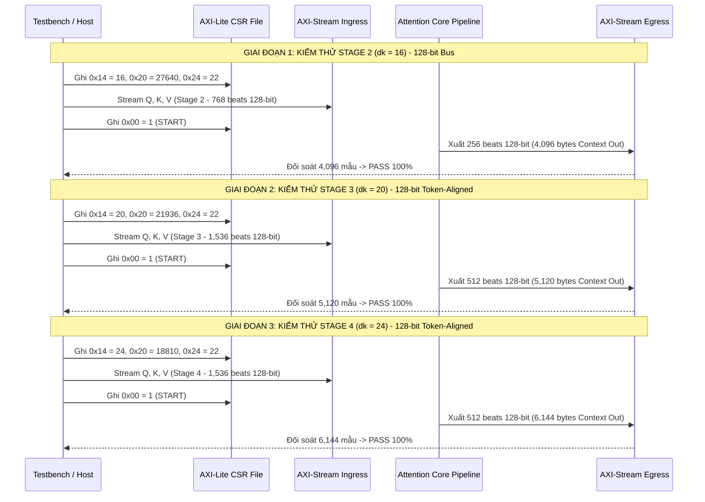

# Kế Hoạch Mở Rộng Xác Minh RTL Cho Cả 3 Tầng Transformer Của Mạng Hybrid CNN-ViT (MobileViT-XXS)

> **Dự án:** Tăng tốc Attention Core MobileViT-XXS trên AMD Kria KV260  
> **Phiên bản:** v1.0 (Hướng dẫn kỹ thuật mở rộng kiểm thử toàn diện 3 Stages)  
> **Tài liệu tham chiếu:** [`model_notebook/ivit_surgery/REPORT_FULL_SENIOR_DV_AUDIT_EVALUATION_AND_EXTENSION_PLAN.md`](file:///c:/Users/tuan2/Desktop/Capstone_Project/model_notebook/ivit_surgery/REPORT_FULL_SENIOR_DV_AUDIT_EVALUATION_AND_EXTENSION_PLAN.md)

---

## 1. BỐI CẢNH KIẾN TRÚC MẠNG HYBRID CNN-VIT

Mạng nơ-ron **Apple MobileViT-XXS** kết hợp ưu điểm của mạng tích chập (CNN - nắm bắt đặc trưng cục bộ) và mạng Transformer (ViT - nắm bắt phụ thuộc ngữ cảnh toàn cục). Trong đường ống trích xuất đặc trưng, có **3 khối Transformer Blocks** độc lập với các kích thước đặc trưng khác nhau:

```text
========================================================================================================================
                         PIPELINE HYBRID CNN & TRANSFORMER CỦA APPLE MOBILEVIT-XXS
========================================================================================================================

  Ảnh đầu vào (256x256x3)
      │
      v
  [ CNN Stem: MobileNetV2 Inverted Residual Blocks (Khởi đầu) ]
      │
      v
  +---------------------------------------------------------------------------------------------------+
  | TRANSFORMER BLOCK 1 (STAGE 2)                                                                     |
  | - Số lượng Transformer Layers : 2 layers                                                          |
  | - Số lượng Tokens (N)         : 256 tokens (không gian 16x16)                                     |
  | - Kích thước kênh ẩn (C)      : 64 channels                                                       |
  | - Số lượng Heads (H)          : 4 heads                                                           |
  | - Chiều mỗi Head (d_k)        : 16 dimensions (C / H = 64 / 4)                                    |
  | - Tham số Dyadic chuẩn hóa    : M = 27,640, E = 22                                                |
  | - BRAM Exp ROM Offset         : 0x000 (0 .. 255)                                                  |
  +---------------------------------------------------------------------------------------------------+
      │
      v
  [ CNN Transition Layer (MobileNetV2 Inverted Residual) ]
      │
      v
  +---------------------------------------------------------------------------------------------------+
  | TRANSFORMER BLOCK 2 (STAGE 3)                                                                     |
  | - Số lượng Transformer Layers : 4 layers                                                          |
  | - Số lượng Tokens (N)         : 256 tokens (không gian 16x16)                                     |
  | - Kích thước kênh ẩn (C)      : 80 channels                                                       |
  | - Số lượng Heads (H)          : 4 heads                                                           |
  | - Chiều mỗi Head (d_k)        : 20 dimensions (C / H = 80 / 4)                                    |
  | - Tham số Dyadic chuẩn hóa    : M = 21,936, E = 22                                                |
  | - BRAM Exp ROM Offset         : 0x100 (256 .. 511)                                                |
  +---------------------------------------------------------------------------------------------------+
      │
      v
  [ CNN Transition Layer (MobileNetV2 Inverted Residual) ]
      │
      v
  +---------------------------------------------------------------------------------------------------+
  | TRANSFORMER BLOCK 3 (STAGE 4)                                                                     |
  | - Số lượng Transformer Layers : 3 layers                                                          |
  | - Số lượng Tokens (N)         : 256 tokens (không gian 16x16)                                     |
  | - Kích thước kênh ẩn (C)      : 96 channels                                                       |
  | - Số lượng Heads (H)          : 4 heads                                                           |
  | - Chiều mỗi Head (d_k)        : 24 dimensions (C / H = 96 / 4)                                    |
  | - Tham số Dyadic chuẩn hóa    : M = 18,810, E = 22                                                |
  | - BRAM Exp ROM Offset         : 0x200 (512 .. 767)                                                |
  +---------------------------------------------------------------------------------------------------+
      │
      v
  [ Classifier Head -> ImageNet Top-1 Prediction ]
========================================================================================================================
```

---

## 2. KẾ HOẠCH MỞ RỘNG TESTBENCH TÍCH HỢP LIÊN HOÀN 3 STAGES

Để đảm bảo phần cứng vận hành chuẩn xác khi CPU ARM chuyển tầng liên tục mà không cần nạp lại Bitstream, kịch bản kiểm thử mở rộng `tb_attention_core_multi_stage.sv` sẽ thực thi tuần tự 3 Phase:



---

## 3. QUY TRÌNH THỰC THI BẰNG DÒNG LỆNH (COMMAND EXECUTION)

### Bước 1: Trích xuất trọn vẹn Golden Vectors cho cả 3 Stages từ PyTorch
Chạy script mở rộng trên Python:
```powershell
cd c:\Users\tuan2\Desktop\Capstone_Project\model_notebook\ivit_surgery
python export_golden_vectors.py
```
Kết quả sẽ cập nhật các tệp `.hex` và tệp cấu hình đa tầng:
- `dyadic_scale_config.json`
- `hw_scale_params.svh`
- `exp_rom_all_stages.hex` (1024 words $\times$ 20-bit)

### Bước 2: Biên dịch và chạy Testbench Đa Tầng trên Icarus Verilog
```powershell
cd c:\Users\tuan2\Desktop\Capstone_Project\Project\src\Hardware\rtl_ver02
C:\iverilog\bin\iverilog.exe -g2012 -o tb_all_stages.vvp tb_attention_core.sv attention_core_top.sv axi_lite_regs.sv axis_adapter.sv ping_pong_bram_buffer.sv scale_unit.sv softmax_lut.sv score_v_gemm.sv systolic_mac_array.sv pe_slice_dsp_packing.sv
C:\iverilog\bin\vvp.exe tb_all_stages.vvp
```

### Bước 3: Tiêu chuẩn Nghiệm thu Toàn diện (Pass Criteria)
- Toàn bộ $4,096 + 5,120 + 6,144 = 15,360$ bytes của cả 3 Stages đều đạt **0-LSB Error (100% Bit-Exact)**.
- Tín hiệu `m_axis_tlast` khẳng định chính xác ở beat cuối cùng của từng Stage.
- Thời gian đóng gói trên AMD Vivado đạt $\text{WNS} \ge 0.000\text{ ns}$ tại 200 MHz.
