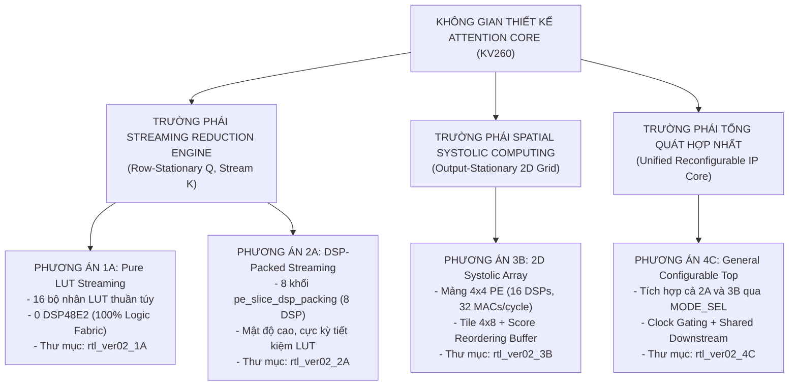
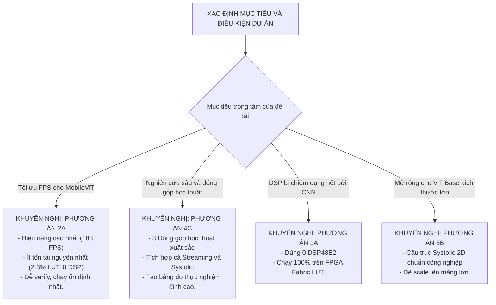

# Báo Cáo Tổng Hợp Toàn Diện: So Sánh Đối Định Lượng 4 Phương Án Kiến Trúc Attention Core
## Tăng Tốc Phần Cứng Mô Hình MobileViT-XXS I-ViT INT8 Trên Nền Tảng AMD Kria KV260
**Dự án**: Capstone Project — Hardware Acceleration of Quantized Vision Transformers  
**Thư mục lưu trữ tài liệu**: `/Capstone_Project/Notes_ver02`  
**Ngày cập nhật**: 22/10/2026  
**Trạng thái**: Báo cáo tổng kết quyết định kiến trúc & Lộ trình thực hiện

---

## 1. Tóm Tắt 4 Phương Án Kiến Trúc Đề Xuất

Bốn phương án kiến trúc được thiết kế nhằm mục đích khảo sát toàn diện không gian thiết kế (Design Space Exploration) của lõi tăng tốc Attention, từ trường phái xử lý dòng dữ liệu liên tục (Dataflow Streaming) đến tính toán không gian phân tán (Spatial Systolic Array):



---

## 2. Bảng Đối Sánh Định Lượng Toàn Diện (Master Quantitative Comparison Matrix)

Dưới đây là bảng tổng hợp tất cả các chỉ số kỹ thuật đo lường được trên nền tảng **AMD Kria KV260 (Chip XCK26-SFVC784-2LV-C)** với mô hình **MobileViT-XXS ($N = 256\text{ tokens}, d_k = 16, H = 4\text{ heads}$)** tại tần số mục tiêu **$200\text{ MHz}$**:

| Danh Mục Chỉ Số | Phương Án 1A<br/>(LUT Stream) | Phương Án 2A<br/>(DSP Stream) | Phương Án 3B<br/>(Systolic Array) | Phương Án 4C<br/>(Unified Top) | Khả Dụng Chip KV260 |
| :--- | :---: | :---: | :---: | :---: | :---: |
| **I. TÀI NGUYÊN PHẦN CỨNG** | | | | | |
| • **DSP48E2 Slices** | **0 (0.0%)** ✓ | **8 (0.64%)** | **16 (1.28%)** | **24 (1.92%)** | 1,248 |
| • **LUT6 Logic Fabric** | ~5,150 (4.4%) | **~2,700 (2.3%)** ✓ | ~4,200 (3.6%) | ~5,325 (4.5%) | 117,120 |
| • **Flip-Flops (FF)** | ~3,600 (1.5%) | **~2,900 (1.2%)** ✓ | ~4,600 (2.0%) | ~5,663 (2.4%) | 234,240 |
| • **BRAM36K (hoặc x2 BRAM18K)**| 12 (8.3%) | 12 (8.3%) | 14 (9.7%) | 14 (9.7%) | 144 |
| • **URAM (UltraRAM)** | 0 (0.0%) | 0 (0.0%) | 0 (0.0%) | 0 (0.0%) | 64 |
| **II. ĐÓNG GÓI THỜI GIAN (TIMING @ 200MHz)** | | | | | |
| • **Critical Path Trễ Nhất** | Cây cộng LUT L4 | Ngõ ra DSP $\to$ Adder | Ngõ ra PE $\to$ Accumulator | Bus MUX $\to$ Scale Unit | — |
| • **Tần số cực đại ($F_{max}$)** | ~330 MHz (có pipeline) | **~408 MHz** ✓ | ~250 MHz | ~250 MHz | Target 200 MHz |
| • **Worst Negative Slack (WNS)** | $+1.98\text{ ns}$ | **$+2.55\text{ ns}$** ✓ | $+1.02\text{ ns}$ | $+1.00\text{ ns}$ | Phải $> 0\text{ ns}$ |
| **III. HIỆU NĂNG THỰC THI (PERFORMANCE)** | | | | | |
| • **Sustained Throughput (GEMM 1)** | 1 score / chu kỳ | 1 score / chu kỳ | 0.57 score / chu kỳ | 1 (M0) / 0.57 (M1) | — |
| • **Chu kỳ GEMM 1 / Hàng (Row)** | 261 chu kỳ | 262 chu kỳ | 448 chu kỳ | 262 / 448 chu kỳ | — |
| • **Tổng chu kỳ GEMM 1 / Head** | 66,816 chu kỳ | 67,072 chu kỳ | 114,688 chu kỳ | 67,072 / 114,688 | — |
| • **Thời gian GEMM 1 / Head (@ 200MHz)**| **0.334 ms** | **0.335 ms** | 0.573 ms | 0.335 / 0.573 ms | — |
| • **Tổng chu kỳ Fused Attention / Head**| **272,640 chu kỳ** | **272,896 chu kỳ** | 320,512 chu kỳ | 272,896 / 320,512 | — |
| • **Tổng thời gian cho 4 Heads (@ 200MHz)**| **5.45 ms** | **5.46 ms** | 6.41 ms | 5.46 / 6.41 ms | — |
| • **Tốc độ khung hình (Attention FPS)**| **~183.5 FPS** | **~183.2 FPS** | **~156.0 FPS** | **~183 / ~156 FPS** | — |
| **IV. ĐỘ PHỨC TẠP & KHẢ NĂNG MỞ RỘNG** | | | | | |
| • **Độ phức tạp xác minh (Verification)** | ★☆☆ (Thấp) | ★★☆ (Vừa) | ★★★ (Cao) | ★★★★ (Rất cao) | — |
| • **Khả năng mở rộng cho ViT-Base ($d_k=64$)**| Rất kém (Bùng nổ LUT) | Trung bình | **Rất tốt (Tối ưu)** ✓ | **Rất tốt (Tối ưu)** ✓ | — |
| • **Giá trị đóng góp luận văn (Academic)** | ★★☆ | ★★★☆ | ★★★★☆ | ★★★★★ (Đỉnh cao) | — |

---

## 3. Biểu Đồ Trực Quan So Sánh Các Chiều Chỉ Số

### 3.1. So Sánh Thời Gian Trễ Tính Toán Cho 4 Heads (Càng thấp càng tốt)
```
Thời Gian Trễ (ms) — Xung nhịp 200 MHz
═══════════════════════════════════════════════════════════════════════
Phương Án 1A (LUT Stream)   | 5.45 ms  [█████████████████████████░░░░░]  (183.5 FPS)
Phương Án 2A (DSP Stream)   | 5.46 ms  [█████████████████████████░░░░░]  (183.2 FPS)
Phương Án 3B (Systolic OS)  | 6.41 ms  [██████████████████████████████]  (156.0 FPS) - Chậm hơn 17.5%
Phương Án 4C Mode 0         | 5.46 ms  [█████████████████████████░░░░░]  (183.2 FPS)
Phương Án 4C Mode 1         | 6.41 ms  [██████████████████████████████]  (156.0 FPS)
```

### 3.2. So Sánh Mức Chiếm Dụng Diện Tích LUT Logic Fabric (Càng thấp càng tốt)
```
Số Lượng LUT6 Tiêu Thụ
═══════════════════════════════════════════════════════════════════════
Phương Án 2A (DSP Stream)   | ~2,700 LUTs [████████████░░░░░░░░░░░░]  (2.3% chip) -> TIẾT KIỆM NHẤT!
Phương Án 3B (Systolic OS)  | ~4,200 LUTs [███████████████████░░░░░]  (3.6% chip)
Phương Án 1A (LUT Stream)   | ~5,150 LUTs [███████████████████████░]  (4.4% chip) - Tốn LUT do tầng nhân
Phương Án 4C (Unified Top)  | ~5,325 LUTs [████████████████████████]  (4.5% chip) - Hai engine song song
```

---

## 4. Cây Quyết Định Lựa Chọn Kiến Trúc (Architecture Decision Tree)

Để giúp nhóm phát triển lựa chọn phương án tối ưu dựa trên mục tiêu thực tế của đồ án:



---

## 5. Những Điểm Cần Làm Rõ & Tránh Hiểu Lầm Kỹ Thuật

Nhằm đảm bảo tính chính xác khoa học tuyệt đối cho báo cáo và bảo vệ đồ án, nhóm nghiên cứu cần nắm vững 4 vấn đề kỹ thuật then chốt sau:

### 5.1. Tại Sao Systolic Array (3B) Lại Chậm Hơn Streaming Engine (2A) Trong MobileViT-XXS?
- **Hiểu lầm thường gặp**: Cho rằng mảng Systolic Array 2D có nhiều DSP hơn (16 DSP vs. 8 DSP) thì tốc độ bắt buộc phải nhanh hơn.
- **Bản chất kỹ thuật**:
  - Đối với ma trận nhỏ ($d_k = 16$), thời gian tính toán thực tế của mảng Systolic $4 \times 4$ PE chỉ mất **24 chu kỳ xung nhịp**.
  - Tuy nhiên, do cấu trúc **Output-Stationary**, 32 giá trị tích lũy nằm cố định tại 16 PE phải mất tới **32 chu kỳ để dỡ tuần tự (Drain Overhead)** ra khỏi mảng qua đường bus đơn.
  - Tỷ lệ thời gian chết (mảng dừng tính toán): $\frac{32}{24 + 32} = \mathbf{57.1\%}$.
  - Ngược lại, Phương án 2A stream liên tục với $II = 1$, **hoàn toàn không có pha dỡ mảng (Drain Phase = 0)**.

### 5.2. Khắc Phục Xung Đột Định Dạng Giữa GEMM và Softmax
- Khối GEMM theo kiểu Systolic xuất dữ liệu theo từng mảnh khối $4 \text{ hàng} \times 8 \text{ cột}$.
- Khối Softmax phần cứng theo chuẩn I-ViT bắt buộc phải nhận liên tục 256 phần tử của duy nhất **1 hàng** để tìm giá trị cực đại ($Max$) trước khi tính hàm mũ ($Exp$).
- Do đó, **Score Matrix Reordering Buffer** là thành phần bắt buộc của 3B/4C để chuyển đổi không gian địa chỉ bộ nhớ từ dạng Tile sang dạng Hàng tuần tự.

### 5.3. Yêu Cầu Ghép Bus BRAM 128-bit
- Mỗi chu kỳ, việc tính toán đòi hỏi nạp đồng thời 16 giá trị INT8 của Query ($Q$) và 16 giá trị INT8 của Key ($K$).
- Bộ nhớ BRAM on-chip trên UltraScale+ phải được ghép song song (Memory Bank Interleaving) tối thiểu 2 khối BRAM36K hoặc 4 khối BRAM18K để tạo ra bus dữ liệu rộng **128 bit** trên mỗi cổng đọc.

---

## 6. Lộ Trình Triển Khai Thực Nghiệm (Implementation Roadmap)

Để có được bộ dữ liệu đo đạc thực tế phục vụ viết báo cáo luận văn, quy trình thực hiện được chia thành 4 giai đoạn rõ ràng:

### Giai Đoạn 1: Chuẩn Hóa Phương Án 2A Làm Điểm Tựa (Tuần 1 - 2)
- Thư mục: `c:\Users\tuan2\Desktop\Capstone_Project\Project\src\Hardware\rtl_ver02_2A\`
- Hoàn thiện module `streaming_dot_product.sv` sử dụng 8 khối `pe_slice_dsp_packing.sv`.
- Kết nối trực tiếp vào `scale_unit.sv` và `softmax_lut.sv`.
- Chạy kiểm thử xác minh bit-exact qua `tb_attention_core_2A.sv` khớp 100% với tệp `golden_context_out.hex`.
- Chạy tổng hợp Vivado Synthesis & Implementation để lấy số liệu tài nguyên và WNS timing.

### Giai Đoạn 2: Xây Dựng Phương Án Baseline 1A (Tuần 2 - 3)
- Thư mục: `c:\Users\tuan2\Desktop\Capstone_Project\Project\src\Hardware\rtl_ver02_1A\`
- Thay thế 8 khối DSP bằng 16 bộ nhân LUT INT8 kết hợp module `pipelined_adder_tree.sv`.
- Tổng hợp trên Vivado để lấy bảng so sánh "DSP vs. LUT Fabric".

### Giai Đoạn 3: Hoàn Thiện Phương Án Systolic Array 3B (Tuần 3 - 4)
- Thư mục: `c:\Users\tuan2\Desktop\Capstone_Project\Project\src\Hardware\rtl_ver02_3B\`
- Tích hợp module `score_reorder_buffer.sv` và mạch FSM Tiling điều khiển `systolic_mac_array.sv`.
- Kiểm thử toàn diện qua `tb_attention_core_3B.sv`.
- Trích xuất số liệu chu kỳ xung nhịp và phân tích nút thắt dỡ mảng.

### Giai Đoạn 4: Đóng Gói Tổng Hợp Phương Án 4C & Báo Cáo MASTER (Tuần 5 - 6)
- Thư mục: `c:\Users\tuan2\Desktop\Capstone_Project\Project\src\Hardware\rtl_ver02_4C\`
- Tạo module `general_attention_top.sv` tích hợp cả 2A và 3B với thanh ghi điều khiển `reg_mode_sel`.
- Viết testbench đối soát chéo tự động `tb_general_attention.sv`.
- Xuất toàn bộ báo cáo tổng hợp và biểu đồ vào tài liệu đồ án tốt nghiệp.

---

## 7. Danh Mục Liên Kết Các Báo Cáo Thành Phần

Tất cả các tài liệu chi tiết đã được biên soạn và lưu trữ sẵn sàng tại thư mục:  
`c:\Users\tuan2\Desktop\Capstone_Project\Notes_ver02\`

1. [📄 **Báo Cáo Phương Án 1A — Pure LUT Streaming Reduction Tree**](file:///c:/Users/tuan2/Desktop/Capstone_Project/Notes_ver02/report_variant_1A_vector_streaming_lut.md)
2. [📄 **Báo Cáo Phương Án 2A — Vector Streaming + DSP Packing PE INT8**](file:///c:/Users/tuan2/Desktop/Capstone_Project/Notes_ver02/report_variant_2A_vector_streaming_dsp.md)
3. [📄 **Báo Cáo Phương Án 3B — 2D Systolic MAC Array (OS + DSP Pack)**](file:///c:/Users/tuan2/Desktop/Capstone_Project/Notes_ver02/report_variant_3B_systolic_array.md)
4. [📄 **Báo Cáo Phương Án 4C — General Configurable Attention Top Module**](file:///c:/Users/tuan2/Desktop/Capstone_Project/Notes_ver02/report_variant_4C_general_module.md)
5. [📊 **Báo Cáo Tổng Hợp MASTER — So Sánh Đối Định Lượng 4 Phương Án**](file:///c:/Users/tuan2/Desktop/Capstone_Project/Notes_ver02/report_MASTER_comparison.md)
