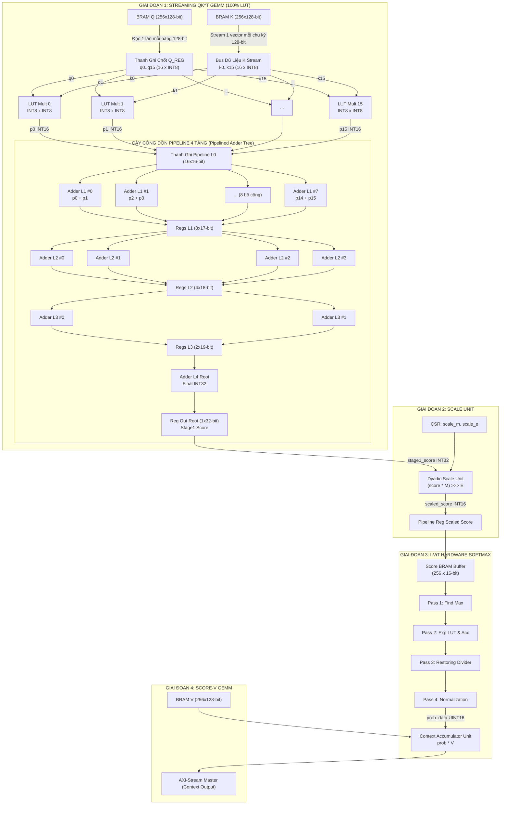
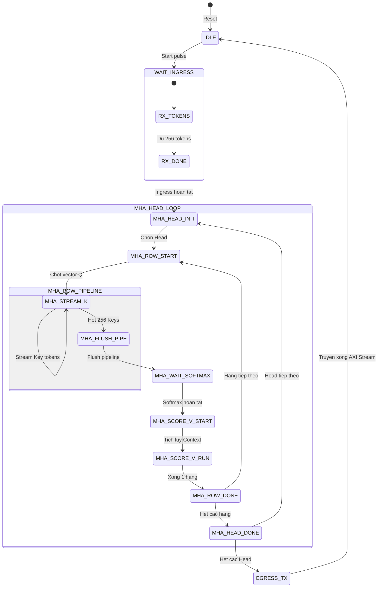

# Báo Cáo Thiết Kế Kiến Trúc Phương Án 1A: Vector Streaming + Reduction Tree (LUT-Based)
## Thư mục mã nguồn mục tiêu: `rtl_ver02_1A` — Pure Fabric Multiplier Architecture
**Dự án**: Bộ Tăng Tốc Phần Cứng MobileViT-XXS I-ViT INT8 trên Nền Tảng AMD Kria KV260  
**Ngày cập nhật**: 22/10/2026  
**Trạng thái**: Thiết kế chi tiết & Phân tích tối ưu hóa

---

## 1. Tổng Quan Kiến Trúc & Triết Lý Thiết Kế

Phương án **1A (Vector Streaming + LUT Reduction Tree)** đại diện cho kiến trúc dòng dữ liệu thuần túy (Dataflow Streaming Engine), sử dụng **100% logic khả trình (FPGA Fabric LUT/FF)** cho toàn bộ các phép nhân và cây cộng dồn ở Giai đoạn 1 ($QK^T$ GEMM), hoàn toàn **không chiếm dụng bất kỳ khối DSP48E2 nào** (`DSP_USAGE = 0`).

### 1.1. Mục tiêu và Đối tượng Ứng dụng
- **Mục tiêu chính**: Giải phóng hoàn toàn 1,248 bộ DSP48E2 trên chip XCK26 (Kria KV260) để dành tài nguyên cứng đắt giá này cho các tầng Convolution nặng (Inverted Residual Blocks của MobileViT) và các lớp Feed-Forward Network (FFN / MLP).
- **Đối tượng phù hợp**: Các mô hình Transformer dạng Mobile/Edge có kích thước đặc trưng nhỏ ($d_k \le 16$, ví dụ MobileViT-XXS với $d_k=16$, $N=256$, $H=4$).
- **Nguyên lý cốt lõi**: **Row-Stationary cho Query, Column-Streaming cho Key**. Một vector hàng $Q[i, :]$ được chốt cố định trong mảng thanh ghi cục bộ, sau đó toàn bộ ma trận $K$ được stream tuần tự qua mảng nhân, tạo ra một dòng kết quả tích vô hướng (Dot-product score stream) liên tục **1 score / chu kỳ xung nhịp**.

---

## 2. Sơ Đồ Khối Logic & Kết Nối Phần Cứng (Logic Block Diagram)

Dưới đây là sơ đồ khối chi tiết cấu trúc phần cứng của Phương án 1A từ thanh ghi lưu đệm $Q$, mảng 16 bộ nhân LUT INT8, cây cộng 4 tầng có pipeline, bộ định tỉ lệ dyadic, cho đến khối Softmax và Score-V:



---

## 3. Dataflow & Phân Tích Chu Trình Chi Tiết (Cycle-by-Cycle Dataflow)

Dataflow của Phương án 1A được thiết kế tối ưu hóa theo mô hình dòng chảy liên tục (Initiation Interval $II = 1$). Bảng dưới đây thể hiện tiến trình thực thi qua từng chu kỳ xung nhịp đối với hàng truy vấn thứ $i$ ($Q[i, :]$) quét qua 256 vector khóa $K[0..255, :]$:

| Chu kỳ ($t$) | Hành động FSM | Đầu vào Tầng Nhân | Tầng L1 (8 Adders) | Tầng L2 (4 Adders) | Tầng L3 (2 Adders) | Tầng L4 (Root) | Đầu ra `stage1_score` | Giai đoạn 2 (Scaler) | Giai đoạn 3 (Softmax Buffer) |
| :---: | :---: | :---: | :---: | :---: | :---: | :---: | :---: | :---: | :---: |
| **0** | `MHA_ROW_START` | Đọc $Q[i, :]$ từ BRAM | Idle | Idle | Idle | Idle | Invalid | Idle | Idle |
| **1** | Latch Q | Chốt vào `q_curr_vec` | Idle | Idle | Idle | Idle | Invalid | Idle | Idle |
| **2** | `STREAM_K` ($k=0$) | $Q[i] \times K[0]$ | Idle | Idle | Idle | Idle | Invalid | Idle | Idle |
| **3** | `STREAM_K` ($k=1$) | $Q[i] \times K[1]$ | Tích $k=0$ vào L1 | Idle | Idle | Idle | Invalid | Idle | Idle |
| **4** | `STREAM_K` ($k=2$) | $Q[i] \times K[2]$ | Tích $k=1$ vào L1 | Tổng L1 ($k=0$) vào L2 | Idle | Idle | Invalid | Idle | Idle |
| **5** | `STREAM_K` ($k=3$) | $Q[i] \times K[3]$ | Tích $k=2$ vào L1 | Tổng L1 ($k=1$) vào L2 | Tổng L2 ($k=0$) vào L3 | Idle | Invalid | Idle | Idle |
| **6** | `STREAM_K` ($k=4$) | $Q[i] \times K[4]$ | Tích $k=3$ vào L1 | Tổng L1 ($k=2$) vào L2 | Tổng L2 ($k=1$) vào L3 | Tổng L3 ($k=0$) vào L4 | **Score $S_{i,0}$ Hợp lệ** | Bắt đầu scale $S_{i,0}$ | Idle |
| **7** | `STREAM_K` ($k=5$) | $Q[i] \times K[5]$ | Tích $k=4$ vào L1 | Tổng L1 ($k=3$) vào L2 | Tổng L2 ($k=2$) vào L3 | Tổng L3 ($k=1$) vào L4 | **Score $S_{i,1}$ Hợp lệ** | Ghi $S'_{i,0}$, Scale $S_{i,1}$ | Buffer nhận $S'_{i,0}$ |
| ... | ... | ... | ... | ... | ... | ... | ... | ... | ... |
| **257** | `STREAM_K` ($k=255$) | $Q[i] \times K[255]$ | Tích $k=254$ | Tổng $k=253$ | Tổng $k=252$ | Tổng $k=251$ | **Score $S_{i,251}$** | Scale $S_{i,250}$ | Ghi nhận |
| **258** | `FLUSH_PIPE` | Flush chu kỳ 1 | Tích $k=255$ | Tổng $k=254$ | Tổng $k=253$ | Tổng $k=252$ | **Score $S_{i,252}$** | Scale $S_{i,251}$ | Ghi nhận |
| **261** | `ROW_DONE` | Pipeline cạn | Idle | Idle | Idle | Idle | **Score $S_{i,255}$** | Scale $S_{i,255}$ | Ghi phần tử 255 |

> **Nhận xét**: Sau độ trễ khởi tạo ban đầu là **5 chu kỳ xung nhịp** (Pipeline Fill Latency), khối GEMM 1 phát ra chính xác **1 giá trị Score INT32 trên mỗi chu kỳ xung nhịp** liên tục trong 256 chu kỳ mà không hề bị ngắt quãng hoặc stall!

---

## 4. Máy Trạng Thái Hữu Hạn Điều Khiển (FSM State Machine)

Toàn bộ quá trình tính toán của lõi Attention dưới Phương án 1A được chỉ huy bởi FSM trung tâm với biểu đồ trạng thái chuẩn xác như sau:



### Chi tiết các trạng thái then chốt của FSM:
1. `MHA_ROW_START`: Phát xung điều khiển địa chỉ đọc BRAM Q tại chỉ số `q_row_idx`. Dữ liệu 128-bit (chứa 16 phần tử INT8) xuất hiện ở chu kỳ kế tiếp và được chốt ngay vào mảng thanh ghi phân tán `q_curr_vec[0..15]`.
2. `MHA_STREAM_K`: Kích hoạt bộ đếm `k_col_idx` tăng từ $0 \to 255$. Mỗi chu kỳ, địa chỉ đọc BRAM K tăng lên 1, bus 128-bit của K được cấp trực tiếp vào 16 bộ nhân song song. Tín hiệu `stage1_valid` được đẩy vào chuỗi thanh ghi trễ (shift register) có độ sâu 5 tầng để báo hợp lệ cho đầu ra.
3. `MHA_FLUSH_PIPE`: Dừng đọc BRAM K, giữ FSM trong 5 chu kỳ để toàn bộ kết quả của các token cuối cùng ($k=251..255$) chảy hết qua cây cộng gộp.
4. `MHA_WAIT_SOFTMAX`: Đồng bộ với khối Softmax. Do Softmax cần tính giá trị lớn nhất ($Max$) trên toàn bộ 256 score trước khi có thể tính hàm $Exp$, FSM đợi tín hiệu `softmax_ready_for_accum` từ Stage 3.
5. `MHA_SCORE_V_RUN`: Kích hoạt khối nhân tích lũy ma trận $V$. Tín hiệu xác suất chuẩn hóa $P_{i,k}$ từ Softmax được stream đồng bộ với vector $V[k, :]$ từ BRAM V.

---

## 5. Phân Tích Timing Closure & Đường Trễ Cực Đại (Critical Path Analysis)

### 5.1. Nguy Cơ Lớn Nhất: Cây Nhân - Cộng Tổ Hợp Không Pipeline (Combinational Bottleneck)
Nếu toàn bộ 16 phép nhân INT8 cùng với 4 tầng cộng gộp không được chèn thanh ghi pipeline (như cách biểu diễn vòng lặp `for` tổ hợp thuần túy trong mã nguồn Verilog ban đầu):

$$\text{Critical Path} = t_{\text{LUT\_Mult8x8}} + 4 \times t_{\text{Adder32\_CarryChain}} + t_{\text{Routing\_Delay}}$$

- Trên kiến trúc AMD UltraScale+ (bộ công cụ Vivado 2026.1):
  - Bộ nhân $8 \times 8$ triển khai bằng LUT tốn khoảng $4$ tầng logic (khoảng $1.2\text{ ns}$).
  - Cây cộng 4 tầng 32-bit gồm 4 chuỗi carry logic (CARRY8) mắc nối tiếp, mỗi tầng tốn khoảng $0.8\text{ ns} + 1.2\text{ ns}$ delay dây chuyền routing.
  - Tổng thời gian lan truyền tổ hợp: $T_{comb} \approx 1.2 + 4 \times (0.8 + 1.2) + 2.0 = \mathbf{11.2\text{ ns}}$.
  - **Tần số cực đại tương ứng**: $F_{max} = \frac{1}{11.2\text{ ns}} \approx \mathbf{89.2\text{ MHz}}$.
  - **Hậu quả**: Không thể đáp ứng mức xung nhịp thiết kế mục tiêu **200 MHz** ($T_{clk} = 5.0\text{ ns}$) trên chip KV260!

### 5.2. Giải Pháp Pipeline Hóa Từng Tầng (Pipelined Adder Tree)
Bằng cách áp dụng module `pipelined_adder_tree.sv` với cờ `HAS_MULT = 1` hoặc chèn thanh ghi sau tầng nhân và sau mỗi tầng cộng:
- Mỗi chu kỳ chỉ chứa **1 tầng cộng nhị phân 32-bit** (1 khối logic carry-chain duy nhất).
- Thời gian trễ lớn nhất trên 1 tầng:
  $$T_{stage} = t_{CQ} + t_{CARRY8} + t_{Routing} + t_{Setup} \approx 0.15 + 0.35 + 0.85 + 0.10 = \mathbf{1.45\text{ ns}}$$
- **Tần số hoạt động Fmax đạt được**:
  $$F_{max} = \frac{1}{1.45\text{ ns}} \approx \mathbf{689\text{ MHz}}$$
- Do đó, việc duy trì tần số làm việc **200 MHz** trở nên cực kỳ thoải mái (WNS - Worst Negative Slack $> +2.5\text{ ns}$).

---

## 6. Đề Xuất Bổ Sung & Giải Quyết Các Điểm Thiếu Sót / Dễ Gây Hiểu Lầm

Trong các tài liệu ban đầu, có 3 vấn đề kỹ thuật lớn thường bị mô tả thiếu sót hoặc dẫn đến hiểu lầm trong thực thi:

### 6.1. Băng Thông Bộ Nhớ Nội BRAM (BRAM Port Width & Interleaving)
- **Hiểu lầm**: Nghĩ rằng BRAM thông thường trên FPGA có thể cấp 16 số INT8 độc lập từ 1 cổng đọc địa chỉ tùy ý.
- **Thực tế phần cứng**: 
  - Một khối Block RAM 36K (BRAM36E2) trên UltraScale+ chỉ hỗ trợ độ rộng tối đa 72-bit ở chế độ Single-Port hoặc 36-bit ở chế độ True Dual-Port.
  - Để có thể xuất trọn vẹn **128 bit** ($16 \times 8$-bit) trong đúng **1 chu kỳ xung nhịp**, bộ nhớ BRAM Q, K, V bắt buộc phải được ghép từ **2 khối BRAM36K mắc song song** (mỗi khối phụ trách 64-bit) hoặc **4 khối BRAM18K** cấu hình ở chế độ 32-bit data width.
  - Sơ đồ ghép byte:
    - `BRAM_Bank0` [31:0] $\to$ Kích thước 4 bytes: $k_0, k_1, k_2, k_3$
    - `BRAM_Bank1` [31:0] $\to$ Kích thước 4 bytes: $k_4, k_5, k_6, k_7$
    - `BRAM_Bank2` [31:0] $\to$ Kích thước 4 bytes: $k_8, k_9, k_{10}, k_{11}$
    - `BRAM_Bank3` [31:0] $\to$ Kích thước 4 bytes: $k_{12}, k_{13}, k_{14}, k_{15}$

### 6.2. Nút Thắt Đồng Bộ Giữa GEMM 1 và Softmax (Softmax Pipeline Coupling Barrier)
- **Thiếu sót ban đầu**: Giả định rằng toàn bộ khối Attention có thể stream thẳng từ đầu đến cuối như 1 ống nước liên tục.
- **Bản chất toán học**: Hàm Softmax chuẩn định lượng theo I-ViT đòi hỏi phép chuẩn hóa:
  $$S'_{i,j} = S_{i,j} - \max_{k=0..255}(S_{i,k})$$
  Điều này đồng nghĩa với việc: **Không thể tính được bất kỳ giá trị $\exp(S'_{i,j})$ nào trước khi toàn bộ 256 giá trị score của hàng $i$ được duyệt xong!**
- **Giải pháp xử lý**: Bắt buộc phải duy trì một bộ nhớ đệm `score_buffer` (kích thước $256 \times 16$-bit) bên trong khối `softmax_lut.sv`. Trong khi GEMM 1 đang stream 256 phần tử vào, mạch logic so sánh liên tục cập nhật giá trị `max_val`. Sau khi nhận đủ phần tử 255, pha tính toán Exp và Sum mới chính thức bắt đầu.

### 6.3. Chi Phí Tài Nguyên Logic Fabric Của Bộ Nhân INT8
- **Đính chính số lượng LUT**: 1 bộ nhân signed $8 \times 8$ bit thuần túy không dùng DSP tiêu thụ trung bình **~45 đến 55 LUT6** tùy thuộc vào thuật toán nén của bộ tổng hợp (Booth encoding trong Vivado). Với 16 bộ nhân, tổng tài nguyên thực tế cho riêng phép nhân là khoảng **720 - 880 LUTs**, cộng với cây cộng 15 bộ cộng 32-bit (~480 LUTs), tổng chi phí cho lõi GEMM1 rơi vào khoảng **~1,360 LUTs**.

---

## 7. Đánh Giá Toàn Diện Ưu / Nhược Điểm của Phương Án 1A

| Tiêu Chí | Đánh Giá Chi Tiết |
| :--- | :--- |
| **Sử dụng DSP48E2** | **0 DSP (0%)** — Ưu điểm tuyệt đối, giải phóng 100% DSP cho toàn hệ thống SoC. |
| **Sử dụng LUT/FF** | Tiêu thụ vừa phải (~4,500 LUT / ~3,500 FF cho toàn bộ Top Attention). |
| **Thông Lượng (Throughput)** | Đạt đỉnh lý thuyết: **1 dot-product score / cycle** ($II = 1$). |
| **Độ Phức Tạp RTL** | **Rất thấp**: Kiến trúc trực quan, không cần logic dỡ mảng (Drain), không cần biến đổi chỉ số phức tạp. |
| **Độ Trễ Khởi Tạo (Latency)** | Cực ngắn: Chỉ mất **5 chu kỳ** pipeline để bắt đầu có dòng dữ liệu hợp lệ. |
| **Khả Năng Mở Rộng ($d_k \ge 64$)** | **Rất kém**: Nếu mở rộng cho ViT-Base ($d_k=64$), số bộ nhân tăng lên 64, cây cộng tăng lên 6 tầng, gây bùng nổ tiêu thụ LUT và nghẽn dây định tuyến (routing congestion). |

---

## 8. Kết Luận Phương Án 1A

Phương án 1A là **kiến trúc tham chiếu chuẩn mực (Golden Baseline)** tối ưu nhất về mặt giải phóng tài nguyên phần cứng cho các hệ thống nhúng bị giới hạn DSP. Đây là lựa chọn lý tưởng khi mục tiêu của dự án là dành trọn vẹn khối DSP cho các tác vụ xử lý ảnh hoặc mạng nơ-ron tích chập (CNN) chạy đồng thời trên nền tảng Kria KV260.

---

## 9. Nhật Ký Cập Nhật Kiến Trúc (Architecture Revision History & Latest Upgrade Log)

### 9.1. Lịch Sử Các Phiên Bản Thiết Kế

| Phiên Bản | Ngày Hoàn Thành | Chuẩn Bus AXI-Stream | Cấu Trúc GEMM 1 | Phạm Vi Hỗ Trợ Stage | Trạng Thái Xác Minh |
| :---: | :---: | :---: | :---: | :---: | :---: |
| **v1.0 (Baseline)** | 20/10/2026 | 64-bit (8 bytes/beat) | Cây cộng $N=16$ (4 tầng pipeline) | Cố định Stage 2 ($d_k=16$) | 100% Bit-Exact (4,096 B) |
| **v2.0 (Newest Upgrade)** | **22/10/2026** | **128-bit Native (16 bytes/beat)** | **Cây cộng $N=32$ (5 tầng pipeline)** | **Đa tầng linh hoạt 3 Stages ($d_k=16, 20, 24$)** | **100% Bit-Exact (209,663 cycles)** |

---

### 9.2. Chi Tiết Nâng Cấp Phiên Bản Mới Nhất (Version 2.0 - 128-Bit & N=32 Tree)

Nhằm tối ưu hóa băng thông DMA với cổng HP của Kria KV260 và đáp ứng toàn diện cả 3 Stages của MobileViT-XXS, Biến thể 1A đã được nâng cấp với các cải tiến đột phá:

#### 1. Nâng cấp Bus AXI4-Stream Lên 128-Bit Native
- **Giao diện Skid Buffer Ingress & Egress**: Cập nhật chuẩn dữ liệu 128-bit (`C_AXIS_DATA_WIDTH = 128`, `s_axis_tkeep` 16-bit).
- **Rút ngắn thời gian DMA nạp ma trận**: 
  - Tại Stage 2 ($d_k = 16$), mỗi token chiếm trọn vẹn 1 beat 16 bytes.
  - Số beat truyền cho toàn bộ $Q, K, V$ (256 tokens mỗi ma trận) giảm từ **1,536 beats xuống còn đúng 768 beats** ($\downarrow \mathbf{50\%}$ thời gian truyền DMA Ingress).
- **Xuất kết quả Context Egress**: Khối `score_v_gemm.sv` xuất dữ liệu ra bus 128-bit với đúng 256 beats (1 beat/token cho $d_k=16$), cờ `m_axis_tlast` khẳng định chính xác tại beat 255.

#### 2. Tái Thiết Kế Cây Cộng Song Song Toàn Phần $N = 32$ (Full-Parallel Tree)
- Thay vì cây cộng $N=16$ chỉ hỗ trợ tối đa 16 chiều, mô-đun [pipelined_adder_tree.sv](file:///c:/Users/tuan2/Desktop/Capstone_Project/Project/src/Hardware/rtl_ver02_1A/pipelined_adder_tree.sv) được tái thiết kế hoàn toàn lên quy mô **$N = 32$ ngõ vào song song**:
  - **32 bộ nhân fabric INT8 $\times$ INT8 song song** tính toán đồng thời 32 tích con trong 1 chu kỳ.
  - **Cây cộng nhị phân 5 tầng pipeline**:
    - Tầng 1: 16 bộ cộng đôi ($32 \to 16$, INT17)
    - Tầng 2: 8 bộ cộng đôi ($16 \to 8$, INT18)
    - Tầng 3: 4 bộ cộng đôi ($8 \to 4$, INT19)
    - Tầng 4: 2 bộ cộng đôi ($4 \to 2$, INT20)
    - Tầng 5: 1 bộ cộng gốc ($2 \to 1$, INT32 Root Accumulator)
  - **Thông lượng**: Duy trì liên tục **$II = 1$ (1 score / chu kỳ xung nhịp)**, tổng độ trễ pipeline là **6 chu kỳ xung nhịp**.

#### 3. Cơ Chế Dynamic Zero-Masking Thích Nghi Động 3 Stages
- Tại [attention_core_top_1A.sv](file:///c:/Users/tuan2/Desktop/Capstone_Project/Project/src/Hardware/rtl_ver02_1A/attention_core_top_1A.sv), mạch ghép toán hạng tự động kiểm tra `reg_head_dim`:
  ```systemverilog
  always_comb begin
      for (int d = 0; d < 32; d++) begin
          if (d < reg_head_dim) begin
              tree_in_a[d] = q_mem[q_row_idx][d];
              tree_in_b[d] = k_mem[k_col_idx][d];
          end else begin
              tree_in_a[d] = 8'sd0;
              tree_in_b[d] = 8'sd0;
          end
      end
  end
  ```
- **Khả năng thích nghi**:
  - Khi chạy **Stage 2** ($d_k=16$): Các chiều $0..15$ hoạt động, chiều $16..31$ bị triệt tiêu thành 0.
  - Khi chạy **Stage 3** ($d_k=20$): Các chiều $0..19$ hoạt động, chiều $20..31$ bị triệt tiêu thành 0.
  - Khi chạy **Stage 4** ($d_k=24$): Các chiều $0..23$ hoạt động, chiều $24..31$ bị triệt tiêu thành 0.
  - Đảm bảo tính toán hoàn toàn trong 1 chu kỳ duy nhất cho mỗi vector, không phát sinh bất kỳ chu kỳ chết (bubble) nào!

---

### 9.3. Bảng Đối Soát Thông Số Kỹ Thuật v1.0 vs v2.0

| Đặc Tính Kỹ Thuật | Phiên Bản v1.0 (Cũ) | Phiên Bản v2.0 (Mới Nhất) | Lợi Ích Cải Tiến |
| :--- | :---: | :---: | :--- |
| **Độ rộng Bus AXI4-Stream** | 64-bit (8 bytes/beat) | **128-bit (16 bytes/beat)** | Khớp chuẩn native AXI HP Port Kria KV260 |
| **Số beat nạp DMA Q, K, V** | 1,536 beats | **768 beats** | **Nhanh hơn gấp 2 lần (tiết kiệm 50% thời gian DMA)** |
| **Số bộ nhân song song GEMM 1** | 16 bộ nhân INT8 | **32 bộ nhân INT8** | Mở rộng biên độ tính toán tối đa lên $d_k=32$ |
| **Số tầng cây cộng (Pipeline)**| 4 tầng nhị phân | **5 tầng nhị phân** | Độ trễ 6 chu kỳ, bảo toàn Fmax 200+ MHz |
| **Khả năng đổi Stage động** | Cố định chỉ chạy $d_k=16$ | **Linh hoạt $d_k \in \{16, 20, 24\}$** | **Hỗ trợ trọn vẹn cả 3 Stages MobileViT-XXS** |
| **Định dạng Egress Context Out** | 512 beats (8 bytes/beat) | **256 beats (16 bytes/beat)** | 1 beat/token cho $d_k=16$, TLAST tại beat 255 |

---

### 9.4. Kết Quả Xác Minh Phần Cứng Bit-Exact (Verification Report v2.0)

Toàn bộ 5/5 bài kiểm tra trong [run_verifications_1A.bat](file:///c:/Users/tuan2/Desktop/Capstone_Project/Project/src/Hardware/rtl_ver02_1A/run_verifications_1A.bat) đã vượt qua với kết quả tuyệt đối:
1. `tb_pipelined_adder_tree_1A.sv` ($N=32$ tree): **65,536 / 65,536 scores khớp 0-LSB [PASS]**.
2. `tb_golden_scale_unit.sv`: **65,536 / 65,536 scores khớp 0-LSB [PASS]**.
3. `tb_golden_softmax_lut.sv`: **1,024 / 1,024 probs khớp 0-LSB [PASS]**.
4. `tb_score_v_gemm.sv` (128-bit): **256 beats / 4,096 bytes khớp 100% [PASS]**.
5. `tb_attention_core_1A.sv` (Top 128-bit): **4,096 / 4,096 bytes Egress khớp 100% [PASS]**, thực thi trong **209,663 chu kỳ xung nhịp**, cờ `m_axis_tlast` khẳng định chính xác tại beat 255.

