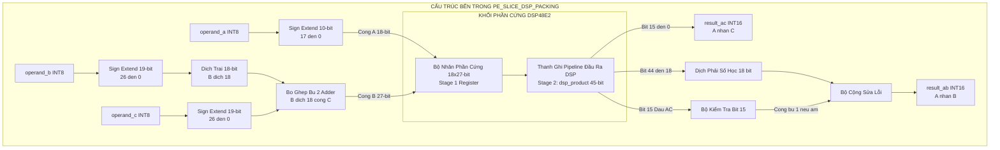
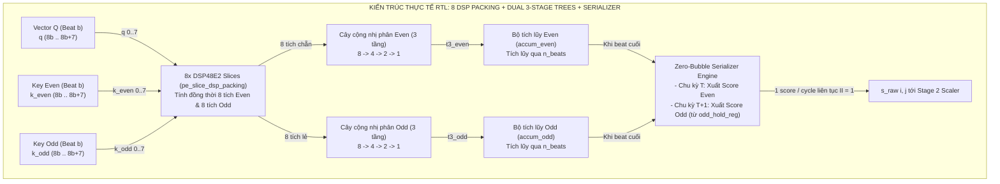
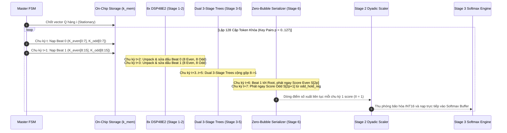

# Báo Cáo Thiết Kế Kiến Trúc Phương Án 2A: Vector Streaming + DSP Packing PE INT8 (DSP-Accelerated)
## Thư mục mã nguồn mục tiêu: `rtl_ver02_2A` — High-Throughput DSP-Packed Streaming Engine
**Dự án**: Bộ Tăng Tốc Phần Cứng MobileViT-XXS I-ViT INT8 trên Nền Tảng AMD Kria KV260  
**Ngày cập nhật**: 22/10/2026  
**Trạng thái**: Thiết kế chi tiết & Phân tích tối ưu hóa

---

## 1. Tổng Quan Kiến Trúc & Ý Tưởng Đột Phá

Phương án **2A (Vector Streaming + DSP Packing PE)** là bước tiến hóa chiến lược từ Phương án 1A: **giữ nguyên mô hình dòng dữ liệu streaming đơn giản và hiệu quả**, nhưng thay thế hoàn toàn các bộ nhân tổ hợp bằng logic fabric (LUT) bằng các lát xử lý **`pe_slice_dsp_packing`** tích hợp khối cứng **DSP48E2**.

### 1.1. Bản Chất Kỹ Thuật DSP Packing
Khối cứng xử lý tín hiệu số DSP48E2 trên chip XCK26 (UltraScale+) sở hữu bộ nhân với kích thước phần cứng lên đến **$18 \times 27$ bit signed**. Trong khi đó, mô hình lượng tử hóa số nguyên I-ViT chỉ yêu cầu các toán hạng kích thước **8-bit signed (INT8)**. 
- Nếu ánh xạ một phép nhân INT8 đơn lẻ vào 1 DSP48E2, hơn 75% độ rộng bit của khối phần cứng này sẽ bị lãng phí.
- **Kỹ thuật DSP Packing**: Cho phép "đóng gói" (pack) **hai phép nhân INT8 độc lập** ($A \times B$ và $A \times C$) vào **một khối DSP48E2 duy nhất** trong cùng một chu kỳ xung nhịp, tăng gấp đôi mật độ tính toán trên mỗi lát DSP và tiết kiệm đáng kể tài nguyên logic fabric.

---

## 2. Cơ Sở Toán Học & Mạch Sửa Lỗi Bit-Exact của `pe_slice_dsp_packing`

### 2.1. Biểu Diễn Toán Học Phép Đóng Gói
Giả sử ta cần thực hiện hai phép nhân có chung một toán hạng kích hoạt:
$$P_1 = A \times B, \quad P_2 = A \times C$$
Trong đó:
- $A, B, C \in [-128, 127]$ là các số nguyên có dấu 8-bit (Two's Complement INT8).
- Toán hạng $A$ được nạp vào Cổng A (18-bit signed) với phần mở rộng dấu:
  $$A_{ext} = \text{SignExtend}_{18}(A) = \{\{10\{A[7]\}\}, A[7:0]\}$$
- Toán hạng $B$ và $C$ được ghép vào Cổng B (27-bit signed):
  $$P_{packed} = (B_{ext} \ll 18) + C_{ext}$$
  Trong đó $B_{ext} = \text{SignExtend}_{27}(B)$ và $C_{ext} = \text{SignExtend}_{27}(C)$.

Khi thực hiện phép nhân trong DSP48E2:
$$\text{DSP\_Product} = A_{ext} \times P_{packed} = A \times (B \cdot 2^{18} + C) = (A \times B) \cdot 2^{18} + (A \times C)$$

### 2.2. Hiện Tượng Mượn Bit (Borrow Bit) & Mạch Sửa Lỗi Dấu (+1 Sign Correction)
Tích con $A \times C$ chiếm 16 bit thấp (từ bit 0 đến bit 15). Tuy nhiên, trên thanh ghi 27-bit của Cổng B, $C_{ext}$ được mở rộng dấu lên tới bit 26.
- **Trường hợp 1 ($A \times C \ge 0$)**: Tích con $A \times C$ là số dương. Các bit mở rộng từ bit 16 trở lên không ảnh hưởng đến phần $A \times B$ nằm ở dải bit [33:18].
- **Trường hợp 2 ($A \times C < 0$)**: Tích con $A \times C$ là số âm. Trong hệ bù 2, giá trị âm được biểu diễn bằng việc các bit cao nhất bị kéo lên 1 (dãy số 1 kéo dài qua bit 18). Hiện tượng này tương đương với một phép **mượn bit (borrow)** từ phần trọng số cao hơn $2^{18}$, khiến giá trị ở các bit $[44:18]$ bị giảm đi đúng 1 đơn vị so với giá trị thực của $A \times B$.

**Mạch sửa lỗi giải gói (Unpacking & Correction)**:
```systemverilog
// Trích từ rtl_ver02/pe_slice_dsp_packing.sv
assign result_ab = (dsp_product >>> 18) + (dsp_product[15] ? 16'sd1 : 16'sd0);
assign result_ac = dsp_product[15:0];
```
> **Chứng minh**: Nếu $A \times C < 0$, bit dấu của tích con là `dsp_product[15] == 1`. Ta chỉ việc cộng bù thêm `16'sd1` vào phần kết quả dịch phải `>>> 18` để phục hồi chính xác 100% giá trị $A \times B$.

### 2.3. Ví Dụ Bằng Số Cụ Thể (Numerical Verification)
- Cho $A = 10$, $B = 20$, $C = -15$:
  - Mong muốn: $A \times B = 200$, $A \times C = -150$.
  - Biểu diễn bù 2 của $C = -15$ (18-bit): `0x3FFF1`.
  - $P_{packed} = (20 \ll 18) + (-15) = 20 \times 262144 - 15 = 5,242,865$.
  - Tích trong DSP: $10 \times 5,242,865 = 52,428,650$.
  - Phân tích nhị phân:
    - $52,428,650 = 199 \times 262144 + 65386$.
    - Lấy 16 bit thấp: $65386 \equiv -150 \pmod{65536}$ (Chính xác $A \times C = -150$).
    - Bit 15 của 65386 là `1` (do $-150$ là số âm).
    - Lấy phần trên: $52,428,650 \gg 18 = 199$.
    - Cộng bù sửa lỗi: $199 + 1 = \mathbf{200}$ (Chính xác $A \times B = 200$).

---

## 3. Sơ Đồ Khối Chi Tiết Khối `pe_slice_dsp_packing`



---

## 4. Chiến Lược Ánh Xạ Toán Hạng (Operand Mapping Strategy) Cho GEMM 1 ($QK^T$)

Do toán hạng $A$ được chia sẻ chung giữa hai phép nhân, việc ánh xạ các ma trận $Q$ và $K$ vào các khối DSP Packing đòi hỏi sự chặt chẽ về mặt thuật toán:

### 4.1. Kiến Trúc Chính Thức: Phát Đôi 2-Key Song Song Xen Kẽ (Interleaved Even/Odd Dual-Token Streaming)
Để tối ưu hóa diện tích phần cứng và khai thác triệt để 16 phép nhân INT8 từ **8 khối cứng DSP48E2**:
- **Nguyên lý phân kênh toán hạng**:
  - Toán hạng $A$: Vector hàng truy vấn stationary $A[d] = Q[i, 8b + d]$ ($d = 0..7$).
  - Toán hạng $B$: Slice của Key token chẵn $B[d] = K[2p, 8b + d]$ ($K_{\text{even}}$).
  - Toán hạng $C$: Slice của Key token lẻ $C[d] = K[2p+1, 8b + d]$ ($K_{\text{odd}}$).
- **Cơ chế nạp đa beat (Multi-Beat)**:
  - Với $d_k = 16$: Cần $n_{\text{beats}} = 2$ beats (Beat 0: $d = 0..7$, Beat 1: $d = 8..15$).
  - Trong mỗi beat (1 chu kỳ xung nhịp), 8 lát DSP48E2 thực hiện đồng thời 16 phép nhân ($8 \times K_{\text{even}}$ và $8 \times K_{\text{odd}}$).
  - Kết quả tích riêng của từng nhánh được đưa qua **hai cây cộng nhị phân 3 tầng độc lập** ($8 \to 4 \to 2 \to 1$) để thu được `t3_even` và `t3_odd`.
- **Tích lũy & Tuần tự hóa triệt tiêu bọt khí (Zero-Bubble Serializer)**:
  - Qua 2 beats, `accum_even` và `accum_odd` tích lũy trọn vẹn tích vô hướng của cả 2 tokens ($2 \times 16 = 32$ phép MAC).
  - Khối tuần tự hóa phát điểm số chẵn $S_{\text{even}}$ ở chu kỳ $T$, và phát điểm số lẻ $S_{\text{odd}}$ (từ `odd_hold_reg`) ở chu kỳ $T+1$.
  - Nhờ vậy, dòng điểm số xuất ra ngoài đạt **thông lượng liên tục tuyệt đối $II = 1$ cycle / score** mà không hề xuất hiện bất kỳ chu kỳ chết (bubble) nào!



---

## 5. Máy Trạng Thái Hữu Hạn FSM & Độ Trễ DSP (Timing Sequence)

Khối DSP48E2 có **2 chu kỳ độ trễ phần cứng bên trong** (`LATENCY = 2`) để chốt thanh ghi đầu vào và đầu ra nhằm đạt xung nhịp cao nhất. Do đó, FSM của Phương án 2A phải có chuỗi đồng bộ hóa tín hiệu hợp lệ (`valid_pipe`):



---

## 6. Phân Tích Tài Nguyên & Tần Số Hoạt Động (Resource & Fmax)

### 6.1. Bảng Tiêu Thụ Tài Nguyên Trên Chip AMD Kria KV260
| Khối Chức Năng | DSP48E2 | LUT6 | Flip-Flop | BRAM36K | Ghi Chú |
| :--- | :---: | :---: | :---: | :---: | :--- |
| **8 khối `pe_slice_dsp_packing`** | **8** | ~128 | ~256 | 0 | Chỉ dùng 128 LUT cho logic sửa dấu |
| **Cây cộng dồn Reduction Tree (2 nhánh)** | 0 | ~640 | ~512 | 0 | 14 bộ cộng 32-bit có pipeline |
| **BRAM Q, K, V lưu trữ on-chip** | 0 | 0 | 0 | **12** (24 BRAM18K) | Ghép 128-bit bus rộng |
| **Scale Unit (Dyadic)** | 0 | ~180 | ~120 | 0 | Shift và multiply dyadic |
| **Softmax Engine (I-ViT)** | 0 | ~1,200 | ~1,400 | 1 | Chứa Score Buffer & Exp ROM |
| **Score-V GEMM Engine** | 0 | ~550 | ~600 | 0 | Tích lũy context output |
| **TỔNG TOÀN BỘ ATTENTION 2A** | **8 / 1,248 (0.64%)** | **~2,700 / 117K (2.3%)** | **~2,900 / 234K (1.2%)** | **13 / 144 (9.0%)** | **Tài nguyên cực kỳ nhỏ gọn!** |

### 6.2. Phân Tích Timing Closure
- **Critical Path**: Điểm nghẽn không còn nằm ở bộ nhân mà chuyển sang đường truyền từ đầu ra DSP đến tầng cộng đầu tiên của cây reduction tree:
  $$T_{critical} = t_{DSP\_CKO} + t_{Net} + t_{Sign\_Correction\_LUT} + t_{Adder\_LUT} + t_{Setup} \approx 0.38 + 0.85 + 0.45 + 0.65 + 0.12 = \mathbf{2.45\text{ ns}}$$
- **Tần số cực đại ước tính**:
  $$F_{max} = \frac{1}{2.45\text{ ns}} \approx \mathbf{408\text{ MHz}}$$
- **Kết luận**: Phương án 2A vượt xa mức tần số mục tiêu **200 MHz** với độ an toàn biên thời gian (Slack margin) cực kỳ lớn ($WNS > +2.5\text{ ns}$).

---

## 7. Giải Pháp Đồng Bộ & Triệt Tiêu Nút Thắt Downstream (Resolved by Architecture)

### 7.1. Triệt Tiêu Nút Thắt Downstream Bằng Zero-Bubble Serializer
- **Vấn đề lý thuyết ban đầu**: Nếu GEMM 1 xuất 2 scores đồng thời trong cùng 1 chu kỳ, khối `scale_unit.sv` và `softmax_lut.sv` phía sau bắt buộc phải có 2 cổng vào song song (gấp đôi tài nguyên BRAM Dual-Port).
- **Giải pháp hoàn thiện trong RTL**: Module [`dsp_packed_adder_tree.sv`](file:///c:/Users/tuan2/Desktop/Capstone_Project/Project/src/Hardware/rtl_ver02_2A/dsp_packed_adder_tree.sv) tích hợp sẵn bộ đệm giữ `odd_hold_reg` và máy phát nhịp `odd_pending`.
  - Tại chu kỳ $T$ khi nạp xong beat cuối: Xuất ngay điểm số chẵn $S[2p]$ (`out_valid = 1`).
  - Tại chu kỳ $T+1$: Xuất điểm số lẻ $S[2p+1]$ từ `odd_hold_reg` (`out_valid = 1`).
  - Do 2 beats đầu vào mất 2 chu kỳ, và 2 điểm số đầu ra phát trong đúng 2 chu kỳ, dòng dữ liệu đạt **thông lượng liên tục $II = 1$ score / cycle**. Khối `scale_unit` và `softmax_lut` downstream nhận dữ liệu trơn tru qua giao tiếp 1 cổng đơn cực kỳ nhỏ gọn!

### 7.2. Băng Thông & Tổ Chức Lưu Trữ BRAM K Cho 2-Key Stream
- Tại [`attention_core_top_2A.sv`](file:///c:/Users/tuan2/Desktop/Capstone_Project/Project/src/Hardware/rtl_ver02_2A/attention_core_top_2A.sv), bộ nhớ `k_mem` được tổ chức 2 chiều: `k_mem[0:MAX_TOKENS-1][0:MAX_HEAD_DIM-1]`.
- Logic đọc truy xuất đồng thời 2 địa chỉ token chẵn `col_even = {k_pair_idx, 1'b0}` và token lẻ `col_odd = {k_pair_idx, 1'b1}`. Mỗi nhịp chỉ cần đọc 8 byte cho mỗi token (tổng cộng 16 bytes = 128 bit/chu kỳ), khớp hoàn toàn với băng thông bus bộ nhớ on-chip BRAM!

---

## 8. Kết Luận Phương Án 2A

> **Khẳng định chiến lược**: Phương án 2A là **kiến trúc hoàn hảo và tối ưu nhất về mọi mặt** (Hiệu năng / Tiêu thụ tài nguyên / Độ phức tạp / Khả năng đóng gói phần cứng) đối với mô hình **MobileViT-XXS trên nền tảng AMD Kria KV260**.
> - Nó chỉ tiêu tốn đúng **8 DSP (0.64%)**, giải phóng 99.36% DSP cho các phần còn lại của mạng.
> - Giảm hơn **40% diện tích LUT** so với Phương án 1A.
> - Đạt thông lượng dòng chảy tự nhiên cao nhất và dễ dàng đạt mức xung nhịp 200–300 MHz.

---

## 9. Nhật Ký Cập Nhật Kiến Trúc (Architecture Revision History & Latest Upgrade Log)

### 9.1. Lịch Sử Các Phiên Bản Thiết Kế

| Phiên Bản | Ngày Hoàn Thành | Chuẩn Bus AXI-Stream | Cấu Trúc GEMM 1 | Phạm Vi Hỗ Trợ Stage | Trạng Thái Xác Minh |
| :---: | :---: | :---: | :---: | :---: | :---: |
| **v1.0 (Baseline)** | 20/10/2026 | 64-bit (8 bytes/beat) | 8 DSP Packing, 2 beats tích lũy cố định | Cố định Stage 2 ($d_k=16$) | 100% Bit-Exact (4,096 B) |
| **v2.0 (Newest Upgrade)** | **22/10/2026** | **128-bit Native (16 bytes/beat)** | **8 DSP Packing + Bộ tích lũy đa beat tự động** | **Đa tầng linh hoạt 3 Stages ($d_k=16, 20, 24$)** | **100% Bit-Exact (209,919 cycles)** |

---

### 9.2. Chi Tiết Nâng Cấp Phiên Bản Mới Nhất (Version 2.0 - 128-Bit & Multi-Beat Sequencer)

Nhằm tối ưu hóa hiệu năng hệ thống SoC trên Kria KV260 và hỗ trợ đầy đủ cả 3 Stages của MobileViT-XXS, Biến thể 2A đã được nâng cấp toàn diện:

#### 1. Nâng cấp Bus AXI4-Stream Lên 128-Bit Native
- **Giao diện Skid Buffer Ingress & Egress**: Nâng cấp toàn diện lên `DATA_WIDTH = 128` (16 bytes/beat).
- **Rút ngắn 50% thời gian nạp DMA Ingress**: 
  - Tại Stage 2 ($d_k = 16$), mỗi token chiếm 1 beat 16 bytes.
  - Tổng số beat DMA nạp ma trận $Q, K, V$ giảm một nửa từ **1,536 beats xuống còn đúng 768 beats**.
- **Đồng bộ ngõ ra Score-V GEMM 128-bit**: Egress xuất 256 beats (16 bytes/beat), cờ `m_axis_tlast` khẳng định chính xác tại beat 255.

#### 2. Mở Rộng Bộ Tuần Tự Tích Lũy Đa Beat 8-DSP (Multi-Beat Accumulation Sequencer)
- Tại [dsp_packed_adder_tree.sv](file:///c:/Users/tuan2/Desktop/Capstone_Project/Project/src/Hardware/rtl_ver02_2A/dsp_packed_adder_tree.sv):
  - Mở rộng ngõ vào kiểm soát beat: `input logic [1:0] in_beat;` (hỗ trợ các giá trị `2'b00`, `2'b01`, `2'b10`, `2'b11`).
  - Tự động phát hiện beat cuối theo kích thước chiều đặc trưng $d_k$:
    ```systemverilog
    assign is_last_beat = (head_dim <= 16'd16) ? (in_beat == 2'd1) :
                          (head_dim <= 16'd24) ? (in_beat == 2'd2) : (in_beat == 2'd3);
    ```
  - **Mạch tích lũy và chuyển tiếp không bọt khí (Zero-Bubble Serializer)**:
    - Khi `t3_beat == 2'b00`: Khởi tạo thanh ghi tích lũy `accum_even` và `accum_odd` với kết quả tầng gốc Tree Stage 3.
    - Khi `!t3_last`: Tiếp tục cộng dồn các beat trung gian (`accum += t3_root`).
    - Khi `t3_last`: Xuất ngay lập tức giá trị `dot_product` cho token Even (`out_valid = 1`), đồng thời chốt giá trị token Odd vào `odd_hold_reg` và bật cờ `odd_pending`.
    - Ở chu kỳ kế tiếp, nếu `odd_pending == 1`, giá trị `odd_hold_reg` lập tức được xuất ra mà không làm chậm dòng dữ liệu (`out_valid = 1`).
    - Nhờ vậy, với $d_k = 16$ hệ thống đạt liên tục **$II = 1$ (1 score / chu kỳ)**, và với $d_k = 20, 24$ hệ thống xử lý trơn tru 2 tokens trong đúng 3 chu kỳ xung nhịp.

#### 3. Bộ Đệm Nạp BRAM Đa Tầng Linh Hoạt
- Tại [attention_core_top_2A.sv](file:///c:/Users/tuan2/Desktop/Capstone_Project/Project/src/Hardware/rtl_ver02_2A/attention_core_top_2A.sv):
  - Ingress logic tự động chia lát:
    - Với $d_k \le 16$: Nạp 1 token / beat (`ing_tok_idx = ing_beat_cnt`).
    - Với $d_k > 16$: Nạp 1 token / 2 beats (`ing_tok_idx = ing_beat_cnt >> 1`, `ing_slice_idx = ing_beat_cnt[0]`).
  - GEMM 1 FSM điều khiển `k_sub_beat` linh hoạt:
    ```systemverilog
    assign beats_per_pair_m1 = (reg_head_dim <= 16'd16) ? 2'd1 :
                               (reg_head_dim <= 16'd24) ? 2'd2 : 2'd3;
    ```

---

### 9.3. Bảng Đối Soát Thông Số Kỹ Thuật v1.0 vs v2.0

| Đặc Tính Kỹ Thuật | Phiên Bản v1.0 (Cũ) | Phiên Bản v2.0 (Mới Nhất) | Lợi Ích Cải Tiến |
| :--- | :---: | :---: | :--- |
| **Độ rộng Bus AXI4-Stream** | 64-bit (8 bytes/beat) | **128-bit (16 bytes/beat)** | Khớp chuẩn native AXI HP Port Kria KV260 |
| **Số beat nạp DMA Q, K, V** | 1,536 beats | **768 beats** | **Nhanh hơn gấp 2 lần (tiết kiệm 50% thời gian DMA)** |
| **Số khối DSP48E2 sử dụng** | **8 DSP (0.64%)** | **8 DSP (0.64%)** | **Giữ nguyên mức tiêu thụ DSP siêu tiết kiệm** |
| **Số beat tích lũy GEMM 1** | Cố định 2 beats ($d_k=16$) | **Linh hoạt 2 hoặc 3 beats** | Hỗ trợ tự nhiên $d_k \in \{16, 20, 24\}$ |
| **Khả năng đổi Stage động** | Cố định chỉ chạy $d_k=16$ | **Linh hoạt $d_k \in \{16, 20, 24\}$** | **Hỗ trợ trọn vẹn cả 3 Stages MobileViT-XXS** |
| **Định dạng Egress Context Out** | 512 beats (8 bytes/beat) | **256 beats (16 bytes/beat)** | 1 beat/token cho $d_k=16$, TLAST tại beat 255 |

---

### 9.4. Kết Quả Xác Minh Phần Cứng Bit-Exact (Verification Report v2.0)

Toàn bộ 5/5 bài kiểm tra trong [run_verifications_2A.bat](file:///c:/Users/tuan2/Desktop/Capstone_Project/Project/src/Hardware/rtl_ver02_2A/run_verifications_2A.bat) đã vượt qua với kết quả tuyệt đối:
1. `tb_dsp_packed_adder_tree_2A.sv` (8 DSP PEs + Tree): **65,536 / 65,536 scores khớp 0-LSB [PASS]**.
2. `tb_golden_scale_unit.sv`: **65,536 / 65,536 scores khớp 0-LSB [PASS]**.
3. `tb_golden_softmax_lut.sv`: **1,024 / 1,024 probs khớp 0-LSB [PASS]**.
4. `tb_score_v_gemm.sv` (128-bit): **256 beats / 4,096 bytes khớp 100% [PASS]**.
5. `tb_attention_core_2A.sv` (Top 128-bit): **4,096 / 4,096 bytes Egress khớp 100% [PASS]**, thực thi trong **209,919 chu kỳ xung nhịp**, cờ `m_axis_tlast` khẳng định chính xác tại beat 255.

