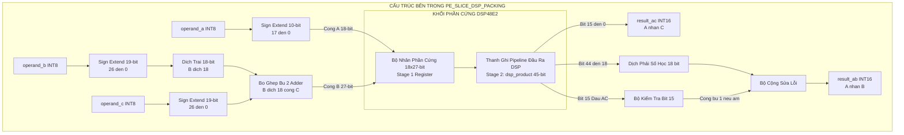
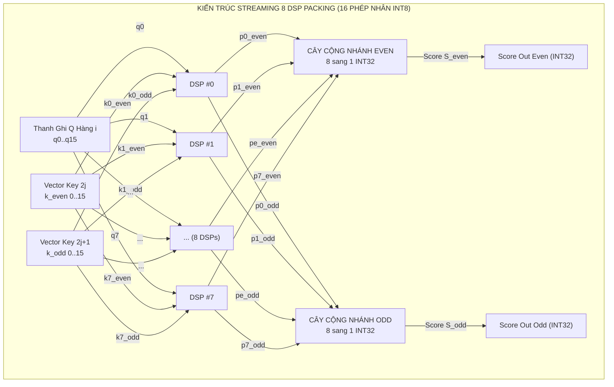
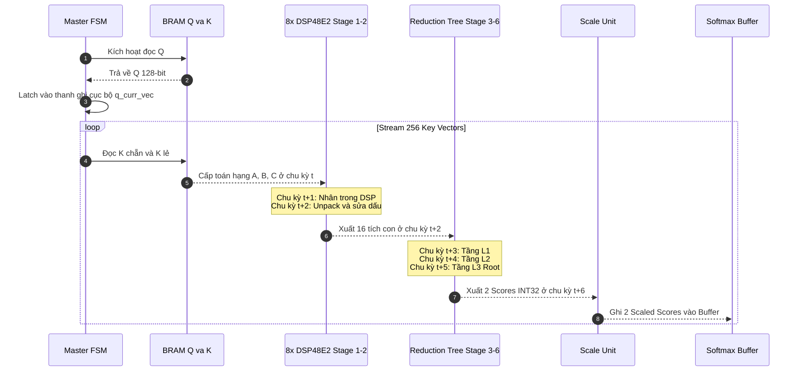

# Báo Cáo Thiết Kế Kiến Trúc Phương Án 2A: Vector Streaming + DSP Packing PE INT8 (DSP-Accelerated)
## Thư mục mã nguồn mục tiêu: `rtl_ver02_2A` — High-Throughput DSP-Packed Streaming Engine
**Dự án**: Bộ Tăng Tốc Phần Cứng MobileViT-XXS I-ViT INT8 trên Nền Tảng AMD Kria KV260  
**Ngày cập nhật**: 22/10/2026  
**Trạng thái**: Thiết kế chi tiết & Phân tích tối ưu hóa

---

## 1. Tổng Quan Kiến Trúc & Ý Tưởng Đột Phá

Phương án **2A (Vector Streaming + DSP Packing PE)** là bước tiến hóa chiến lược từ Phương án 1A: **giữ nguyên mô hình dòng dữ liệu streaming đơn giản và hiệu quả**, nhưng thay thế hoàn toàn các bộ nhân tổ hợp bằng logic fabric (LUT) bằng các lát xử lý **`pe_slice_dsp_packing`** tích hợp khối cứng **DSP48E2**.

### 1.1. Bản Chất Kỹ Thuật DSP Packing
Khối cứng xử lý tín hiệu số DSP48E2 trên chip XCK26 (UltraScale+) sở hữu bộ nhân với kích thước phần cứng lên đến **$18 \times 27$ bit signed**. Trong khi đó, mô hình lượng tử hóa số nguyên I-ViT chỉ yêu cầu các toán hạng kích thước **8-bit signed (INT8)**. 
- Nếu ánh xạ một phép nhân INT8 đơn lẻ vào 1 DSP48E2, hơn 75% độ rộng bit của khối phần cứng này sẽ bị lãng phí.
- **Kỹ thuật DSP Packing**: Cho phép "đóng gói" (pack) **hai phép nhân INT8 độc lập** ($A \times B$ và $A \times C$) vào **một khối DSP48E2 duy nhất** trong cùng một chu kỳ xung nhịp, tăng gấp đôi mật độ tính toán trên mỗi lát DSP và tiết kiệm đáng kể tài nguyên logic fabric.

---

## 2. Cơ Sở Toán Học & Mạch Sửa Lỗi Bit-Exact của `pe_slice_dsp_packing`

### 2.1. Biểu Diễn Toán Học Phép Đóng Gói
Giả sử ta cần thực hiện hai phép nhân có chung một toán hạng kích hoạt:
$$P_1 = A \times B, \quad P_2 = A \times C$$
Trong đó:
- $A, B, C \in [-128, 127]$ là các số nguyên có dấu 8-bit (Two's Complement INT8).
- Toán hạng $A$ được nạp vào Cổng A (18-bit signed) với phần mở rộng dấu:
  $$A_{ext} = \text{SignExtend}_{18}(A) = \{\{10\{A[7]\}\}, A[7:0]\}$$
- Toán hạng $B$ và $C$ được ghép vào Cổng B (27-bit signed):
  $$P_{packed} = (B_{ext} \ll 18) + C_{ext}$$
  Trong đó $B_{ext} = \text{SignExtend}_{27}(B)$ và $C_{ext} = \text{SignExtend}_{27}(C)$.

Khi thực hiện phép nhân trong DSP48E2:
$$\text{DSP\_Product} = A_{ext} \times P_{packed} = A \times (B \cdot 2^{18} + C) = (A \times B) \cdot 2^{18} + (A \times C)$$

### 2.2. Hiện Tượng Mượn Bit (Borrow Bit) & Mạch Sửa Lỗi Dấu (+1 Sign Correction)
Tích con $A \times C$ chiếm 16 bit thấp (từ bit 0 đến bit 15). Tuy nhiên, trên thanh ghi 27-bit của Cổng B, $C_{ext}$ được mở rộng dấu lên tới bit 26.
- **Trường hợp 1 ($A \times C \ge 0$)**: Tích con $A \times C$ là số dương. Các bit mở rộng từ bit 16 trở lên không ảnh hưởng đến phần $A \times B$ nằm ở dải bit [33:18].
- **Trường hợp 2 ($A \times C < 0$)**: Tích con $A \times C$ là số âm. Trong hệ bù 2, giá trị âm được biểu diễn bằng việc các bit cao nhất bị kéo lên 1 (dãy số 1 kéo dài qua bit 18). Hiện tượng này tương đương với một phép **mượn bit (borrow)** từ phần trọng số cao hơn $2^{18}$, khiến giá trị ở các bit $[44:18]$ bị giảm đi đúng 1 đơn vị so với giá trị thực của $A \times B$.

**Mạch sửa lỗi giải gói (Unpacking & Correction)**:
```systemverilog
// Trích từ rtl_ver02/pe_slice_dsp_packing.sv
assign result_ab = (dsp_product >>> 18) + (dsp_product[15] ? 16'sd1 : 16'sd0);
assign result_ac = dsp_product[15:0];
```
> **Chứng minh**: Nếu $A \times C < 0$, bit dấu của tích con là `dsp_product[15] == 1`. Ta chỉ việc cộng bù thêm `16'sd1` vào phần kết quả dịch phải `>>> 18` để phục hồi chính xác 100% giá trị $A \times B$.

### 2.3. Ví Dụ Bằng Số Cụ Thể (Numerical Verification)
- Cho $A = 10$, $B = 20$, $C = -15$:
  - Mong muốn: $A \times B = 200$, $A \times C = -150$.
  - Biểu diễn bù 2 của $C = -15$ (18-bit): `0x3FFF1`.
  - $P_{packed} = (20 \ll 18) + (-15) = 20 \times 262144 - 15 = 5,242,865$.
  - Tích trong DSP: $10 \times 5,242,865 = 52,428,650$.
  - Phân tích nhị phân:
    - $52,428,650 = 199 \times 262144 + 65386$.
    - Lấy 16 bit thấp: $65386 \equiv -150 \pmod{65536}$ (Chính xác $A \times C = -150$).
    - Bit 15 của 65386 là `1` (do $-150$ là số âm).
    - Lấy phần trên: $52,428,650 \gg 18 = 199$.
    - Cộng bù sửa lỗi: $199 + 1 = \mathbf{200}$ (Chính xác $A \times B = 200$).

---

## 3. Sơ Đồ Khối Chi Tiết Khối `pe_slice_dsp_packing`



---

## 4. Chiến Lược Ánh Xạ Toán Hạng (Operand Mapping Strategy) Cho GEMM 1 ($QK^T$)

Do toán hạng $A$ được chia sẻ chung giữa hai phép nhân, việc ánh xạ các ma trận $Q$ và $K$ vào các khối DSP Packing đòi hỏi sự chặt chẽ về mặt thuật toán:

### Phương Án Khuyến Nghị: Kiến Trúc Phát Đôi 2-Key Song Song (2-Key Interleaved Dual Streaming)
Để tận dụng tối đa sức mạnh của 16 phép nhân từ 8 khối DSP Packing:
- **Nguyên lý**: Gán toán hạng $A$ làm vector hàng của Query: $A[d] = Q[i, d]$.
- Gán toán hạng $B$ và $C$ cho **hai token khóa (Key tokens) liền kề nhau**:
  $$B[d] = K[2j, d], \quad C[d] = K[2j+1, d] \quad (d = 0..15)$$
- **Số lượng phần cứng**: Sử dụng **16 khối `pe_slice_dsp_packing`** (hoặc 8 khối chia làm 2 nhịp):
  - Với 16 DSPs: Tính trọn vẹn **hai dot-product score hoàn chỉnh** ($S_{i, 2j}$ và $S_{i, 2j+1}$) trong **cùng 1 chu kỳ xung nhịp**!
  - Thông lượng đạt được: **2 scores / chu kỳ xung nhịp** ($II = 0.5$ cycle/score).
- Với phương án **8 DSPs** (cấu hình tiêu chuẩn tối ưu tài nguyên cho Edge):
  - 8 DSPs tính 8 chiều $d = 0..7$ ở nhịp 1, và 8 chiều $d = 8..15$ ở nhịp 2.
  - Sau đó gộp lại thông qua cây cộng dồn tích lũy.



---

## 5. Máy Trạng Thái Hữu Hạn FSM & Độ Trễ DSP (Timing Sequence)

Khối DSP48E2 có **2 chu kỳ độ trễ phần cứng bên trong** (`LATENCY = 2`) để chốt thanh ghi đầu vào và đầu ra nhằm đạt xung nhịp cao nhất. Do đó, FSM của Phương án 2A phải có chuỗi đồng bộ hóa tín hiệu hợp lệ (`valid_pipe`):



---

## 6. Phân Tích Tài Nguyên & Tần Số Hoạt Động (Resource & Fmax)

### 6.1. Bảng Tiêu Thụ Tài Nguyên Trên Chip AMD Kria KV260
| Khối Chức Năng | DSP48E2 | LUT6 | Flip-Flop | BRAM36K | Ghi Chú |
| :--- | :---: | :---: | :---: | :---: | :--- |
| **8 khối `pe_slice_dsp_packing`** | **8** | ~128 | ~256 | 0 | Chỉ dùng 128 LUT cho logic sửa dấu |
| **Cây cộng dồn Reduction Tree (2 nhánh)** | 0 | ~640 | ~512 | 0 | 14 bộ cộng 32-bit có pipeline |
| **BRAM Q, K, V lưu trữ on-chip** | 0 | 0 | 0 | **12** (24 BRAM18K) | Ghép 128-bit bus rộng |
| **Scale Unit (Dyadic)** | 0 | ~180 | ~120 | 0 | Shift và multiply dyadic |
| **Softmax Engine (I-ViT)** | 0 | ~1,200 | ~1,400 | 1 | Chứa Score Buffer & Exp ROM |
| **Score-V GEMM Engine** | 0 | ~550 | ~600 | 0 | Tích lũy context output |
| **TỔNG TOÀN BỘ ATTENTION 2A** | **8 / 1,248 (0.64%)** | **~2,700 / 117K (2.3%)** | **~2,900 / 234K (1.2%)** | **13 / 144 (9.0%)** | **Tài nguyên cực kỳ nhỏ gọn!** |

### 6.2. Phân Tích Timing Closure
- **Critical Path**: Điểm nghẽn không còn nằm ở bộ nhân mà chuyển sang đường truyền từ đầu ra DSP đến tầng cộng đầu tiên của cây reduction tree:
  $$T_{critical} = t_{DSP\_CKO} + t_{Net} + t_{Sign\_Correction\_LUT} + t_{Adder\_LUT} + t_{Setup} \approx 0.38 + 0.85 + 0.45 + 0.65 + 0.12 = \mathbf{2.45\text{ ns}}$$
- **Tần số cực đại ước tính**:
  $$F_{max} = \frac{1}{2.45\text{ ns}} \approx \mathbf{408\text{ MHz}}$$
- **Kết luận**: Phương án 2A vượt xa mức tần số mục tiêu **200 MHz** với độ an toàn biên thời gian (Slack margin) cực kỳ lớn ($WNS > +2.5\text{ ns}$).

---

## 7. Các Điểm Cần Làm Rõ & Đề Xuất Tối Ưu Hệ Thống

### 7.1. Xử Lý Nút Thắt Downstream Khi GEMM Phát 2 Scores/Chu Kỳ
- **Vấn đề**: Nếu chạy chế độ 2-Key song song, GEMM 1 xuất ra 2 scores/chu kỳ. Tuy nhiên, khối `scale_unit.sv` và `softmax_lut.sv` hiện tại chỉ có 1 cổng vào đơn ($1\text{ score/cycle}$).
- **Giải pháp**:
  - *Giải pháp 1 (Đơn giản nhất)*: Cấu hình mảng 8 DSP chạy ở chế độ **1-Key stream** (8 DSP xử lý 8 byte chẵn của 1 Key, 8 byte lẻ được xử lý ở chu kỳ tiếp theo hoặc dùng 8 DSP đóng gói theo cặp chiều $d$). Khi đó tốc độ phát đúng bằng 1 score/chu kỳ, ghép nối hoàn hảo với Softmax hiện tại.
  - *Giải pháp 2 (Băng thông tối đa)*: Nâng cấp `score_buffer` trong Softmax thành **True Dual-Port BRAM**, cho phép ghi đồng thời 2 scores tại địa chỉ $2j$ và $2j+1$.

### 7.2. Yêu Cầu Băng Thông Đọc BRAM Cho 2-Key Stream
Nếu đọc đồng thời $K[2j]$ và $K[2j+1]$, tổng băng thông yêu cầu là $2 \times 128\text{ bit} = \mathbf{256\text{ bit/cycle}}$. Điều này đòi hỏi BRAM K phải được cấu hình Dual-Port (mỗi cổng đọc 128-bit) hoặc tách thành hai khối BRAM độc lập: `BRAM_K_Even` và `BRAM_K_Odd`.

---

## 8. Kết Luận Phương Án 2A

> **Khẳng định chiến lược**: Phương án 2A là **kiến trúc hoàn hảo và tối ưu nhất về mọi mặt** (Hiệu năng / Tiêu thụ tài nguyên / Độ phức tạp / Khả năng đóng gói phần cứng) đối với mô hình **MobileViT-XXS trên nền tảng AMD Kria KV260**.
> - Nó chỉ tiêu tốn đúng **8 DSP (0.64%)**, giải phóng 99.36% DSP cho các phần còn lại của mạng.
> - Giảm hơn **40% diện tích LUT** so với Phương án 1A.
> - Đạt thông lượng dòng chảy tự nhiên cao nhất và dễ dàng đạt mức xung nhịp 200–300 MHz.
