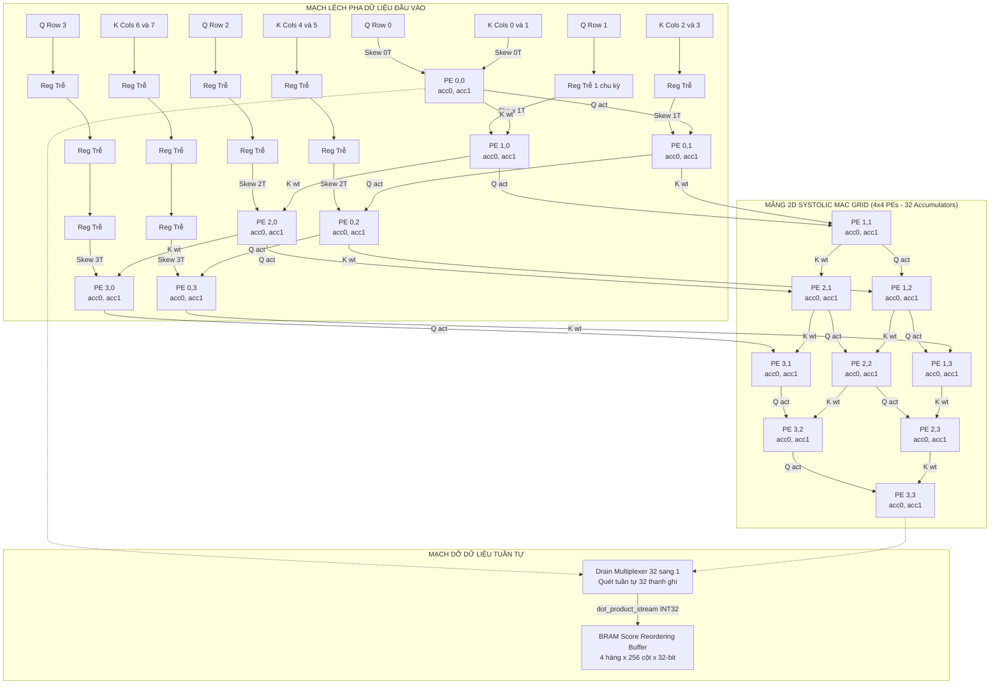
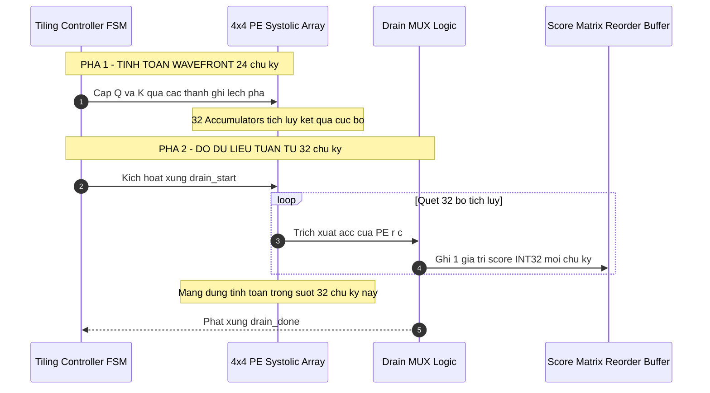
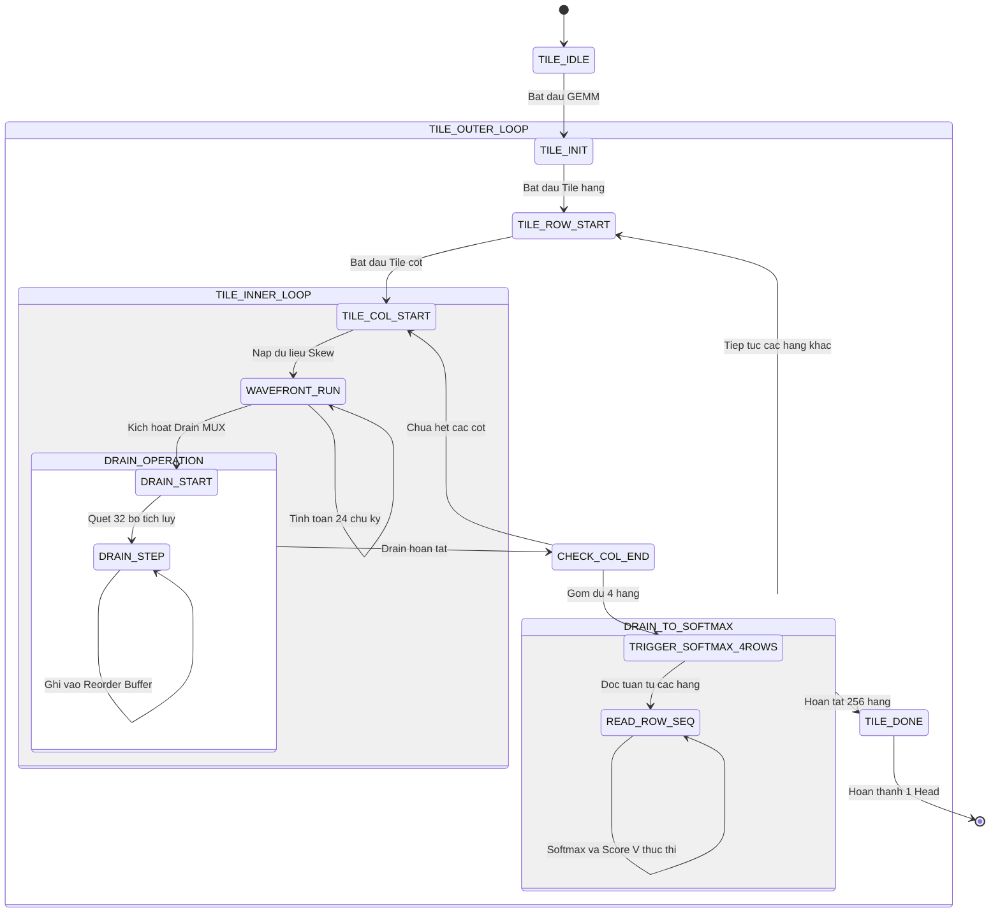

# Báo Cáo Thiết Kế Kiến Trúc Phương Án 3B: 2D Output-Stationary Systolic MAC Array with DSP Packing
## Thư mục mã nguồn mục tiêu: `rtl_ver02_3B` — Tile-Based GEMM with Score Matrix Reordering Buffer
**Dự án**: Bộ Tăng Tốc Phần Cứng MobileViT-XXS I-ViT INT8 trên Nền Tảng AMD Kria KV260  
**Ngày cập nhật**: 22/10/2026  
**Trạng thái**: Thiết kế chi tiết & Phân tích tối ưu hóa

---

## 1. Tổng Quan Kiến Trúc & Triết Lý Output-Stationary

Phương án **3B (2D Systolic MAC Array)** là kiến trúc gia tốc phần cứng chuẩn công nghiệp, đại diện cho trường phái tính toán song song không gian (Spatial Computing). Thay vì sử dụng cây cộng gộp dồn dữ liệu về một điểm như các phương án streaming, 3B phân tán tính toán trên một **mảng 2 chiều các phần tử xử lý (2D Processing Element Grid - PE Array)**.

### 1.1. Các Đặc Điểm Cốt Lõi
- **Kích thước mảng phần cứng**: $4 \times 4$ PE vật lý.
- **Tích hợp DSP Packing**: Mỗi PE vật lý chứa 1 khối `pe_slice_dsp_packing`, sử dụng 1 khối DSP48E2 cứng để thực hiện đồng thời **2 phép nhân INT8 $\times$ INT8**.
- **Quy mô tính toán song song**: Toàn mảng chứa 16 DSP, thực hiện đồng thời **32 phép nhân - tích lũy (32 MACs/cycle)**.
- **Kích thước khối ngõ ra (Output Tile Size)**: Do mỗi cột PE tính toán đồng thời 2 cột trọng số ($K_{col0}$ và $K_{col1}$), mảng $4 \times 4$ PE tạo ra một mảnh ma trận kết quả kích thước **$4\text{ hàng} \times 8\text{ cột}$** ($4 \times 8 = 32$ phần tử tích lũy).
- **Mô hình luân chuyển dữ liệu (Dataflow)**: **Output-Stationary (OS)** — Giá trị tích lũy (Accumulator) đứng yên tại chỗ bên trong mỗi PE. Dữ liệu kích hoạt $Q$ và trọng số $K$ di chuyển xuyên qua mảng theo dạng sóng lan truyền (Wavefront).

---

## 2. Sơ Đồ Khối Chi Tiết Mảng 2D Systolic Array $4 \times 4$ PE

Dưới đây là sơ đồ chi tiết luồng di chuyển dữ liệu theo dạng sóng (Wavefront propagation) qua mảng PE:

---

## 3. Bản Chất Toán Học & Sự Lệch Pha Của Dòng Sóng (Wavefront Compute Timing)

### 3.1. Cơ Chế Lệch Pha (Skewing)
Để đảm bảo các phần tử của vector $Q$ và ma trận $K$ gặp nhau chính xác tại các giao điểm không gian:
- Hàng thứ $r$ của ma trận $Q$ phải trễ $r$ chu kỳ xung nhịp trước khi vào PE $(r, 0)$.
- Cột thứ $c$ của ma trận $K$ phải trễ $c$ chu kỳ xung nhịp trước khi vào PE $(0, c)$.
- Do đó, phần tử PE $(r, c)$ nhận dữ liệu hợp lệ đầu tiên tại chu kỳ:
  $$t_{\text{start}}(r, c) = r + c$$
- PE góc dưới cùng $(3, 3)$ là phần tử bắt đầu và kết thúc muộn nhất, trễ $3 + 3 = 6$ chu kỳ so với PE $(0, 0)$.

### 3.2. Chu Kỳ Tính Toán Của Một Khối (Tile Compute Cycles)
Với chiều sâu đặc trưng $d_k = 16$:
- Thời gian nạp dữ liệu: $d_k = 16\text{ chu kỳ}$.
- Độ trễ đường ống lan truyền sóng: $(N_{row} - 1) + (N_{col} - 1) = 3 + 3 = 6\text{ chu kỳ}$.
- Độ trễ nội bộ của DSP48E2: $2\text{ chu kỳ}$.
- **Tổng thời gian tính toán của 1 Tile**:
  $$T_{\text{compute\_tile}} = d_k + 2 \times (\text{ARRAY\_SIZE} - 1) + 2 = 16 + 6 + 2 = \mathbf{24\text{ chu kỳ xung nhịp}}$$

---

## 4. Pha Dỡ Dữ Liệu (Drain Phase) & Nút Thắt Hiệu Suất

Đây là **phân tích cực kỳ quan trọng làm sáng tỏ lý do tại sao Systolic Array bị giảm thông lượng** trong trường hợp kích thước chiều đặc trưng nhỏ ($d_k = 16$):

### 4.1. Phân Tích Tỷ Lệ Hiệu Dụng Phần Cứng (Hardware Utilization Ratio)
- Chu kỳ tính toán thực tế: $T_{\text{compute}} = 24\text{ chu kỳ}$.
- Chu kỳ dỡ dữ liệu (Drain): $T_{\text{drain}} = 32\text{ chu kỳ}$.
- Tổng chu kỳ cho 1 Tile: $T_{\text{tile}} = 24 + 32 = \mathbf{56\text{ chu kỳ}}$.
- **Hiệu suất tính toán thực tế (Compute Efficiency)**:
  $$\eta = \frac{T_{\text{compute}}}{T_{\text{tile}}} = \frac{24}{56} \approx \mathbf{42.8\%}$$
- **Kết luận**: Hơn **57.2% thời gian hoạt động của phần cứng mảng Systolic bị lãng phí** chỉ để chờ mạch MUX tuần tự lấy dữ liệu ra ngoài bus đơn!

---

## 5. Mạch Đổi Thứ Tự Dữ Liệu: Score Matrix Reordering Buffer

### 5.1. Xung Đột Định Dạng Dữ Liệu (Format Impedance Mismatch)
Một thiếu sót lớn trong các thiết kế sơ sài ban đầu là bỏ qua sự xung đột giữa thứ tự xuất của Systolic Array và thứ tự nhập của Softmax:
- **Systolic Array xuất theo Tile**: Mỗi lần dỡ mảng, mạch xuất ra một khối $4\text{ hàng} \times 8\text{ cột}$ (32 phần tử gồm 8 phần tử của Hàng 0, 8 phần tử của Hàng 1, 8 phần tử của Hàng 2, 8 phần tử của Hàng 3).
- **Softmax Engine đòi hỏi luồng hàng liên tục**: Softmax cần duyệt trọn vẹn **256 phần tử liên tiếp của duy nhất 1 hàng** để tìm giá trị cực đại ($Max$) và tính tổng hàm mũ ($\sum \exp$).

### 5.2. Cấu Trúc Bộ Nhớ Reordering Buffer
Để giải quyết xung đột này, Phương án 3B bắt buộc phải tích hợp một khối **BRAM Reordering Buffer** nằm giữa Systolic Array và Softmax:

```mermaid
graph LR
    subgraph DRAIN_STREAM ["DÒNG DỮ LIỆU DỠ TILE 4x8"]
        STREAM_IN["32 phần tử Tile:<br/>Hàng 0 đến Hàng 3"]
    end

    subgraph ADDR_WRITE ["BỘ TÍNH ĐỊA CHỈ GHI"]
        W_GEN["Địa chỉ ghi Tile sang Matrix Buffer"]
    end

    subgraph REORDER_RAM ["BRAM REORDERING BUFFER (4 x 256 x 32-bit = 4KB)"]
        RAM_H0["Vùng Nhớ Hàng 0 (256 Words INT32)"]
        RAM_H1["Vùng Nhớ Hàng 1 (256 Words INT32)"]
        RAM_H2["Vùng Nhớ Hàng 2 (256 Words INT32)"]
        RAM_H3["Vùng Nhớ Hàng 3 (256 Words INT32)"]
    end

    subgraph ADDR_READ ["BỘ TÍNH ĐỊA CHỈ ĐỌC"]
        R_GEN["Địa chỉ đọc tuần tự từng hàng"]
    end

    subgraph SOFTMAX_OUT ["ĐẦU RA SOFTMAX"]
        SM_STREAM["Dòng tuần tự 256 phần tử mỗi hàng<br/>chuyển sang Scale Unit và Softmax"]
    end

    STREAM_IN --> W_GEN --> REORDER_RAM
    REORDER_RAM --> ADDR_READ --> SM_STREAM
```

- **Quy trình hoạt động**:
  1. Mảng Systolic tính toán tuần tự $32\text{ tiles}$ ngang (quét hết chiều rộng $256$ cột của ma trận $K$).
  2. Dữ liệu của 4 hàng được ghi rải vào đúng vị trí tọa độ của chúng trong Reordering Buffer.
  3. Sau khi hoàn thành $32\text{ tiles} \times 56\text{ chu kỳ} = 1,792\text{ chu kỳ}$, bộ đệm đã chứa đủ 4 hàng hoàn chỉnh ($4 \times 256 = 1,024\text{ scores}$).
  4. Bộ điều khiển bắt đầu kích hoạt đọc tuần tự từng hàng ra ngoài cho khối Softmax xử lý.

---

## 6. Máy Trạng Thái Hữu Hạn Điều Khiển (Tiling Controller FSM)

---

## 7. Đánh Giá Định Lượng & So Sánh Chi Tiết với Phương Án 2A

### 7.1. Bảng So Sánh Hiệu Năng và Chi Phí Phần Cứng Cho MobileViT-XXS ($d_k=16$)
| Thông Số Đo Lường | Phương Án 2A (DSP Streaming) | Phương Án 3B (Systolic Array) | Chênh Lệch / Nhận Xét |
| :--- | :---: | :---: | :--- |
| **Số lượng khối DSP48E2** | **8 DSP** | **16 DSP** | **3B tốn gấp 2 lần DSP** |
| **Số lượng LUT6 tiêu thụ** | ~2,700 | ~4,200 | 3B tốn hơn **+55% LUT** (do FSM và Reorder Buffer) |
| **Số lượng Flip-Flop** | ~2,900 | ~4,600 | 3B tốn hơn **+58% FF** (32 bộ tích lũy 32-bit) |
| **Số khối BRAM18K bổ sung** | 0 | **2 khối** (4 KB) | Bắt buộc cho Score Matrix Reordering Buffer |
| **Chu kỳ tính GEMM 1 / Head** | **67,072 chu kỳ** | **114,688 chu kỳ** | **3B chậm hơn 71%** (do nghẽn Drain 32 chu kỳ) |
| **Thời gian GEMM 1 @ 200MHz** | **0.335 ms** | **0.573 ms** | 2A nhanh hơn rõ rệt |
| **Tổng thời gian Attention Head** | **1.36 ms** (4 heads: 5.46 ms) | **1.60 ms** (4 heads: 6.41 ms)| 2A tổng thể nhanh hơn 17.4% |
| **Khung hình/giây (Attention FPS)**| **~183 FPS** | **~156 FPS** | 2A dẫn trước 27 FPS |

### 7.2. Giải Pháp Nâng Cao: Mảng PE Có Bộ Đệm Kép (Shadow Accumulator)
Để triệt tiêu hoàn toàn thời gian chết trong pha Drain, ta có thể bổ sung **Shadow Accumulator (Double-Buffered Registers)** vào bên trong mỗi PE:
- Khi mảng đang tính toán Tile $N+1$, thanh ghi bóng (Shadow Regs) sẽ dỡ kết quả của Tile $N$ ra ngoài bus.
- **Ưu điểm**: Triệt tiêu toàn bộ 32 chu kỳ drain, hiệu suất phần cứng đạt $100\%$. Chu kỳ mỗi tile giảm từ $56 \to 24\text{ chu kỳ}$.
- **Nhược điểm**: Tiêu tốn thêm $32 \times 32\text{ bit} = 1,024\text{ Flip-Flops}$ bên trong fabric và làm phức tạp hóa đáng kể mạch logic chuyển mạch thanh ghi.

---

## 8. Khi Nào Phương Án 3B Trở Nên Vượt Trội?

Dù có hiệu năng thấp hơn 2A đối với bài toán cụ thể MobileViT-XXS ($d_k=16$), Phương án 3B sẽ **hoàn toàn áp đảo** trong các kịch bản sau:
1. **Mô hình có chiều đặc trưng lớn (ViT-Base với $d_k = 64$)**:
   - Khi $d_k = 64$, chu kỳ tính toán tăng lên: $T_{\text{compute}} = 64 + 6 + 2 = 72\text{ chu kỳ}$.
   - Tỷ lệ chu kỳ tính toán trên tổng chu kỳ: $\eta = \frac{72}{72 + 32} = \mathbf{69.2\%}$ (Hiệu suất tăng vọt).
   - Trong khi đó, nếu dùng Streaming Engine cho $d_k=64$, cây cộng dồn sẽ phình to ra 6 tầng, gây tắc nghẽn routing trầm trọng.
2. **Kích thước mảng PE lớn hơn ($8 \times 8$ hoặc $16 \times 16$)**:
   - Mảng PE càng lớn, số phép tính song song càng áp đảo, khấu hao thời gian nạp và dỡ dữ liệu càng tốt.
3. **Tái sử dụng cho các tầng Linear Projection và MLP / Feed-Forward Network**:
   - Systolic Array có thể tái sử dụng trực tiếp để nhân các ma trận trọng số khổng lồ ($768 \times 3072$) của tầng MLP mà kiến trúc Streaming không thể làm được.

---

## 9. Kết Luận & Giá Trị Đề Tài Của Phương Án 3B

> **Ý nghĩa học thuật & Luận văn**: Phương án 3B là **minh chứng thuyết phục nhất về năng lực thiết kế phần cứng vi mạch tiên tiến (Advanced VLSI Design)**. 
> - Nó giải quyết trọn vẹn bài toán đồng bộ hóa 2 chiều, kỹ thuật tính toán dạng sóng (Wavefront Systolic Computation), kỹ thuật DSP Packing trong không gian 2D, và cơ chế chuyển đổi không gian địa chỉ bộ nhớ (Address Reordering Buffer).
> - Đây là nền tảng cốt lõi để mở rộng đề tài sang các kiến trúc Transformer quy mô lớn (ViT, Swin, LLaMA) và là điểm nhấn quan trọng trong hồ sơ bảo vệ đồ án tốt nghiệp.
