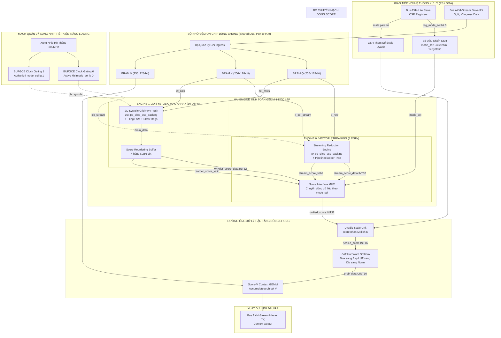
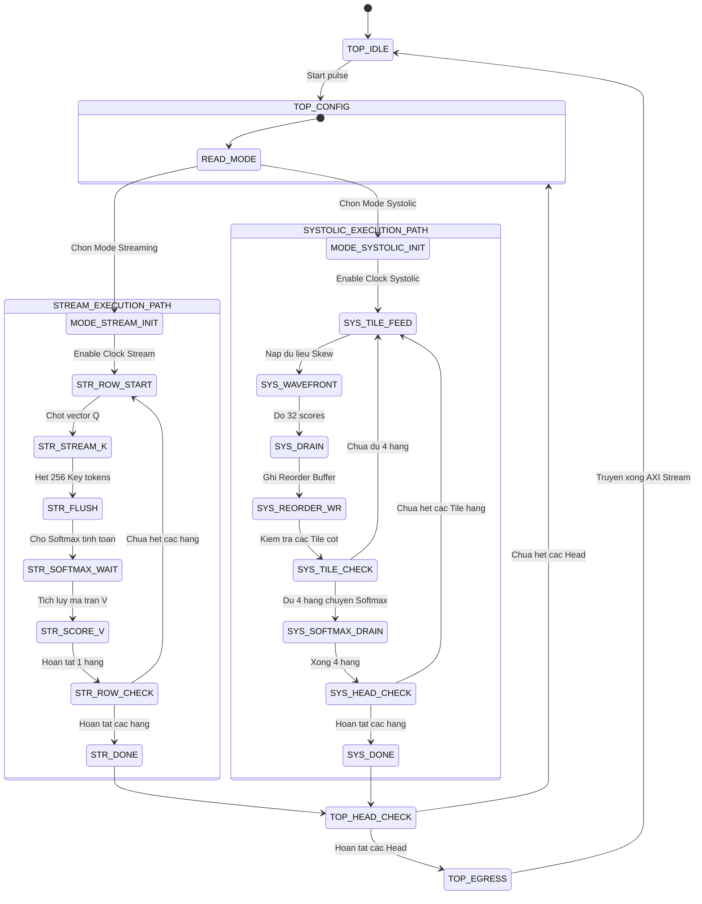
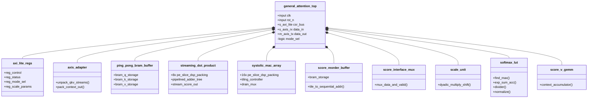
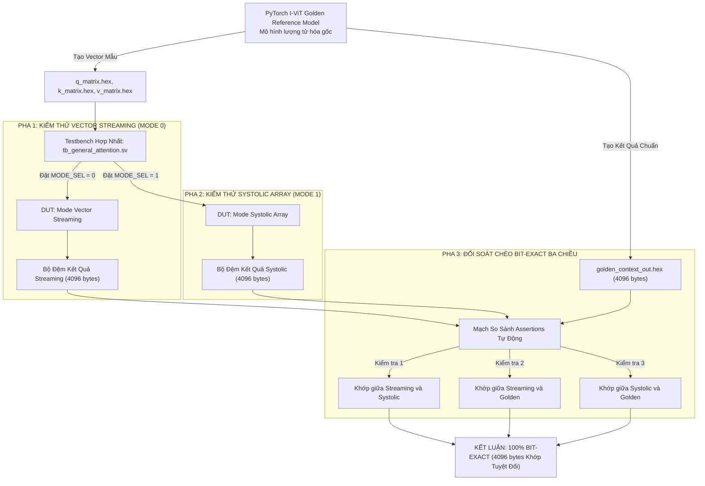

# Báo Cáo Thiết Kế Kiến Trúc Phương Án 4C: General Configurable Attention Top Module
## Thư mục mã nguồn mục tiêu: `rtl_ver02_4C` — Unified Multi-Mode Attention Core (`MODE_SEL`)
**Dự án**: Bộ Tăng Tốc Phần Cứng MobileViT-XXS I-ViT INT8 trên Nền Tảng AMD Kria KV260  
**Ngày cập nhật**: 22/10/2026  
**Trạng thái**: Thiết kế chi tiết & Phân tích tối ưu hóa

---

## 1. Tổng Quan Kiến Trúc & Tầm Nhìn Chiến Lược

Phương án **4C (General Configurable Attention Top Module)** là kiến trúc đỉnh cao kết hợp tinh hoa của cả hai trường phái thiết kế: **Vector Streaming Engine (từ 2A)** và **2D Systolic MAC Array Engine (từ 3B)** vào trong một lõi IP phần cứng thống nhất duy nhất.

### 1.1. Khả Năng Tái Cấu Hình Động (Runtime Dynamic Reconfigurability)
Người dùng hoặc bộ xử lý trung tâm (ARM Cortex-A53 trên Zynq UltraScale+ PS) có thể chuyển đổi linh hoạt mô hình tính toán thông qua thanh ghi điều khiển **`reg_mode_sel`** qua bus AXI4-Lite:
- **`MODE_SEL = 0` (Vector Streaming Engine)**: Kích hoạt luồng xử lý streaming chuyên dụng. Tối ưu hóa cực hạn về độ trễ và thông lượng cho các mô hình Transformer dòng Mobile/Edge có kích thước vector ngắn ($d_k = 16 \dots 32$, tiêu biểu là MobileViT-XXS, MobileViT-S).
- **`MODE_SEL = 1` (2D Systolic MAC Array Engine)**: Kích hoạt mảng tính toán không gian 2D với cơ chế Tiling. Tối ưu hóa cho các mô hình Transformer kích thước lớn có chiều đặc trưng sâu ($d_k = 64 \dots 128$, tiêu biểu là ViT-Base, Swin-Transformer, DeiT).

---

## 2. Sơ Đồ Khối Kiến Trúc Cấp Hệ Thống (Top-Level Architecture Diagram)

Dưới đây là sơ đồ khối hoàn chỉnh của Phương án 4C, thể hiện rõ các khối tài nguyên dùng chung (Shared Resources), hai engine tính toán độc lập, cơ chế Clock Gating tiết kiệm năng lượng, và khối Multiplexer hợp nhất dòng Score:

---

## 3. Chiến Lược Ghép Nối Phần Cứng & Quản Lý Năng Lượng

### 3.1. Phương Pháp Ghép Song Song Độc Lập (Side-by-Side Instantiation)
Có hai phương pháp tích hợp 2 engine:
1. **Phương pháp A (Ghép Song Song - Khuyến Nghị Tuyệt Đối)**: Instantiate cả hai module `streaming_dot_product.sv` và `systolic_mac_array.sv` một cách độc lập bên trong module top. Đầu ra của 2 engine được đưa vào một bộ MUX 2:1 (`score_interface_mux.sv`).
   - *Lý do*: Tổng số DSP tiêu thụ chỉ là $8 + 16 = \mathbf{24\text{ DSPs}}$, chiếm chưa đầy **$1.92\%$** tổng số 1,248 DSP của chip KV260! Không có bất kỳ áp lực nào về tài nguyên DSP buộc phải chia sẻ (time-multiplex) các khối nhân cứng.
   - *Độ an toàn*: Giữ hai miền logic hoàn toàn độc lập giúp loại bỏ 100% rủi ro nhiễu chéo, đơn giản hóa công tác kiểm thử (debug) và đảm bảo thời gian đóng gói timing ($F_{max}$) đạt cực đại.
2. **Phương pháp B (Chia sẻ khối DSP - Reconfigurable MAC Pool)**: Dùng chung 16 khối DSP cho cả hai chế độ.
   - *Đánh giá*: Cực kỳ rủi ro. Việc đặt các bộ MUX kích thước lớn trên đường dây tốc độ cao của DSP48E2 sẽ làm suy giảm nghiêm trọng tần số hoạt động ($F_{max}$ tụt dưới 120 MHz).

### 3.2. Quản Lý Năng Lượng Bằng Clock Gating (Dynamic Power Optimization)
Nhằm giải quyết vấn đề tiêu thụ công suất động (Dynamic Power Dissipation) của khối logic không hoạt động:
- Tích hợp 2 bộ đệm xung nhịp chuyên dụng **`BUFGCE`** của kiến trúc Xilinx UltraScale+:
  - Khi `reg_mode_sel == 0`: Tắt xung nhịp của toàn bộ mảng Systolic Array. Mảng $4 \times 4$ PE và 16 DSP đi vào trạng thái đóng băng (Quiescent State), tiêu thụ công suất động xấp xỉ bằng $0\text{ mW}$.
  - Khi `reg_mode_sel == 1`: Tắt xung nhịp của bộ nhân Vector Streaming và cây cộng dồn.

---

## 4. Máy Trạng Thái Hữu Hạn Đa Chế Độ (Master General Controller FSM)

FSM trung tâm quản lý luồng điều khiển hợp nhất, tự động định tuyến các trạng thái dựa trên cấu hình người dùng:

---

## 5. Cấu Trúc Thành Phần & Phân Cấp Module (UML Component Architecture)

Sơ đồ phân cấp các module phần cứng trong thư mục `rtl_ver02_4C`:

---

## 6. Chiến Lược Xác Minh Chéo 3 Pha (3-Phase Cross-Verification)

Một trong những ưu thế học thuật lớn nhất của Phương án 4C là cho phép **xác minh chéo bit-exact giữa 2 cấu trúc phần cứng hoàn toàn khác nhau** trên cùng một bộ dữ liệu đầu vào:

---

## 7. Phân Tích Tổng Tài Nguyên Phần Cứng Phương Án 4C (AMD Kria KV260)

| Thành Phần Phần Cứng | DSP48E2 | LUT6 | Flip-Flop | BRAM36K | Tỷ Lệ Chiếm Dụng KV260 |
| :--- | :---: | :---: | :---: | :---: | :---: |
| Giao tiếp CSR AXI-Lite + Adapter RX/TX | 0 | ~650 | ~580 | 0 | LUT: 0.5% |
| Bộ nhớ đệm On-chip Q, K, V (Ping-Pong) | 0 | ~180 | ~120 | **12** (24 BRAM18K) | BRAM: 8.3% |
| **Engine 0: Vector Streaming (8 DSPs)** | **8** | ~780 | ~768 | 0 | DSP: 0.64% |
| **Engine 1: Systolic Array (16 DSPs)** | **16** | ~1,450 | ~1,850 | 0 | DSP: 1.28% |
| Bộ đệm Reorder Buffer (Dành cho Mode 1) | 0 | ~240 | ~180 | **1** (2 BRAM18K) | BRAM: 0.7% |
| Khối MUX và Clock Gating Controller | 0 | ~95 | ~45 | 0 | LUT: 0.08% |
| Khối dùng chung: Scale Unit + Softmax + Score-V| 0 | ~1,930 | ~2,120 | 1 | LUT: 1.6% |
| **TỔNG TOÀN BỘ LÕI IP PHƯƠNG ÁN 4C** | **24 / 1,248** | **~5,325 / 117K** | **~5,663 / 234K** | **14 / 144** | **CỰC KỲ AN TOÀN!** |
| **Tỷ Lệ Phần Trăm Thực Tế** | **1.92%** | **4.5%** | **2.4%** | **9.7%** | **Dư > 90% cho toàn chip!** |

---

## 8. Đóng Góp Học Thuật & Giá Trị Bảo Vệ Luận Văn (Thesis Contributions)

Nếu triển khai Phương án 4C, tác giả đề tài sẽ sở hữu **3 luận điểm đóng góp khoa học (Academic Contributions) cực kỳ giá trị** trong báo cáo đồ án tốt nghiệp và bài báo khoa học:

1. **Đóng góp 1 (Kiến trúc phần cứng thích nghi đa mô hình)**: Thiết kế thành công một lõi IP tăng tốc Attention hợp nhất có khả năng tái cấu hình thời gian thực (`MODE_SEL`), đáp ứng tối ưu cả hai lớp mô hình Edge Transformer ($d_k \le 32$) và Server Transformer ($d_k \ge 64$) trên cùng một diện tích silicon.
2. **Đóng góp 2 (Công trình đối sánh thực nghiệm định lượng sâu sắc)**: Cung cấp một bảng so sánh thực nghiệm "Apple-to-Apple" duy nhất và công bằng tuyệt đối giữa hai trường phái thiết kế kinh điển: *Spatial Systolic Computing* và *Dataflow Streaming Reduction* trên cùng một nền tảng FPGA, cùng một mức xung nhịp và cùng một hệ thống bộ nhớ.
3. **Đóng góp 3 (Khung xác minh chéo Bit-Exact toàn diện)**: Xây dựng phương pháp luận kiểm thử chéo 3 chiều, chứng minh tính toàn vẹn toán học và loại bỏ hoàn toàn sai số làm tròn số học giữa các đồ thị thực thi phần cứng phân tán.
