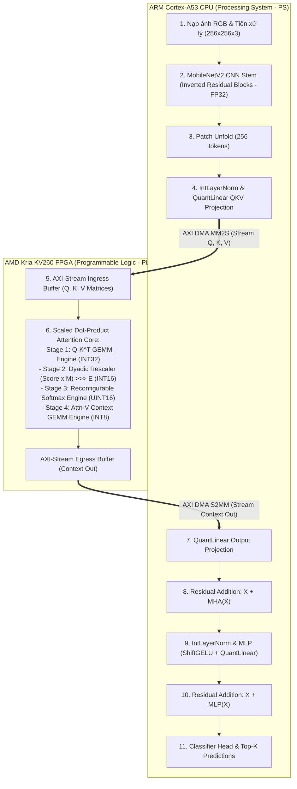

# Thiết Kế Phối Hợp HW-SW Cho Vision Transformer (MobileViT-XXS Trên Kria KV260) v2.0

> **Dự án:** Đồng thiết kế Phần cứng - Phần mềm (HW-SW Codesign) tăng tốc MobileViT-XXS trên AMD Kria KV260  
> **Phiên bản:** v2.0 (Cập nhật chuẩn hóa theo phương pháp I-ViT Surgery và RTL `rtl_ver02`)  
> **Tài liệu gốc tham chiếu:** [`Notes/thiet_ke_sw_hw_cho_vit.md`](file:///c:/Users/tuan2/Desktop/Capstone_Project/Notes/thiet_ke_sw_hw_cho_vit.md)

---

## 1. PHÂN HOẠCH RÀNG BUỘC PHẦN CỨNG - PHẦN MỀM (SW-HW PARTITIONING)

Để đạt hiệu năng tối ưu và tiết kiệm tài nguyên trên chip biên Kria KV260, dự án áp dụng chiến lược phân hoạch chuyên sâu:

---

## 2. NGUYÊN LÝ KHỚP CHÍNH XÁC TỪNG BIT (BIT-EXACT ALIGNMENT)

Khác với các phương pháp lượng tử hóa sau huấn luyện thông thường (PTQ) tạo ra sai số không xác định, giải pháp **I-ViT Surgery** kết hợp **Fake Quantization** mang lại tính đối soát hoàn hảo:
1. **Toán tử số học giống hệt:**
   - Softmax phần mềm và phần cứng đều dùng bảng tra số mũ và bộ chia nguyên khôi phục số dư.
   - Các phép thu phóng đều dùng chung cặp số Dyadic $(M, E)$ trích xuất trực tiếp từ mô hình QAT.
2. **Giá trị thực tiễn đối chiếu:**
   - Cho phép đo lường và so sánh chính xác các đặc tính phần cứng (kích thước, độ trễ, công suất tiêu thụ, độ tin cậy) so với mô hình tham chiếu chỉ chạy trên CPU ARM, mà không bị sai lệch về độ chính xác dự đoán (Accuracy không đổi).
